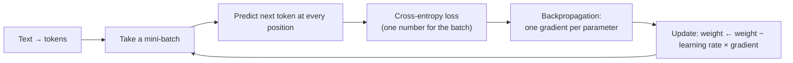
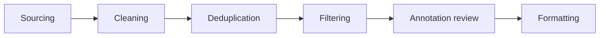

# 02 · Data preparation & training mechanics: getting a fine-tune right

**Session:** 18 July 2026 · Prof. Jiaul Paik (IIT Kharagpur) · Module 3, *LLM Fine-tuning Fundamentals II: Data Preparation and Training Mechanisms*
**Read time:** 40–50 min · **Builds on:** Chapter 01 (what fine-tuning is and when to use it)

---

## In one minute

Chapter 01 was about *whether* to fine-tune. This chapter is about *doing it well*. The session's central message:

> "A modest, well-curated, correctly formatted dataset will consistently outperform a larger but noisy one — and even good data can be undone by careless training choices."

So there are two halves:

- **Data.** Clean it, de-duplicate it, balance it, split it properly, and match the model's chat template exactly. **Quality beats quantity.**
- **Training.** Choose the learning rate (the most important knob), a warm-up and a decay schedule, and a batch size. Then **read the loss curves** to spot overfitting, underfitting or instability, and **protect the model's general skills** from catastrophic forgetting.

If you remember one sentence, make it this one: **"Good data, a gentle learning rate with warm-up and decay, and always watch the validation curve."**

---

## Exam radar

| Topic | Likelihood | Why we think so |
|---|---|---|
| Catastrophic forgetting: what it is, why it is "silent", and the mitigations | 🔴 High | 10 slides, pre-read, post-read, a notebook and the biggest Q&A cluster (~15 rows) |
| Reading loss curves: overfitting vs underfitting vs healthy vs no learning | 🔴 High | A dedicated "ultimate guide" section, pre-read and post-read, and the Chapter 01 notebook overfitted live |
| Learning rate, warm-up and schedules (cosine, linear, constant, WSD, restarts, step) | 🔴 High | 14 slides; called "the single most important hyperparameter" |
| Training instability: loss spike vs gradient explosion vs divergence; gradient clipping; bf16 vs fp16 | 🔴 High | 8 slides plus a "stability checklist" table |
| Data quality: the five data challenges, the curation pipeline, "quality beats quantity" | 🔴 High | Agenda, pre-read, post-read and 13 slides |
| Batch size: small vs large trade-off, gradient accumulation, "bigger batch → raise LR" | 🟠 Medium | 8 slides. The formulas exist, but we don't expect arithmetic |
| Imbalanced data and the accuracy paradox; which metrics to use | 🟠 Medium | Classic MCQ material |
| Data splitting and leakage (70/15/15, time-based and group splits) | 🟠 Medium | One dense slide |
| Domain shift: usage, temporal, domain | 🟠 Medium | One slide plus post-read |
| Label-error detection with out-of-fold predictions (cleanlab demo) | 🟢 Low | Notebook only |
| One training step end to end (tokenise → loss → backprop → update) | 🟢 Low | Recap-style slides, though students asked many questions |

---

## Part 1 — How a model learns, in one loop

Everything else in this chapter is about tuning this loop, so it's worth seeing once:

| Term | Plain meaning |
|---|---|
| **Mini-batch** | A small group of examples used for **one** update. It's the sweet spot between "whole dataset" (exact but impossibly slow) and "one example" (cheap but very noisy) |
| **Step** | One mini-batch → one weight update |
| **Epoch** | One full pass over the whole training set |
| **Loss** | One number per batch saying "how wrong were we". Lower is better |
| **Gradient** | For every parameter, which direction (and how much) to move to reduce the loss |
| **Learning rate (η)** | How big a step to take in that direction |
| **Seed** | A fixed starting number for randomness (shuffling, initialisation) so runs can be reproduced |

**Why the loss curve wiggles:** each mini-batch is a random sample, so its loss is a noisy estimate. A wiggle is normal; a trend is what matters.

!!! example "Everyday analogy"
    Walking downhill in fog. You can only feel the slope under your feet (the gradient). The learning rate is your stride length. A mini-batch is checking the slope at a few nearby spots instead of surveying the whole mountain.

### Common misunderstandings

- **"A mini-batch is the same as the train/validation split."** No. A mini-batch is a small slice of the *training* set used for one update.
- **"Reshuffling batches each epoch causes data leakage."** No. Leakage is when validation or test information gets into training.
- **"Fine-tuning uses a different training algorithm."** No. Same forward pass, loss and backprop. It just starts from pre-trained weights.

---

## Part 2 — The data

### Concept 1 — Quality beats quantity

> "A few hundred excellent examples routinely beat tens of thousands of mediocre ones."

The course cites **LIMA**: about **1,000 carefully curated examples** can outperform much larger, noisy datasets.

**Four quality dimensions** (from the pre-read):

| Dimension | Question to ask |
|---|---|
| **Correctness** | Is the answer actually right? |
| **Relevance** | Does it match the task we want? |
| **Consistency** | Do similar inputs get similarly formatted answers? |
| **Diversity** | Does it cover different phrasings, cases and edge cases? |

!!! example "Everyday analogy"
    Learning to cook from 20 recipes by a great chef vs 2,000 random recipes from the internet, half of them wrong. The 20 good ones teach you more.

### Concept 2 — The data curation pipeline (6 stages, in order)

| Stage | What happens | Example |
|---|---|---|
| **Sourcing** | Collect raw data | Support tickets, internal docs, public datasets |
| **Cleaning** | Remove junk | Menus, cookie banners, broken HTML, OCR errors |
| **Deduplication** | Remove exact and near-duplicates | The same FAQ copied 500 times |
| **Filtering** | Keep only what meets quality rules | Length, language, heuristic or LLM-based quality scores |
| **Annotation review** | Humans check labels and answers | Spot-check a sample for wrong answers |
| **Formatting** | Convert to the exact structure the model expects | JSON records with system/user/assistant messages |

### The golden rule of formatting

**Match the base model's chat template exactly.** A formatting mismatch can **silently ruin** a fine-tune even when the content is perfect. In the hands-on, `apply_chat_template` did this automatically.

### Concept 3 — Five data challenges that quietly break models

| # | Challenge | What it looks like | Main fixes |
|---|---|---|---|
| 1 | **Data quality issues** | Noisy text, wrong labels or facts, duplicates, mixed formats, outdated info | The curation pipeline above |
| 2 | **Insufficient data** | Too few examples, missing edge cases, lack of diversity | Transfer learning (fine-tune a pre-trained model), augmentation such as paraphrasing, synthetic data (always validate it), **active learning** |
| 3 | **Imbalanced data** | One class vastly outnumbers others | Right metrics, resampling, class weights (see below) |
| 4 | **Bad data splitting** | Information leaks from test into training | Split first, stratify, time- and group-aware splits |
| 5 | **Domain / distribution shift** | Training data ≠ real-world usage | Blend broader data, retrieval, monitoring |

Duplicates deserve a special mention. They **waste compute, increase memorisation** (a privacy and copyright risk) and can **contaminate benchmarks**: if test questions are in the training data, scores look better than they really are.

**Active learning**, in one line: look at real production traffic, find the examples the model is *least sure about*, and get those labelled first.

### Concept 4 — Imbalanced data and the accuracy paradox

!!! example "The classic example"
    In credit-card data, only about 0.2% of transactions are fraud. A "model" that **always says 'not fraud'** scores **99.8% accuracy**, and catches **zero** fraud.

That's the **accuracy paradox**: on skewed data, accuracy looks great while the model is useless for the class you care about.

**Fixes:**

- **Use the right metrics:** precision, recall, F1, PR-AUC. Never plain accuracy on skewed data.
- **Resample:** oversample the rare class (for example with SMOTE) or undersample the common class.
- **Cost-sensitive learning:** give mistakes on the rare class a bigger penalty, using class weights or focal loss.

### Concept 5 — Splitting the data without leaking

The slide's default split:

| Split | Share | Purpose |
|---|---|---|
| **Train** | 70% | Fit the weights |
| **Validation** | 15% | Tune hyperparameters, decide when to stop |
| **Test** | 15% | **Touch once**, at the very end |

**Ways leakage sneaks in:**

| Leak | Example | Fix |
|---|---|---|
| Preprocessing before splitting | Scaling using statistics from the whole dataset | **Split first**, fit transforms on train only |
| Duplicates across splits | The same ticket appears in train and test | Deduplicate before splitting |
| Random split of time data | The model is trained on next month and tested on last month, so it "sees the future" | **Time-based** split |
| Grouped data split randomly | The same patient appears in train and test | **Group-aware** split |

Also: **stratify** (keep class proportions the same in every split), and for small datasets use **k-fold cross-validation**. That means splitting into k parts, training on k−1 and testing on the one left out, rotating so every example gets tested once.

### Concept 6 — Domain and distribution shift

The model was trained on one kind of data but is used on another.

| Kind of shift | Plain meaning | Example |
|---|---|---|
| **Usage shift** | Documents → dialogue | A raw base model *continues* your text instead of answering it |
| **Temporal shift** | The world moved on after the cutoff | It suggests deprecated library functions |
| **Domain shift** | General → specialist | It doesn't understand your company's internal jargon |

**Fixes:** instruction tuning plus alignment (bridges documents → dialogue), domain-adaptive continued pre-training *with replay*, retrieval and tools for fresh facts, and monitoring in production.

---

## Part 3 — Training

### Concept 7 — Reading loss curves (the "ultimate guide")

Always plot **training loss** and **validation loss** together.

| What you see | Name | What it means | What to do |
|---|---|---|---|
| Both fall together; small, stable gap | ✅ **Healthy** | Learning and generalising | Stop at the **validation minimum** and keep that checkpoint |
| Train loss keeps falling towards 0; **validation turns back up** | ⚠️ **Overfitting** | Memorising the training set. Outputs may echo training examples verbatim | Early stopping, fewer epochs, regularisation, more or more varied data |
| **Both stay high** and flatten early | ⚠️ **Underfitting** | Not learning enough | Train longer, bigger model, higher LR, smaller batch |
| **Both flat** at the starting value | ❌ **No learning** | Nothing is updating | Check for a bug, frozen parameters, or an LR far too low |

!!! example "Everyday analogy"
    A student preparing for an exam with past papers (training) and a mock test (validation).

    - **Overfitting:** they memorise the past papers word for word and score 100% on them, but do worse on the mock.
    - **Underfitting:** they barely studied, so both scores are low.
    - **Healthy:** both scores improve together.

**Remember:** a training loss of exactly 0 is *suspicious*, not a success. It usually means overfitting, leakage or a task that's too easy. In Chapter 01's SFT demo, training loss went 2.31 → 1.14 → 0.58 while validation loss rose in the last epoch: overfitting.

### Concept 8 — The learning rate: the most important knob

- **Too high:** the loss jumps around, spikes or blows up.
- **Too low:** the loss falls painfully slowly.
- **Fine-tuning uses much smaller learning rates than pre-training**, because the goal is to *nudge* the model, not rebuild it.

Typical peak values to *recognise* (not compute):

| Method | Typical peak learning rate |
|---|---|
| Full fine-tuning | 1e-5 to 2e-5 (that is, 0.00001–0.00002) |
| LoRA | 1e-4 to 2e-4 (about ten times higher, since far fewer weights train) |

### Concept 9 — Warm-up and LR schedules

**The dilemma:** you want *big* steps early, to learn fast, and *small* steps later, to settle into a good solution. A single fixed LR can't do both. A **schedule** changes the LR over the run.

**Three phases of training:**

1. **Fragile start** (the first ~3% of steps). The new data shocks the pre-trained weights, so ramp the LR up from zero. This is **warm-up**.
2. **Rapid learning** (~3% to 60%). Gradients are big and informative, so use the **peak** LR.
3. **Convergence** (~60% to 100%). The model is settling into a narrow valley, so **decay** the LR.

!!! example "Everyday analogy"
    Driving into a parking spot: start gently (warm-up), drive at normal speed on the road (peak), then slow right down as you park (decay).

**Warm-up facts:** the default is **3% of total steps** (raise it to 5–10% for short or unstable runs). It's counted in **optimizer steps**, not epochs.

**Six schedule shapes:**

| Shape | Picture it as | Best for |
|---|---|---|
| **Constant (+ warm-up)** | Flat line | **Short runs only** (for example, short LoRA runs). Spike-prone in long runs |
| **Linear decay** | Straight ramp down to zero | The simple, "no-surprises" default |
| **Cosine decay** | Smooth curve: stays near the peak, then glides down | **The modern default** for standard fine-tuning of known length |
| **Step decay** | Staircase. Often reactive: drop when validation loss stops improving | Validation-driven control; data arriving in waves |
| **Cosine with restarts** | Cosine that jumps back to the peak several times | Getting **several candidate models** from one budget. It does *not* reset the weights |
| **Warmup–Stable–Decay (WSD)** | Trapezoid: warm up, hold the peak for most of the run, decay sharply at the end | **Unknown run length / continual training**. You can start the decay whenever you decide to stop |

**If training is unstable at any point:** first **lengthen the warm-up**, then **lower the peak LR**. Tweaking the shape beats swapping it.

### Concept 10 — Training instability: spike, explosion, divergence

When one update is too big, it damages the weights. That causes bigger errors, bigger gradients and an even bigger next update: a vicious cycle.

| Stage | What happens | Recovers by itself? |
|---|---|---|
| **Loss spike** | One bad batch gives a huge gradient and the loss jumps | **Yes**, after hundreds of wasted steps. Spikes cluster just after warm-up, when the LR is highest |
| **Gradient explosion** | The feedback loop takes hold: gradient sizes grow and grow; in fp16 they end as Inf, then NaN | It's the warning stage before divergence |
| **Divergence** | The weights have left every good region; the loss keeps rising and outputs turn to gibberish or repetition | **No** |

**Causes:** sharp, narrow valleys in pre-trained models; **fp16 overflow** (fp16 can't store numbers above about 65,000, so they become Inf); one weird outlier batch; and deep networks amplifying small errors.

**Fix 1 — Gradient clipping.** If the gradient is too large, **shrink it to a maximum size while keeping its direction**. The standard cap is `max_grad_norm = 1.0`, which is the Hugging Face default ("keep it").

> "Clipping is a seatbelt, not a steering wheel." If more than ~20% of steps get clipped, your learning rate is too high. Fix the LR rather than relying on clipping.

**Fix 2 — An LR schedule.** For example, a legal-domain fine-tune at a constant LR kept spiking near the end. Switching to cosine (same peak) removed the late spikes.

**The stability checklist** (each layer adds protection):

| Setting | Prevents |
|---|---|
| Gradient clipping `max_grad_norm=1.0` | Loss spikes; starves the explosion loop |
| Cosine schedule | Late-run spikes |
| Warm-up `warmup_ratio=0.03` | Spikes and divergence at step 0 |
| **bf16 instead of fp16** | Overflow → Inf/NaN (bf16 has a much wider range) |
| Conservative peak LR | Overshooting narrow valleys |
| Log the gradient size; alert at 5–10× the usual | Catching an explosion before divergence |
| Save checkpoints regularly (keep the last 3) | Losing the run if it diverges |

### Concept 11 — Batch size

| | Smaller batch | Larger batch |
|---|---|---|
| **Pros** | Often **generalises better** (the noise helps it avoid sharp minima); more frequent updates | Smoother, more stable gradients; faster throughput; better GPU use |
| **Cons** | Noisy gradients; slower convergence | Can generalise worse; fewer updates; usually needs a higher LR |

Key ideas to *recognise*:

- **Gradient accumulation:** if a big batch doesn't fit in GPU memory, process several small "micro-batches" and **add up their gradients before one update**. It behaves like a bigger batch without the memory cost.
- **Effective batch size** = micro-batch × accumulation steps × number of GPUs. You won't need to compute it, just know what goes into it.
- **The linear scaling rule:** if you make the batch bigger, raise the LR roughly in proportion.
- **A practical recipe:** fix the max sequence length → increase the micro-batch until GPU memory is nearly full → use accumulation to reach the batch you want.

**Let the curves judge:**

- Jitter that never shrinks → the batch is too small (or the LR too high).
- Both losses plateau high → the batch is too large, so there were too few updates (aim for at least ~500–1,000 optimizer steps).

### Concept 12 — Catastrophic forgetting

#### What it is

Fine-tune a model on a narrow task, and the updates **overwrite the weights that held its general knowledge**. It gets better at the new task and **quietly worse at almost everything else**: reasoning, coding, other languages, following instructions.

**Example from the slides:** full fine-tuning only on medical Q&A gives a great medical-Q&A model that has forgotten how to write Python, speak French and do arithmetic.

#### Why it's dangerous: the failure is *silent*

The metric you're watching (the target task) **improves**, while general skills collapse unseen. You only notice it **if you measure both**.

> "Always run a fixed general eval suite before and after every fine-tune."

!!! example "Everyday analogy"
    Someone who moves abroad and speaks only the new language for years. They become fluent in it, but slowly lose their mother tongue, and don't notice until they try to use it.

#### Why it happens

- Knowledge is **spread across shared weights**, so changing them for one task disturbs others.
- Fine-tuning data covers a **tiny slice** of what the model knew.
- The further weights **drift** from their pre-trained values, the more old skills suffer.
- A standard optimizer has **no memory of old tasks** unless you show it old data or penalise drift.
- It's **worst in full fine-tuning** with a high LR on narrow data.

#### The mitigations, and when to use each

| Mitigation | How it works | Extra cost | When to reach for it |
|---|---|---|---|
| **Conservative hyperparameters** | Low LR (1e-5 to 2e-5 for full FT), only 1–2 epochs, warm-up + cosine, early-stop on general evals | None | **Always**, as the default baseline |
| **Rehearsal / replay (data mixing)** | Mix a slice (about 1–10%) of general data into every batch, so the model keeps practising old skills | Collecting general data | When you have general (or proxy) data |
| **Regularise towards pre-trained weights (L2-SP, EWC)** | Add a penalty for moving away from the original weights. **EWC** holds the weights *most important* for old skills more tightly (importance measured by Fisher information) | Memory to store the original weights (+ importance scores for EWC) | When full FT is required and no general data is available |
| **Weight averaging (WiSE-FT)** | After fine-tuning, **blend** the fine-tuned weights with the original ones | One merge pass | The model is already fine-tuned and has degraded |
| **Freeze layers** | Freeze the embeddings and lower layers (general knowledge); train only the top ~25–50% of blocks | None | Tight compute or very small datasets |
| **Layer-wise learning rates** (Q&A) | Lower LR for lower layers, higher LR for upper layers | None | A gentler version of freezing |

The Q&A also noted that **PEFT (for example LoRA) + replay** is among the most effective combinations, because PEFT barely touches the original weights at all (Chapters 03 and 04). And if forgetting has already happened, you can **go back to an earlier checkpoint**.

!!! example "EWC in one picture (the TA's example)"
    A student learned Maths and is now learning Physics. EWC says: *"Don't change the parts of your brain that were very important for Maths; adjust the less important ones."*

**Regularisation vs freezing:** regularisation *allows* changes but *penalises* drifting; freezing allows **no** change at all. Gradients still flow *through* frozen layers so that the trainable layers learn correctly. The frozen weights just aren't updated.

### The three failure modes side by side

| Failure | How you detect it | How you fix it |
|---|---|---|
| **Overfitting** | Train loss falls, validation loss flattens or rises | Early stopping, fewer epochs, regularisation, more or more varied data |
| **Catastrophic forgetting** | Great on the new domain, worse on general tasks | Lower LR, replay/data mixing, evaluate on general benchmarks too |
| **Domain shift** | Behaviour narrows to the fine-tuning domain | Blend broader data; test with out-of-domain prompts |

---

## The pre-fine-tuning checklist (from the post-read)

1. Dataset **cleaned, de-duplicated and filtered** against explicit quality rules.
2. Every example in the **exact format** the model expects.
3. A **held-out validation set**, with validation loss monitored every epoch.
4. **Early stopping** (or another plan against overfitting).
5. **Conservative learning rate**; batch size and LR tuned together.
6. **General data mixed in** (or another plan against forgetting).
7. **Evaluation covers both** the target task and general capabilities.

---

## What the hands-on showed

- **Freezing strategies + LR schedulers** (DistilBERT, 4 tasks).
    - Compared layer-wise, block-wise and progressive freezing, applied each epoch by a callback that flips `requires_grad`.
    - Compared the `linear`, `cosine` and `constant_with_warmup` schedulers.
    - In this *short* run (4 epochs, small data), constant-with-warmup scored best. That fits the slide's advice that constant + warm-up suits short runs, but the gap was small and it isn't a general rule.
- **Finding wrong labels with cleanlab** (BERT on SST-2 sentiment).
    - 5-fold cross-validation produced **out-of-fold predictions**, meaning each example was scored by a model that never trained on it.
    - Cleanlab used these to flag 538 likely mislabelled examples out of 10,000.
    - Removing them did **not** improve accuracy in this run.
    - **Lesson:** use out-of-sample predictions to find label errors, and *validate* that cleaning actually helps.
- **Catastrophic forgetting, live** (DistilBERT, two tasks).
    - **Phase 1:** train on sentiment. Accuracy ≈ 84%.
    - **Phase 2:** train only on news topics. Sentiment accuracy **dropped** to ≈ 81%, even though its head wasn't touched: the forgetting happened in the shared encoder.
    - **Phase 3:** train on a mix of both (replay). Sentiment **recovered** to ≈ 85%, with a tiny cost on news.

---

## Where students got confused (from the live Q&A)

| Student question | The clarified answer |
|---|---|
| "Is a mini-batch the same as the validation split?" | No. It's a small piece of the *training* set used for one update. |
| "Are batches processed in parallel?" | Examples *within* a batch are, but batches run one after another, because each depends on the previous update. |
| "Does reshuffling cause leakage?" | No. Leakage is test or validation information entering training. |
| "Is the loss one number or one per parameter?" | One loss per batch; backprop then gives one gradient per parameter. |
| "Why is fp16 risky?" | It overflows above ~65,000 and becomes Inf, then NaN. bf16 has a much wider range. |
| "How do we know which weights hold general knowledge?" | You can't see it directly. It's *estimated*, for example with Fisher information (EWC). |
| "Regularisation vs freezing?" | Regularisation penalises drift; freezing forbids any update. |
| "Do gradients flow through frozen layers?" | Yes, so the trainable layers get the right signal. The frozen weights just don't change. |
| "Best single fix for forgetting?" | There's no single best. LoRA + replay is among the most effective. Suggested order: regularisation → replay → parameter isolation. |
| "Does cosine-with-restarts reset the weights?" | No. Only the learning rate jumps back up. |
| "Why do small batches generalise better?" | Their noisier updates help avoid sharp minima and settle in flatter ones. |
| "How much data is enough?" | There's no formula. Fine-tune on 10%, 25%, 50% and 100% and plot how the results change. |

---

## Traps to watch for in MCQs

- ❌ "More data always beats cleaner data." → The course says **quality beats quantity** (LIMA: ~1,000 curated examples).
- ❌ "99% accuracy on fraud detection proves the model works." → The **accuracy paradox**. Check recall, precision, F1, PR-AUC.
- ❌ "Scale or normalise the full dataset, then split." → **Split first**, then fit transforms on train only, or test information leaks in.
- ❌ "Training loss falling = the model is improving." → Check **validation** loss. Falling train with rising validation is overfitting.
- ❌ "Catastrophic forgetting shows up as a worse target-task score." → It's **silent**: the target improves while *general* skills fall.
- ❌ "Gradient clipping fixes a too-high learning rate." → It's a **seatbelt**. Frequent clipping means you should lower the LR.
- ❌ "A loss spike means the run is ruined." → Spikes **self-repair**. Divergence is what doesn't recover.
- ❌ "Use fp16 for stability." → The checklist says **bf16** (wider range, no overflow).
- ❌ "Cosine with restarts re-initialises the model." → Only the **LR** restarts.
- ❌ "Constant LR is the modern default." → **Cosine** is. Constant + warm-up is for short runs.
- ❌ "Freezing layers stops gradients flowing through them." → Gradients still pass through; the frozen weights just don't update.

---

## Recap

1. **Data first.** Curate in the order source → clean → dedupe → filter → review → format. Match the chat template exactly. Quality beats quantity.
2. **Avoid data traps.** Imbalance (use F1/recall, not accuracy), leakage (split first; time and group splits), domain shift.
3. **The LR is the key knob.** Small for fine-tuning; warm up (~3%), then decay (cosine is the default; WSD for unknown run length).
4. **Read the curves.** Healthy = both fall together; overfit = validation turns up; underfit = both high; no learning = both flat. Keep stability with clipping at 1.0, bf16 and warm-up.
5. **Catastrophic forgetting is silent.** Evaluate general skills before and after. Defend with a low LR and few epochs, replay, L2-SP/EWC, weight averaging or freezing (and PEFT).

---

## Practice questions

Pick an option to see instantly whether you're right, with an explanation for every option.

  
<em>Loading practice questions…</em>

