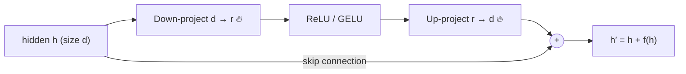
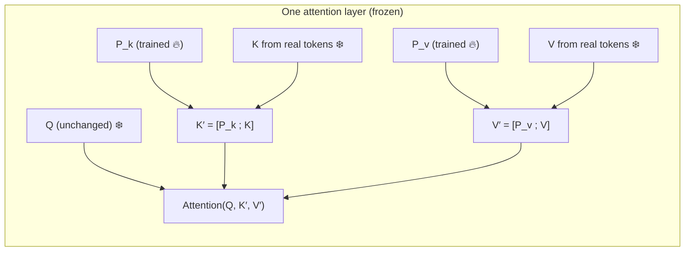

# 03 · PEFT: adapters & soft prompts — teaching a frozen model new tricks

**Session:** 25 July 2026 · Dr. Plaban Kumar Bhowmick (IIT Kharagpur) · Module 3, *PEFT: Adapters and Soft Prompting*
**Read time:** 35–45 min · **Builds on:** Chapters 01–02 (fine-tuning fundamentals) · **Leads into:** Chapter 04 (LoRA & QLoRA)

---

## In one minute

Full fine-tuning changes every weight of a model. That's **expensive**: a 7B model needs about **92 GB** of GPU memory to fine-tune. It's also **risky**: the model can forget what it knew before ("catastrophic forgetting").

**PEFT (Parameter-Efficient Fine-Tuning)** keeps the big model **frozen** and trains only a tiny number of new or selected parameters, often **under 1%**. This chapter covers two of the four PEFT families:

- **Adapters (additive PEFT).** Insert small "bottleneck" modules inside each transformer layer and train only those. Houlsby adapters sit **in series**, which adds latency. Lin's residual adapters sit **in parallel**.
- **Soft prompts.** Don't touch the architecture at all. Instead, learn a few **virtual tokens**, which are vectors rather than words, that steer the frozen model. **Prompt tuning** adds them at the input only. **Prefix tuning** adds them to the keys and values of **every** attention layer.

If you remember one sentence, make it this one: **adapters adapt the model in the *architecture* space (add small layers); soft prompts adapt it in the *token* space (add learned context).**

---

## Exam radar

| Topic | Likelihood | Why we think so |
|---|---|---|
| Why full fine-tuning is costly: weights, gradients and Adam states all in memory | 🔴 High | Slides, pre-read and many Q&A rows; repeated in Chapter 04 |
| Catastrophic forgetting and the multi-task storage problem | 🔴 High | Professor's "in a nutshell" names it as one of the two core problems |
| The four PEFT families: additive, re-parameterization, soft prompt, selective | 🔴 High | Concept map, pre-read table, revision session |
| Adapter structure: down-project → non-linearity → up-project + residual, near-identity init | 🔴 High | Slide "Two requirements of adapters", demo code, many Q&A rows |
| Sequential (Houlsby) vs residual/parallel (Lin) adapters, and why sequential adds latency | 🔴 High | Named limitations slide; pre-read calls latency "the primary practical objection" |
| Prefix tuning vs prompt tuning; only P_k and P_v trained | 🔴 High | Highest-volume confusion in the Q&A sheet |
| Soft prompt vs discrete prompt vs system prompt vs RAG | 🟠 Medium | Several student questions; easy "which is true" material |
| SMoP, APT, IDPG: what problem each fixes | 🟠 Medium | Professor's closing summary slide lists all three |
| Adapter routing, AdapterFusion, task ID | 🟠 Medium | Two setup slides plus demo |
| Choosing a PEFT method by scenario | 🟠 Medium | Rule of thumb given in the Q&A answers |
| Exact GPU table, paper names like Compacter or P-Tuning v2 | 🟢 Low | Mentioned only in passing |

---

## The story behind this lecture: "When scale is a curse"

The professor opened by showing that bigger models gain new abilities. At around 7B they handle simple Q&A, at 70B they manage basic reasoning, and past 400B they do chain-of-thought, maths and code. The catch is that **bigger models are much harder to fine-tune.**

> An enterprise wants to fine-tune LLaMA-7B for **50 different internal tasks**: HR queries, legal summaries, IT tickets and so on.

**The naive way.** Fully fine-tune a separate copy for each task.

- Each fine-tune needs about **90 GB** of GPU memory (two A100s) and hours of training.
- Each copy is a **14 GB** checkpoint, so 50 tasks take **700 GB** just to store the weights.
- Train them one after another on the same model instead, and the model **forgets** the earlier tasks.

**The PEFT way.**

- Keep **one** frozen 14 GB backbone.
- Train a small adapter for each task, about **24 MB** each.
- A new task means training one new adapter. The backbone never changes, so nothing is forgotten.

!!! example "Everyday analogy"
    The professor's own picture: a simple building shell can be turned into a **laboratory or an office** by adding the right fittings. You don't rebuild the building for each use. The shell is the frozen backbone; the fittings are the adapters.

---

## Concept 1 — Why full fine-tuning is so expensive

### The problem

During training, the GPU must hold four things **for every parameter that is being trained**:

| Item | Why it's needed | Size per parameter |
|---|---|---|
| The weight | To run the model | 2 bytes (FP16) |
| Its gradient | To know which way to nudge the weight | 2 bytes (FP16) |
| Adam's **momentum** (running average of gradients) | Smooths the direction of updates | 4 bytes (FP32) |
| Adam's **variance** (running average of squared gradients) | Adapts the step size per weight | 4 bytes (FP32) |

Add the **activations** (intermediate outputs kept for the backward pass) and the course's 7B example comes to about **92 GB**. Notice that **Adam's two states alone are four times the size of the weights.**

The slides' scaling chart makes the trend clear. Full fine-tuning needs about 92 GB at 7B, about 910 GB at 70B and around **5.3 TB** at 405B (67 A100 GPUs).

### Why PEFT fixes it

If a weight is **frozen**, it needs no gradient and no Adam states. It only has to be loaded. PEFT freezes almost everything, so the expensive extras exist only for the tiny trainable part. The slide's headline: *"Why update 7 billion parameters when 4 million will do?"* For the 7B model, PEFT needs about **15 GB on one GPU**, compared with 92 GB on several.

!!! example "Everyday analogy"
    Editing a 1,000-page book. Full fine-tuning is like keeping a separate notebook of edit history for **every** page. PEFT is like gluing a few sticky notes into the book and keeping history only for the sticky notes.

### Common misunderstanding

- **"Gradients and Adam states are needed when using the model."** No. They're needed only for **training**. Inference needs just the weights.

---

## Concept 2 — Catastrophic forgetting and the multi-task problem

### The idea in plain words

Full fine-tuning **overwrites** the general knowledge stored in the weights. Train on Task 1, then Task 2, and so on, and by Task *n* the model has got worse at Task 1. This is called **catastrophic forgetting**. It's worse with small, narrow datasets, because their gradients pull the weights strongly in one direction.

There's also a **storage** problem. Naive fine-tuning keeps **one full model per task**, so storage grows in step with the number of tasks: *n* tasks × model size. (The professor wrote "3S" for a 3-task example, and a student pointed out that in general it's *n* × S.)

### The PEFT fix

**Freeze the backbone and keep task-specific adapters or prompts separate.** The shared backbone never changes, so it can't forget. Each task's knowledge lives in its own small add-on. The professor's slide: *"Task-specific adapters can solve the catastrophic forgetting issue."*

!!! example "Everyday analogy"
    A smartphone and its apps. Installing a new app doesn't erase the phone's operating system or your other apps. Each skill sits in its own app.

---

## Concept 3 — The four families of PEFT

The lecture's concept map splits PEFT into four branches:

| Family | What it does, in one line | Examples | Trainable share (course figures) | Where it's covered |
|---|---|---|---|---|
| **Additive** | Adds small new modules to the frozen network | Adapters, AdapterFusion, Compacter | < 1% | This chapter |
| **Soft prompt** | Adds trainable virtual tokens (vectors) to the input or attention | Prompt tuning, prefix tuning, SMoP, APT | < 0.1% | This chapter |
| **Re-parameterization** | Learns the weight *change* in a compact low-rank form | LoRA, QLoRA, DoRA, AdaLoRA | < 1% | Chapter 04 |
| **Selective** | Unfreezes a chosen **subset of existing** weights; adds nothing new | BitFit (bias terms only), Diff Pruning | Varies | Named only |

!!! example "Everyday analogy: four ways to customise a car"
    - **Additive:** bolt on a roof rack (add a new part).
    - **Soft prompt:** set the GPS and seat presets (change the context, not the car).
    - **Re-parameterization:** a compact "tuning kit" that adjusts the engine, which you can later build in permanently.
    - **Selective:** only re-tune the existing tyres and mirrors (change a few existing parts).

### Common misunderstandings

- **"Selective PEFT adds a small module."** No. Selective PEFT adds **no new parameters**. It picks existing ones, such as bias terms or layer norms, to train.
- **"Soft prompts change the model's weights."** No. The model is completely frozen. Only the virtual-token vectors are learned.

---

## Concept 4 — What an adapter looks like

### The structure

An adapter is a **small trainable neural-network module** inserted into each frozen transformer layer. It always has the same **bottleneck** shape:

1. **Down-project:** a linear layer shrinks the hidden vector from size *d* (for example 768) to a small size *r*, also called *m* or the bottleneck dimension (for example 32 or 64).
2. **Non-linearity:** ReLU or GELU. Without it, the two linear layers would collapse into one plain linear transform.
3. **Up-project:** a linear layer expands back from *r* to *d*.
4. **Residual (skip) connection:** add the adapter's output to its input, *h′ = h + f(h)*.

### The two requirements of a good adapter (a slide the professor stressed)

1. **Few parameters.** As you add more tasks, the total model size should grow only slowly.
2. **Near-identity initialisation.** At the start, *f(h)* ≈ 0, so *h′* ≈ *h*. In practice the **up-projection starts at (near) zero**, as in the demo code. The freshly inserted adapter therefore does **nothing** at first, and the model behaves exactly like the pre-trained model. Training then gradually teaches it the task.

!!! example "Everyday analogy"
    Installing a new volume knob on a sound system, turned to zero. Plugging it in doesn't change the sound at all. You then slowly turn it up while listening, which is training.

### Why it works (evidence shown in class)

On the GLUE benchmark with BERT-large, adapters scored almost the same as full fine-tuning (about **80.0 vs 80.4**) while training only a few percent of the parameters per task. In contrast, fine-tuning **only the top few layers** with a similar budget lost a lot of accuracy. That answers the professor's "food for thought" question: *why not just fine-tune the last layers?* Adapters sit in **every** layer, so they can influence all levels of representation.

!!! info "About the percentages"
    The slides quote different figures for adapters: "< 1%" (taxonomy), "about 1%", "about 2%" (summary slide) and "3.6%" (Houlsby table). They depend on the bottleneck size. Remember **"a small few percent or less"**, not a single number.

### Common misunderstandings

- **"Near-identity means the adapter must stay close to identity during training."** No. It's only the **starting** condition.
- **"The bottleneck permanently shrinks the model's hidden size."** No. It's squeezed inside the adapter and expanded straight back to *d*.
- **"Adapters are a separate model or tool."** No. They're layers **inside** the LLM and run during the normal forward pass.
- **"Adapter training is distillation."** No. It's ordinary supervised training of the new layers only.

---

## Concept 5 — Sequential (Houlsby) vs residual/parallel (Lin) adapters

### Sequential adapters (Houlsby et al., 2019)

Adapters are placed **in series**, twice in each transformer block: once after the attention sub-layer and once after the feed-forward sub-layer, each before the residual add and layer norm.

**Limitations listed on the slide:**

- **Inference latency.** Data must pass through the adapter *after* the sub-layer, one step after another, on every call.
- Parameter cost grows with **depth** (more layers means more adapters).
- It **can't be parallelised** with the existing computation.
- **Multi-task serving is expensive.**

The pre-read calls the latency **"the primary practical objection to adapter deployment"**: even a tiny bottleneck stays in the compute graph forever.

### Residual / parallel adapters (Lin et al., 2020)

The adapter has a similar bottleneck shape: LayerNorm → down-project → ReLU → up-project, plus a residual. The difference is that it runs **in parallel** with the attention or feed-forward sub-layer, and the outputs are **merged**. There's no extra sequential step to wait for.

Lin et al. built **one GPT-2 backbone with a bank of task adapters** in every layer, one each for conversational QA, summarisation, translation, dialogue and NLG. The right adapter is picked for each task. They also added a **task (segment) embedding** to every token:

> input = word embedding (*what* the token is) + position embedding (*where* it is) + segment embedding (*which part or role* it belongs to, e.g. Document, Question or Answer in QA; Persona, System or User in dialogue)

!!! example "Everyday analogy"
    - **Sequential:** an assembly line with an extra inspection station. Every car must stop there, so the line is slower.
    - **Parallel:** the inspector checks the car **while** the main work happens beside it, and both results are combined at the end. There's no extra stop.

### Quick comparison

| | Sequential (Houlsby) | Residual / parallel (Lin) |
|---|---|---|
| Placement | In series after attention and after FFN | Beside the sub-layer, outputs merged |
| Inference latency | Adds sequential steps | Little extra delay |
| Showcase | BERT on GLUE classification | GPT-2 on QA, dialogue, summarisation, translation |
| Extra trick | — | Task/segment embeddings, per-task adapter bank |

---

## Concept 6 — Using adapters for many tasks: task ID, routing and fusion

The slides showed four setups:

| Setup | How it works |
|---|---|
| **Explicit task ID** | The task name picks the adapter. In the demo this was literally a dictionary (`ModuleDict`) of `task_name → adapter`. |
| **Adapter routing** | Computation flows only through the chosen adapter. **Unselected adapters don't run.** Routing happens before or during the forward pass, not after the output. |
| **AdapterFusion** | When there's no task ID, a **fusion layer** softly combines the outputs of several task adapters. |
| **Multi-task adapter** | One adapter is trained on many tasks together. |

The professor also named a **Tiny-Attention Adapter**, which places a small attention module inside the adapter.

**How many adapters?** There's no fixed rule. It's typically one per distinct task, domain or capability.

### Common misunderstanding

- **"The model figures out by itself which parameters to update from the task ID."** No. The **training pipeline** decides which parameters are trainable and which adapter belongs to which task.

---

## Concept 7 — Soft prompts: steering the model with learned context

### Discrete vs continuous prompts

| | Discrete (hard) prompt | Continuous (soft) prompt |
|---|---|---|
| Made of | Real words from the vocabulary | **Virtual tokens**: free vectors in the embedding space |
| Created by | A human, or a search over words | **Learned by backpropagation** |
| Readable? | Yes | No, they're just numbers |
| Weakness | Small wording changes swing results a lot | Tied to one model's embedding space |

The slide's evidence: on a fact-retrieval benchmark (LAMA), paraphrases of the same manual prompt scored anywhere from about 20 to 51. With learned prompts they scored a steady ~58.

The key idea from the slide: **"conditioning on a proper context can steer the LM without changing its parameters."**

!!! example "Example from the Q&A"
    Instead of writing *"Classify the sentiment:"* before *"The movie was amazing!"*, put four learned vectors **[P1][P2][P3][P4]** in front. P1 might be [0.23, −0.14, 0.76, …]. These are numbers, not words, found by training to best push the frozen model toward the right answer.

!!! example "Everyday analogy"
    A **dog whistle**. It's not a word any human understands, but it's precisely tuned to make the dog (the frozen model) do what you want.

### What a soft prompt is **not** (a favourite trap area)

| It is NOT… | Because… |
|---|---|
| A system prompt | A system prompt is human-written text. A soft prompt is learned vectors. |
| Prompt compression | Compression shortens a text prompt. A soft prompt is trained for a task. |
| RAG | RAG retrieves external **knowledge** at inference. A soft prompt changes **behaviour**. |
| Transferable to another LLM | It lives in one model's embedding space and is tied to its tokenizer. |

It's still counted as a **PEFT method**, because its parameters are trained with backpropagation. It's trained once, saved and reused. Virtual tokens also get positional information like any other token.

---

## Concept 8 — Prompt tuning vs prefix tuning

Both freeze the model and learn virtual tokens. The **only** difference is **where** the virtual tokens go.

| | Prompt tuning | Prefix tuning (Li & Liang, 2021) |
|---|---|---|
| Where | At the **input embedding layer only** | Prepended to the **keys and values of every attention layer** |
| What's trained | A small matrix of virtual-token embeddings | Prefix vectors P_k and P_v for each layer (often generated by a small MLP during training) |
| Influence | Indirect: must travel up through all layers | Direct: conditions attention at every layer |
| Good for | Simple adaptation with the fewest parameters | **Generation tasks** such as summarisation, table-to-text and dialogue |

### How prefix tuning works, in words

Normal attention compares each query with the keys and mixes the values. Prefix tuning **adds extra learned keys and values at the front** of every layer's K and V. Every real token can then "attend to" these learned prefix entries, which nudge its output toward the task. The **queries are unchanged**, and the original K/V projection weights (W_k, W_v) stay **frozen**. Only the extra prefix vectors are trained.

**Two layout details from the slides:**

- In a decoder-only model (GPT-2), the sequence is [PREFIX | source | target].
- In an encoder-decoder model (BART), there's a prefix on **both** the encoder and the decoder.

**The reparameterisation trick.** Training the prefix directly can be unstable. The paper (and the demo) instead learns a smaller matrix and passes it through an **MLP** to produce the prefix. After training, the MLP can be thrown away and only the final prefix kept. In the `peft` library this is `prefix_projection=True`.

!!! example "Everyday analogy"
    - **Prompt tuning:** whispering a hint to someone **once** at the start of a long relay.
    - **Prefix tuning:** placing a small hint card at **every** station of the relay, so each runner sees it.

### Common misunderstandings

- **"Prefix tuning trains W_k and W_v."** No. Those are frozen. Only the extra P_k and P_v vectors are trained.
- **"Basic prompt tuning trains a separate neural network."** No. It's just a small matrix of embeddings. Some advanced methods (the SMoP router, the IDPG generator, the prefix MLP) do use small networks.

---

## Concept 9 — Fixing soft prompts' weaknesses: SMoP, APT, IDPG (and SPT/LPT)

The professor's closing summary slide tied each method to a problem. **Learn the problem → method pairs.** That's how scenario questions are framed.

| Problem | Method | Fix in one line |
|---|---|---|
| A long soft prompt (e.g. 100 tokens) is costly, and not every token helps for every input | **SMoP** — Sparse Mixture of Prompts (Choi et al., 2023) | Keep **several short prompts** and a small **router** (e.g. a linear layer + softmax) that picks the best one(s) for each input |
| Every layer gets the same prefix length, but layers need different amounts | **APT** — Adaptive Prefix Tuning (Zhang et al., 2023) | **Learn a different prefix length per layer** using gates. Bottom layers (shallow, phrase-level features) tend to need more; top layers (abstract meaning) need less |
| One fixed prompt for every input of a task is unnatural | **IDPG** — Instance-Dependent Prompt Generation (Wu et al., 2022) | A small generator network (down-project → non-linearity → up-project) creates a **different prompt for each input** |
| Prompts only at the input layer may not be the best place | **SPT / LPT** — Selective / Late Prompt Tuning | Insert prompts at **intermediate layers** (LPT) or **learn which layers** to use within a budget (SPT) |

APT's heatmaps showed this in practice. An entity-relation task (CoNLL04) concentrated its prefix in the **bottom** layers, while a commonsense-reasoning task (COPA) used the **higher** layers more.

!!! example "Everyday analogy"
    - **SMoP:** a **receptionist** who sends each visitor to the right specialist, instead of making everyone sit through one long generic briefing.
    - **APT:** giving **more instructions to new staff** (bottom layers handle details) and fewer to senior managers (top layers handle the big picture).
    - **IDPG:** a **tailor** who cuts a shirt for each customer instead of selling one size to everyone.

---

## Choosing a PEFT method: quick decision table

These rules of thumb come from the course's Q&A answers. The professor added: *"nowadays LoRA is mostly used."*

| Situation | Good choice | Why |
|---|---|---|
| General instruction tuning or domain adaptation | **LoRA** (Chapter 04) | Default today; can be merged for zero extra latency |
| Very large model, limited GPU | **QLoRA** (Chapter 04) | 4-bit base model |
| Several separate tasks or domains on one backbone | **Adapters** (task-specific, routed) | One backbone, a small adapter per task, no forgetting |
| Generation tasks (summarisation, dialogue) with the fewest trainable parameters | **Prefix tuning** | Learned K/V at every layer |
| Latency-sensitive deployment | Avoid **sequential adapters** | They add sequential computation at inference |
| Inputs vary a lot within one task | **IDPG** or **SMoP** | Input-dependent or routed prompts |

---

## What the hands-on showed

**Demo 1 — Residual adapters on GPT-2**

- All GPT-2 weights were frozen. One adapter per layer **per task** was added: LayerNorm → 768→32 → ReLU → 32→768, plus a residual. The **up-projection was initialised to zero** (near-identity).
- Adapters were stored in a `ModuleDict` keyed by task name, alongside per-task **segment embeddings**.
- There were two tasks on the **same frozen GPT-2**. Conversational QA (CoQA) was scored with **F1**, and news summarisation (CNN/DailyMail, prompt "Article: … TL;DR:") was scored with **ROUGE**.
- Only the active task's adapters and segment embedding were given to the optimizer.
- A common problem was **out-of-memory on Colab's T4** with long sequences. The fix was to reduce the batch size or the maximum length.

**Demo 2 — Prefix tuning on BART-large (summarisation, XSum)**

- The demo compared three arms: raw BART, **prefix tuning** (`PrefixTuningConfig`, with 50, 100 and 200 virtual tokens, `prefix_projection=True`) and **full fine-tuning**.
- Prefix tuning trained a tiny fraction of the parameters and approached full fine-tuning's ROUGE. Full fine-tuning used about **2× the GPU memory**.
- Prefix tuning tolerated a **higher learning rate** (1e-4) than full fine-tuning (1e-5), because it trains so few parameters. BART-large full fine-tuning diverged at higher rates.

**Metrics to recognise:**

- **ROUGE** measures word or phrase overlap with a reference summary.
- **F1** balances precision and recall of matching tokens, for QA.
- **BLEU** is used for translation.
- **BERTScore** measures meaning similarity. For example, "child is happy" and "kid is joyful" score high even with no words in common.

---

## Where students got confused (from the live Q&A)

| Student question | The clarified answer |
|---|---|
| "Is an adapter a tool or a separate LLM?" | No. It's a small trainable neural-network layer inside the frozen LLM. |
| "Where is the new task's knowledge stored?" | Entirely in the adapter (or soft-prompt) weights. The backbone is unchanged. |
| "Does near-identity mean the adapter stays close to identity?" | Only at initialisation. The up-projection starts near zero, then learns. |
| "Does the bottleneck permanently shrink the embedding?" | No. It reduces trainable parameters inside the adapter and expands straight back. |
| "Why do we need an activation between down- and up-projection?" | Without it, the two linear layers collapse into one linear map. |
| "How is the bottleneck size chosen?" | By validation, typically trying 8, 16, 32 or 64. |
| "Are CoLA, SST, MRPC… layers?" | No. They're GLUE **dataset** names. |
| "In prefix tuning, are W_k and W_v trained?" | No. Only the extra prefix vectors P_k and P_v. |
| "Is a soft prompt the same as a system prompt or RAG?" | No. A system prompt is written text, RAG adds retrieved knowledge, and a soft prompt is learned vectors. |
| "Can I reuse a soft prompt on another LLM?" | No. It's tied to that model's embedding space. |
| "Do unselected adapters still run?" | No. Routing runs only the selected adapter. |
| "Are gradients and Adam states needed at inference?" | No. Only for training. |

---

## Traps to watch for in MCQs

- ❌ "Adapters modify the original weights slightly." → The backbone is **frozen**. Adapters are **new** modules.
- ❌ "Sequential and parallel adapters have the same latency." → Sequential (Houlsby) adds **sequential computation**. Parallel (Lin) runs beside the sub-layer.
- ❌ "Prompt tuning inserts tokens at every layer." → That's **prefix tuning**. Prompt tuning is **input layer only**.
- ❌ "Soft prompts are human-readable instructions." → They're **learned vectors**, not words.
- ❌ "BitFit adds a small new module." → BitFit is **selective**. It trains existing bias terms and adds nothing.
- ❌ "SMoP makes one long prompt longer." → SMoP uses **several short prompts** plus a **router**.
- ❌ "APT gives the top layers the longest prefix." → The course's finding is that **bottom** layers usually need **more** prefix.
- ❌ "IDPG learns one prompt per task." → IDPG generates a prompt **per input** (instance).
- ❌ "Full fine-tuning avoids catastrophic forgetting." → It **causes** it. Frozen backbones with task-specific modules avoid it.

---

## Recap

1. **Full fine-tuning is costly** (weights + gradients + Adam states, ~92 GB for 7B) and causes **catastrophic forgetting**. PEFT freezes the backbone and trains a tiny part.
2. **There are four PEFT families:** additive (adapters), soft prompt, re-parameterization (LoRA, Chapter 04) and selective (BitFit).
3. **An adapter** is down-project → non-linearity → up-project + residual, starting near identity. **Houlsby** adapters are sequential (they add latency); **Lin** residual adapters are parallel.
4. **Soft prompts** are learned virtual tokens. **Prompt tuning** puts them at the input only; **prefix tuning** puts them in the K and V of every layer. W_k and W_v stay frozen.
5. **Problem → fix:** a long, costly prompt calls for **SMoP** (short prompts + router); one prefix length for all layers calls for **APT**; one prompt for all inputs calls for **IDPG**.

---

## Practice questions

Pick an option to see instantly whether you're right, with an explanation for every option.

  
<em>Loading practice questions…</em>

