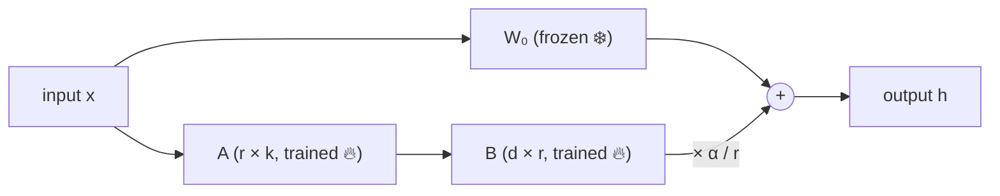
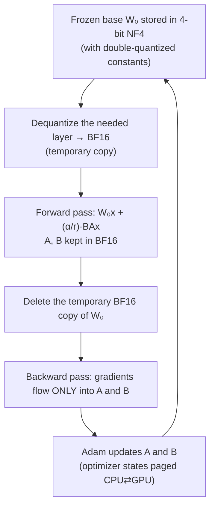

# 04 · LoRA & QLoRA — fine-tuning big models on small hardware

**Session:** 1 August 2026 · Dr. Plaban Kumar Bhowmick (IIT Kharagpur) · Module 3, *Re-parameterization based PEFT*
**Read time:** 35–45 min · **Builds on:** Chapter 03 (adapters & soft prompts)

---

## In one minute

Fine-tuning a big model the normal way ("full fine-tuning") means changing **every** weight. That needs a huge amount of GPU memory. For example, a 70-billion-parameter model needs about **840 GB**, which is roughly 20 data-centre GPUs.

This chapter is about two tricks that make fine-tuning cheap:

- **LoRA (Low-Rank Adaptation)**. Freeze the original model completely. Next to some of its weight matrices, add a tiny "side path" made of two thin matrices, and train only those. You get almost the same quality while training well under 1% of the parameters.
- **QLoRA (Quantized LoRA)**. Do LoRA, but also store the frozen original model in **4 bits** instead of 16. Add three memory-saving tricks on top. A 70B model then fits on a **single** GPU (about 46 GB).

If you remember one sentence, make it this one: **LoRA reduces what you train; QLoRA additionally shrinks what you store.**

---

## Exam radar

How likely each topic is to be tested, based on how much slide time it got, how often it appears across the pre-read, slides and post-read, how many student questions it drew, and whether it came back in the revision session (Chapter 06).

| Topic | Likelihood | Why we think so |
|---|---|---|
| How LoRA works: frozen W₀, side path B·A, B starts at zero | 🔴 High | Pre-read, slides, ~10 Q&A questions, re-taught in revision |
| Why LoRA saves memory (no gradients or optimizer states for frozen weights) | 🔴 High | Repeated in slides and Q&A; the classic "why" question |
| Merging the adapter → no extra inference latency (vs adapters) | 🔴 High | Pre-read calls it "the fundamental advantage" |
| QLoRA's ingredients: NF4, double quantization, paged optimizer (+ gradient checkpointing) | 🔴 High | Whole second half of the lecture; repeated in revision |
| What QLoRA quantizes (frozen base only, not A and B) | 🔴 High | Asked 4 different ways in the Q&A sheet |
| Intrinsic dimension: why low-rank updates are enough | 🟠 Medium | Opens the lecture; pre-read section |
| The two dials r (rank) and α (alpha) | 🟠 Medium | Live in-class quiz on it; several Q&A rows |
| Multi-tenant use case: one base model, many hot-swapped adapters | 🟠 Medium | Opening story; good scenario-question material |
| Block-wise quantization and outliers | 🟠 Medium | Several slides plus Q&A |
| Gradient checkpointing details, exact NF4 level values | 🟢 Low | Mechanism matters; exact numbers don't |

---

## The story that opens the lecture: 200 clients, one GPU budget

The professor started with a real-world problem, and it's worth keeping in mind for every concept below.

> A software company runs a customer-support AI for **200+ business clients**. A fintech client wants careful, compliance-aware answers. A gaming client wants a casual, meme-friendly tone. Each client wants *their own* fine-tuned model.

**The naive way.** Fully fine-tune a 13B model separately for each client.

- Each copy is ~26 GB, so 200 copies take **5.2 TB** of storage.
- Serving them means keeping 200 large models "warm" on 200 GPUs.
- The company can't afford that.

**The LoRA/QLoRA way.**

- **Training:** load the base model in 4 bits (~7 GB instead of 26 GB) and train a small LoRA adapter per client (~50 MB each). That fits on one 24 GB consumer GPU. This is QLoRA.
- **Serving:** keep **one** base model in GPU memory. When a request arrives, a router looks at the client ID and plugs in that client's 50 MB adapter. All 200 adapters together take about **10 GB**, compared with 5.2 TB.

!!! example "Everyday analogy"
    Think of one well-trained chef (the base model) and 200 small recipe cards (the adapters). You don't hire 200 chefs. When an order comes in from a particular restaurant, the chef picks up that restaurant's card and cooks in its style.

Keep this picture in mind. A good share of scenario questions are just this story in disguise.

---

## Concept 1 — Intrinsic dimension: why a *small* change is enough

### The problem it solves

A 7B model has 7 billion knobs. If we want it to learn a new task, do we really need to turn *all 7 billion*?

### The idea in plain words

**Intrinsic dimension** is the *minimum number of directions you actually need to move in* to solve a learning problem well. The model's nominal size doesn't matter.

Research (Li et al., 2018) found something surprising: for big pre-trained language models, the intrinsic dimension of *fine-tuning* is tiny. In the course's example, BERT has **110 million** parameters, but fine-tuning it for a paraphrase task (MRPC) needs only about **200** free directions to reach a good solution.

The reason is that the pre-trained model already "knows" language. Fine-tuning only needs to *nudge* it, and the nudge is simple.

!!! example "Everyday analogy"
    Picture a big city map with thousands of streets. If you want to get from your home to your office, you don't need to know every street. You need a couple of directions: "go north, then turn east." The *map* is huge, but your *journey* only needs a few directions.

### Why it matters

This finding is the justification for LoRA. If the needed change lives in a few directions, we can describe that change using a few directions, and that's exactly what a low-rank update is.

### Common misunderstanding

- **"Intrinsic dimension means the model gets smaller."** No. The model keeps all its parameters. The idea is about the *change* (the update) needed for a task being simple, not the model itself.

---

## Concept 2 — "Low rank": building a big matrix from two thin ones

### The idea in plain words

A weight matrix inside a transformer might be 4096 × 4096, which is about 16.8 million numbers. A *low-rank* matrix of the same size can be built by multiplying a **tall, thin** matrix by a **short, wide** one.

The professor asked the class a quick question:

| Network | Shape | Number of weights |
|---|---|---|
| A | one 1000 × 1000 matrix | 1,000,000 |
| B | a 1000 × 100 matrix followed by a 100 × 1000 matrix | 200,000 |

Both networks take 1000 numbers in and give 1000 numbers out. But B has **five times fewer** weights, because everything passes through a narrow "waist" of 100.

The size of that waist is called the **rank (r)**. A small r means few directions, few parameters and cheap training.

!!! example "Everyday analogy"
    Imagine a spreadsheet of how much 1,000 customers like 1,000 movies. You could store all million ratings. Or you could notice that taste mostly comes down to a few factors: "likes action", "likes romance", "likes comedy". Then you store each customer's score on those 3 factors, plus each movie's score on the same 3 factors. You can rebuild a very good approximation of the whole table from those two small lists. The "3 factors" is the rank.

---

## Concept 3 — How LoRA actually works

### The setup

Take one weight matrix inside the model, say the attention "query" matrix. Call it **W₀**.

- **Full fine-tuning** learns a change **ΔW** that has the *same size* as W₀ and updates all of it.
- **LoRA** says: *keep W₀ frozen, and write the change as the product of two thin matrices,* **ΔW = B · A**.

    - **A** squeezes the input down to r numbers. Its shape is r × k.
    - **B** expands those r numbers back to full size. Its shape is d × r.
    - r is small (typically 4, 8, 16, 32 or 64), much smaller than d or k (which are in the thousands).

The layer's output becomes:

\[
h = W_0\,x \;+\; \frac{\alpha}{r}\,B\,A\,x
\]

In plain English: **the output is what the original frozen model would compute, plus a small learned correction from the side path.**

### What is trained and what is frozen

| Part | Trained? | Notes |
|---|---|---|
| Original weights W₀ | ❄️ Frozen | Never changes, so no gradients or optimizer states are needed for it |
| A | 🔥 Trained | Starts as small random numbers |
| B | 🔥 Trained | **Starts at exactly zero** |

### Why B starts at zero (a favourite exam point)

If B = 0, then B·A = 0. That means **at the start of training, the model behaves exactly like the original pre-trained model.** Training starts from a known-good place and gently moves away from it, instead of beginning with a random, damaging correction.

This is the same idea as the **near-identity initialisation** of adapters in Chapter 03: a new module should start as a "do nothing" module.

### Which matrices get LoRA?

In the course's example, LoRA is applied to the attention projection matrices: **Query, Key, Value and Output**. In code these are often called `q_proj`, `k_proj`, `v_proj` and `o_proj`. The matrices don't have to be square; the slides used square ones only to keep the picture simple.

### Worked example (no calculation needed, just the picture)

Imagine fine-tuning LLaMA-13B with LoRA, rank 16, on the Q, K, V and O matrices of all 40 layers.

- The **trainable** part comes to about **26 million** parameters. That's about **0.2%** of the 13 billion.
- Saved to disk, the adapter is about **50 MB**, compared with 26 GB for the full model.

That's where the "50 MB per client" in the opening story comes from.

### LoRA includes full fine-tuning as a special case

- **r = 0:** there's no side path, so this is just the frozen model.
- **Small r:** cheap, efficient fine-tuning. This is the usual LoRA.
- **r = full size of the matrix:** the side path can express *any* change, so this has the same power as full fine-tuning.

So full fine-tuning isn't a separate idea. It's LoRA with the rank dial turned all the way up. The rank is a **knob that trades flexibility for efficiency.**

### Common misunderstandings

- **"LoRA ranks or sorts the parameters by importance."** No. "Rank" is the linear-algebra word for the *width of the waist* (r), not a ranking.
- **"LoRA reduces the number of parameters in the model."** No. During training the model has slightly *more* parameters (W₀ plus A plus B). LoRA reduces the number of parameters you *train*.
- **"A and B change depending on the input."** No. Like any weights, they're learned during training and then fixed. Only the activations depend on the input.

---

## Concept 4 — The two dials: rank r and alpha α

| Dial | What it controls | Everyday way to think about it |
|---|---|---|
| **r (rank)** | How many directions the update can use, which means capacity and parameter count | The number of "factors" in the movie example |
| **α (alpha)** | How *strongly* the LoRA correction is applied relative to the frozen model | A volume knob for the adapter |
| **α / r** | The actual scaling factor in the formula | Dividing by r keeps the update's size roughly stable when you change r, so you don't have to re-tune everything |

**How to choose r:** start with common values (8, 16, 32), then pick the **smallest r that gives acceptable validation performance**. Bigger isn't automatically better: it costs more memory and can overfit small datasets.

**How to choose α:** it's a hyperparameter set by experiment. A larger α gives the adapter more influence over the base model. (A common habit in practice, though not a rule from the course, is to set α to 1–2 times r.)

!!! warning "In-class quiz trap"
    The professor ran a live quiz on this. The correct reading is: **dividing by r normalises the update's size as the rank changes; α sets the final strength.** Both matter, and neither one alone "is" the learning rate.

---

## Concept 5 — Merging: why LoRA adds zero latency at inference

### The idea

After training, you can **fold the side path into the original weights** in a one-time, offline step:

\[
W_{\text{merged}} = W_0 + \frac{\alpha}{r} B A
\]

The deployed model then has **exactly the same shape and the same amount of computation** as the original model. There are no extra modules and no extra matrix multiplications, so **no added latency.**

### Why this is a big deal compared with adapters

The adapters from Chapter 03 (Houlsby-style) are extra layers that **stay in the network permanently**. Every inference call has to pass through them one after another, which adds latency no matter how small they are. The pre-read calls LoRA's merge ability *"the fundamental advantage of re-parameterization over additive methods."*

!!! example "Everyday analogy"
    An adapter is like a translator standing next to a speaker. Every sentence goes through an extra person. A merged LoRA is like the speaker having *learned* the new phrasing. There's no extra person and no delay.

### The nuance: merge *or* hot-swap?

| You want… | Do this |
|---|---|
| One task, lowest possible latency | **Merge** the adapter into W₀ |
| Many clients or tasks on one base model (the 200-client story) | **Keep adapters separate** and hot-swap them per request. Serving systems use routing, caching and batching to do this efficiently |

Both are correct uses of LoRA. Read the scenario carefully to see which one it describes.

---

## Concept 6 — Where the GPU memory actually goes

To see why LoRA and QLoRA save so much, you need to know what full fine-tuning keeps in GPU memory **for every trainable parameter**:

| Item | Why it's needed | Size per parameter (FP16 + Adam) |
|---|---|---|
| The weight itself | To run the model | 2 bytes |
| Its gradient | To know which way to update it | 2 bytes |
| Adam's two running averages (momentum and variance) | Adam's update rule needs them | 8 bytes (2 × 4 bytes, kept in FP32) |
| **Total** | | **≈ 12 bytes per parameter**, plus activations |

Notice that the **optimizer states are the biggest part**, bigger than the weights themselves.

**Why LoRA saves memory:** the frozen W₀ still has to be loaded, but it needs **no gradient and no Adam states**. Those exist only for the tiny A and B. That's the main saving. It's *not* that A and B are small on disk.

**Why QLoRA saves even more:** it also shrinks the frozen W₀ itself from 16 bits to 4 bits.

The course's headline comparison for a **70B model**:

| Method | Approx. memory | Hardware |
|---|---|---|
| Full fine-tuning | ~840 GB | ~20 data-centre GPUs |
| LoRA | ~154 GB | ~4 data-centre GPUs |
| QLoRA | ~46 GB | **1** data-centre GPU |

You won't be asked to calculate these numbers, but you should recognise the pattern: **each step cuts memory dramatically, and QLoRA is what makes a single GPU possible.**

---

## Concept 7 — Quantization: storing numbers with fewer bits

### The idea in plain words

**Quantization** means storing numbers with fewer bits. For example, a 16-bit or 32-bit decimal number might be stored as an 8-bit or 4-bit integer. Fewer bits mean less memory.

The basic recipe ("absmax" quantization) works like this:

1. Find the **largest absolute value** in the group of numbers.
2. Scale everything so that the largest value maps to the top of the small integer range (127 for 8-bit).
3. Round each number to the nearest integer.
4. Store the integers **plus the one scaling constant**, so you can approximately convert back later. Converting back is called **dequantization**.

!!! example "Everyday analogy"
    Rounding prices to the nearest ₹10 before writing them in a notebook. ₹247 becomes ₹250 and ₹1,183 becomes ₹1,180. You save writing space, and you lose a little precision. That small loss is called **quantization error**.

### Key facts

- **It's lossy.** After dequantization you get *approximately* the original number, not exactly.
- **The error doesn't pile up during training.** In QLoRA the frozen weights are quantized **once** and stored. Each forward or backward pass *temporarily* converts the needed layer back to 16-bit to compute, then throws that copy away. Nothing is re-quantized step after step.
- **It's not only FP32 → FP16.** LLM quantization often goes much further, to INT8, INT4 or NF4.
- **It's useful for inference too.** Tools like Ollama run quantized models so large LLMs fit on a laptop.
- **4-bit is the sweet spot.** Research shown in class (Dettmers & Zettlemoyer, 2023) found that, for a fixed memory budget, 4-bit models give the best accuracy. 3-bit becomes unstable.

---

## Concept 8 — The outlier problem and block-wise quantization

### The problem

Most weights in a neural network are small numbers clustered near zero, but there are a few **outliers** (unusually large values). With one scaling constant for the whole tensor, a single huge outlier "stretches" the scale. Then most of the normal, small weights get squashed into just a few levels and lose precision.

!!! example "Everyday analogy"
    Grading a class "on a curve" where one student scored 1000 by mistake. If you scale everyone's marks relative to that 1000, all the other students end up with nearly the same grade, and you can no longer tell them apart.

### The fix: block-wise (chunked) quantization

1. Split the tensor into small **blocks** (for example, 64 values each).
2. Quantize each block **separately**, with its **own** scaling constant.

Now an outlier only affects its own small block. The slides showed that **smaller blocks (64) give better accuracy** than large blocks (1024).

**The catch:** more blocks mean more scaling constants to store. Concept 10 deals with this.

---

## Concept 9 — NF4: a 4-bit format shaped like the weights

### The idea

With 4 bits you only get **16 possible values**. Where should those 16 levels sit?

- **Evenly spaced levels** waste many levels on the far ends, where very few weights live.
- Pre-trained weights roughly follow a **bell curve (normal distribution) centred at zero**.
- **NF4 (4-bit NormalFloat)** places its 16 levels using the **quantiles of a normal distribution**. That puts **more levels close to zero**, where most weights are, and fewer in the tails. Each level ends up "responsible" for roughly the same number of weights.

!!! example "Everyday analogy"
    Shoe sizes. A shop doesn't stock equal numbers of every size from 1 to 15. It stocks many pairs of the common middle sizes and only a few of the rare extremes. NF4 "stocks" its 16 levels the same way.

### Why it matters

NF4 introduces **less error than other 4-bit formats** for this kind of data, which is why QLoRA uses it for the frozen base model. It brings storage down to about **0.5 bytes per parameter**. For example, LLaMA-7B goes from 14 GB in FP16 to about 3.5 GB.

!!! info "Two different problems, two different fixes"
    - **Block-wise quantization** handles *scale* changes across different regions of the tensor (outliers).
    - **NF4** handles the *shape* of the value distribution (bell curve).

    They're complementary, not redundant. QLoRA uses both.

---

## Concept 10 — Double quantization: compressing the labels too

### The problem

Block-wise quantization gives every block of 64 weights its own scaling constant, stored in 32-bit. Across billions of weights, those constants add up to roughly an extra **0.5 bits for every parameter**. That's meaningful when the weights themselves are only 4 bits.

### The fix

**Quantize the scaling constants themselves.** Group the constants and store them in 8-bit, with one higher-level constant per group. Getting a weight back becomes a two-step dequantization: first recover the block's constant, then recover the weight.

!!! example "Everyday analogy"
    You vacuum-pack your clothes into small bags (block-wise quantization). Each bag has a label. There are so many bags that the labels themselves start filling a drawer. So you shrink the labels as well: shorter codes, plus one master key for each group of labels.

**The cost** is a tiny bit of extra error and a tiny bit of extra compute (one more dequantization step). The memory saving is "essentially free" according to the pre-read.

---

## Concept 11 — Gradient checkpointing: save some, recompute the rest

### The problem

During the forward pass, every layer's output (its **activation**) is normally kept in memory, because the backward pass needs it to compute gradients. For long sequences, activations can take a lot of memory.

### The fix

Keep only some activations, the "checkpoints" (for example, one every √n layers). During the backward pass, **recompute** the missing ones from the nearest checkpoint when they're needed. You **trade extra compute for less memory**, at roughly the cost of one extra forward pass.

!!! example "Everyday analogy"
    A video game that saves only at certain checkpoints instead of after every step. If you need to go back, you reload the nearest checkpoint and replay from there. You use much less storage, at the cost of a little replaying.

**Limitation:** it reduces memory but doesn't remove *spikes*. A batch with an unusually long sequence can still push memory over the limit, and that's what the next trick handles.

---

## Concept 12 — Paged optimizer: spill to CPU RAM instead of crashing

### The problem

Even with all the tricks above, memory can **spike** suddenly, for example when one training batch contains a very long sequence. Without help, the run crashes with an **out-of-memory (OOM)** error.

### The fix

Borrow the idea of **paging** from operating systems. The Adam optimizer states can live in **CPU RAM** and be moved into the GPU **in pages only when needed** for an update. When GPU memory runs short, the least-used pages are pushed back to CPU RAM instead of crashing the run.

!!! example "Everyday analogy"
    Your desk is the GPU and the cupboard behind you is CPU RAM. When the desk gets full, you put the folders you're not using right now into the cupboard and pull them out again when needed. You don't need a bigger desk, and nothing falls on the floor.

**The result:** training can run on a single GPU without carefully hand-tuning batch sizes to avoid crashes.

---

## Putting it together: what QLoRA actually does

QLoRA (Dettmers et al., 2023) = **LoRA** + three ingredients (+ gradient checkpointing):

| Ingredient | What it saves |
|---|---|
| 1. **NF4** storage of the frozen base weights | Shrinks the biggest thing in memory, the base model, about 4× |
| 2. **Double quantization** | Shrinks the scaling constants that block-wise quantization needs |
| 3. **Paged optimizer** | Absorbs sudden memory spikes by spilling optimizer states to CPU RAM |
| (+) **Gradient checkpointing** | Shrinks activation memory |

The professor used a **pizza** picture: NF4 is the dough, double quantization is the sauce, and the paged optimizer is the cheese. All three together make QLoRA.

### One training step, in order

### The three facts students mixed up most

1. **Only the frozen base W₀ is quantized to 4 bits.** The trainable LoRA matrices A and B stay in higher precision (BF16).
2. **The whole model is never dequantized at once.** Each layer is dequantized only when it's needed and then discarded, so the memory advantage is kept.
3. **Dequantizing costs a little compute**, but moving 4× less data around often makes up for it, so speed stays competitive.

---

## Choosing a PEFT method: quick decision table

This combines Chapter 03 and this chapter. The rules of thumb come from the course's Q&A answers.

| Situation | Good choice | Why |
|---|---|---|
| General instruction tuning or domain adaptation | **LoRA** | The default today ("nowadays LoRA is mostly used" — professor) |
| Very large model, limited GPU memory | **QLoRA** | The 4-bit base makes it fit |
| Lowest inference latency for a single task | **LoRA, merged** | No extra modules after merging |
| Many tasks or clients sharing one base model | **LoRA adapters, hot-swapped** (or task adapters) | Tiny per-task files, one resident base model |
| Generation tasks such as summarisation or dialogue, with very few trainable parameters | **Prefix tuning** (Chapter 03) | Learned key/value prefixes at every layer |

---

## What the hands-on showed

The Colab notebook for this session was shared only as a link, so these points come from the Q&A sheet:

- LoRA was implemented by **wrapping** existing linear layers with a custom `LoRALinear` layer that adds the A/B side path. The original weights were frozen.
- The notebook then repeated the experiment with **QLoRA** (4-bit base model) and ran a **rank sweep**, comparing results across different values of r.
- A common error, *"'LoRALinear' object has no attribute 'in_features'"*, came from running the QLoRA cells on top of an already-wrapped model. The fix was to **restart the runtime and run cells in order**, so each experiment starts from a fresh base model.

**The lesson:** LoRA isn't magic inside a library. It's literally "freeze the layer, add B·A beside it, train only B and A."

---

## Where students got confused (from the live Q&A)

| Student question | The clarified answer |
|---|---|
| "Does 'change in weights' mean reducing the number of weights?" | No. It means changing their *values*. ΔW is a learned correction. |
| "How are the parameters ranked?" | They aren't. "Rank" means the width r of the B·A waist. |
| "Is information lost through the narrow bottleneck?" | Potentially, but most tasks don't need to change everything. The important change fits in a small subspace (intrinsic dimension). |
| "Is QLoRA just converting FP32 to FP16?" | No. LLM quantization goes down to INT8, INT4 or NF4. |
| "In QLoRA, are A and B quantized too?" | No. Only the frozen W₀. A and B stay in BF16/FP16. |
| "Do quantization errors add up over training steps?" | No. W₀ is quantized once and dequantized temporarily each time it's used. |
| "Isn't block-wise quantization redundant with NF4?" | No. Block-wise handles scale (outliers); NF4 handles distribution shape. |
| "Do adapters get ranked by client importance in multi-tenant serving?" | No. Each client has its own adapter, picked by a router using the client ID. |
| "Will fine-tuning fix my slow PDF-extraction pipeline?" | No. The bottleneck there is OCR/parsing, not the model. |

---

## Traps to watch for in MCQs

- ❌ "LoRA updates a subset of the original weights." → It updates **none** of them. It trains new A and B matrices beside the frozen weights. (Updating a chosen subset of existing weights is the *selective* PEFT family, such as BitFit.)
- ❌ "LoRA's main memory saving is that A and B are small files." → The main saving is **no gradients or optimizer states for the frozen base**.
- ❌ "A merged LoRA model is slower than the original." → It has the **same** speed, because the structure is identical.
- ❌ "QLoRA trains the model in 4-bit." → It **stores** the frozen base in 4-bit. Computation happens in BF16 and only A and B are trained.
- ❌ "Double quantization quantizes the weights twice." → It quantizes the **scaling constants**.
- ❌ "The paged optimizer makes training faster." → It prevents **out-of-memory crashes** from memory spikes.
- ❌ "Gradient checkpointing saves the gradients to disk." → It stores only some **activations** and recomputes the rest.
- ❌ "Higher rank is always better." → Use the smallest r that validates well. A higher r costs memory and can overfit.

---

## Recap

1. **Intrinsic dimension:** adapting a big model to a task needs only a *small* change, so a low-rank update is enough.
2. **LoRA:** freeze W₀ and train a side path ΔW = B·A (B starts at 0), scaled by α/r. Only a tiny fraction of parameters is trained.
3. **The savings come from skipping** gradients and Adam states for frozen weights. Merging B·A into W₀ removes any inference latency.
4. **QLoRA = LoRA + NF4 (4-bit base) + double quantization + paged optimizer** (+ gradient checkpointing). A 70B model fits on one GPU.
5. **Only the frozen base is quantized.** A and B stay in BF16, and layers are dequantized temporarily, one at a time.

---

## Practice questions

Pick an option to see instantly whether you're right, with an explanation for every option.

  
<em>Loading practice questions…</em>

