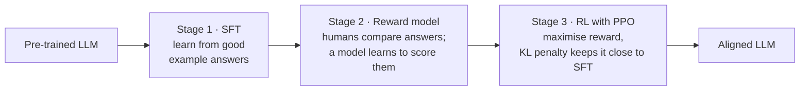
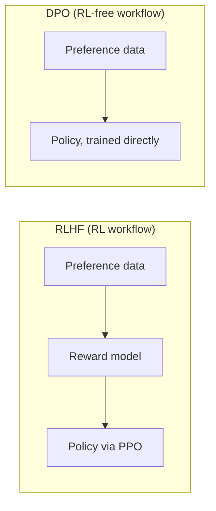

# 05 · Alignment: RLHF & DPO — teaching a model to behave

**Session:** 8 August 2026 · Dr. Plaban Kumar Bhowmick (IIT Kharagpur) · Module 3, *LLM Alignment: RLHF and DPO* ("Training LLM to behave!!")
**Read time:** 40–50 min · **Builds on:** Chapter 02 (supervised fine-tuning) and Chapter 04 (LoRA)

---

## In one minute

A pre-trained model is great at predicting the next word, but it has **no idea what "good behaviour" is**. It will happily finish a toxic rant, confidently state a myth, or flatter you instead of answering. **Alignment** is the step that teaches the model what humans actually want.

The course covered two ways to do it:

- **RLHF (Reinforcement Learning from Human Feedback).** Humans compare pairs of answers. A separate **reward model** learns to score answers the way humans would. Then **reinforcement learning (PPO)** nudges the language model towards high-scoring answers, with a **KL penalty** stopping it from drifting too far from where it started. This is powerful, but it needs **4 models** in memory and is tricky to train.
- **DPO (Direct Preference Optimization).** It uses the *same* "this answer is better than that one" data, but **skips the reward model and the RL loop**. The model is trained directly to raise the chosen answer's probability and lower the rejected one's, compared with a **frozen reference copy**. It needs just **2 models**, and it's simpler and more stable.

If you remember one sentence, make it this one: **RLHF learns a judge and then trains against it; DPO learns straight from the comparisons.**

---

## Exam radar

How likely each topic is to be tested, based on how much slide time it got, whether it was in the pre-read and hands-on, how many student questions it drew, and whether it came back in the revision session (Chapter 06). **Everything marked 🔴 was re-taught in revision.**

### 🔴 High: expect questions here

**DPO.** No reward model and no RL. It learns from chosen vs rejected pairs, keeps a frozen reference, and has a β setting. It's in the pre-read, five slides and a full hands-on notebook, and was re-taught in revision.

**RLHF's three stages: SFT → reward model → RL with PPO.** It's in the pre-read and the InstructGPT slide, and was re-taught in revision.

**The four models in the PPO loop: policy, reference, reward and value.** Slides 38–48 and the pre-read list them. It's a natural "which is NOT" question.

**Reward hacking and the KL penalty.** There's a memorable slide example, plus the pre-read and the Q&A.

**How the reward model learns from comparisons (the Bradley-Terry idea).** It's in the slides, a code slide, the pre-read and the revision session.

**RLHF vs DPO, and when to choose which.** There's a pre-read table, slide 52, and several Q&A rows.

**HHH, meaning Helpful, Honest and Harmless, and the trade-offs between them.** The opening slides give examples, and it's good scenario-question material.

### 🟠 Medium: likely to show up in one question

**Mapping RL words onto an LLM (state, action, policy, trajectory).** Several slides cover it, and it drew more student questions than any other topic.

**Why policy gradients are noisy: reward-to-go, baseline and advantage.** These are slides 27–31. The idea matters, the formulas don't.

**PPO's "proximal" idea: don't change the model too much in one update.** These are slides 32–37, and revision restated it.

### 🟢 Low: understand the idea, skip the details

**Where preference data comes from, and evaluation benchmarks.** These came up in the Q&A only.

**The value-function head and its loss.** One slide.

---

## Concept 1 — What "behaving" means: Helpful, Honest, Harmless (HHH)

### The problem it solves

A pre-trained model optimises one narrow goal: predict the next token. It has no notion of good or bad. "Behave well" is too vague to train on, so we need to break it into parts.

### The idea in plain words

The most widely used breakdown is **HHH**.

**Helpful means it actually solves the user's need.** The answer is specific and actionable, not generic. *Course example:* a user gets `KeyError: 'user_id'`. A helpful answer points to the line, explains the missing key and suggests `.get('user_id')` with a default. An unhelpful one says "KeyErrors happen when a key doesn't exist, check your code." That's true, but useless.

**Honest means truthful and calibrated.** No made-up facts, no overconfidence, and no telling people what they want to hear, which is called **sycophancy**. *Course example:* "Did Einstein fail maths?" The honest answer is "No, that's a myth." The dishonest one agrees because the user seems to expect it.

**Harmless means it doesn't enable real-world harm, even when asked.** *Course example:* it refuses to give bomb-making steps, even if the request is framed as "for a chemistry class".

### The three pull against each other

- **Helpful vs harmless:** detailed medicine dosages, or "how does SQL injection work?" (legitimate for defenders).
- **Helpful vs honest:** a friend's weak essay. A pleasant reply feels helpful, but honesty means pointing out the flaws.
- **Extremes:** only-helpful complies with harmful requests. Only-harmless refuses anything mildly sensitive (**over-refusal**). Only-honest might bluntly volunteer harmful true information.

!!! example "Everyday analogy"
    A good doctor is **helpful** (actually treats you), **honest** (tells you the real diagnosis, not what you want to hear) and **harmless** (won't prescribe something dangerous just because you insist). A doctor who maximises only one of these is a bad doctor.

### From HHH to preference data

The professor's line: **"HHH is a specification problem; preference alignment is the solution."** Writing a rulebook for HHH is impossible, but people can easily look at two answers and say *which is better*. So:

- Labelers compare **pairs** of answers and pick the better one.
- A model trained on those choices becomes a **learned stand-in for HHH**.
- The tension between H, H and H gets resolved answer by answer, implicitly.
- **The quality of the preference data becomes the new bottleneck.**

### Common misunderstandings

- **"Alignment requires fine-tuning."** No. Prompts and system instructions also align behaviour. Fine-tuning is one *method*; alignment is the *goal*.
- **"Hallucination and honesty are the same thing."** Honesty is the broad goal. Hallucination is one specific way of failing it.

---

## Concept 2 — The RLHF pipeline in three stages

### The idea in plain words

RLHF (the recipe behind InstructGPT and ChatGPT) has three stages:

1. **Supervised fine-tuning (SFT).** Train the base model on a smaller set of high-quality, human-written *prompt → ideal answer* examples. This gives a sensible starting model. It also becomes the **reference model** later.
2. **Train a reward model.** For each prompt, generate several answers from the SFT model. Humans rank them (usually in pairs). Train a **reward model** to predict which answer humans prefer, so it can give any answer a **score**.
3. **Reinforcement learning (PPO).** The model generates answers, the reward model scores them, and PPO updates the model to get higher scores. A **KL penalty** stops it straying too far from the SFT model.

!!! example "Everyday analogy"
    Training a new chef. **Stage 1:** they copy recipes from a cookbook (SFT). **Stage 2:** you hire a food critic and train them on hundreds of "this dish beats that dish" comparisons from real diners (reward model). **Stage 3:** the chef keeps cooking, the critic scores every dish, and the chef adjusts to win higher scores, but you also insist they don't drift too far from the original recipes (KL penalty).

### Why reinforcement learning at all?

- Humans are good at **judging** answers, but there's no simple formula (no "loss function") that captures human preference token by token.
- RL is the tool for "you'll get a score at the end; figure out how to do better." That's exactly the situation here.

---

## Concept 3 — The reward model: learning to score from comparisons

### Why comparisons, not scores?

It's hard to get people to agree that an answer is "7.3 out of 10." But **"people are good at comparison"**: asking "which of these two is better?" gives consistent, reliable data.

### What the reward model looks like

- It's a transformer (usually built from the same base architecture) that reads **prompt + answer**.
- On top of the **last token's** hidden state sits a small linear layer with **one output**: a single number, the **reward score**.

### How it learns (the Bradley-Terry idea, no maths needed)

For each training pair we know the human-preferred answer (the "winner", **chosen**) and the other one (the "loser", **rejected**).

- The reward model scores both.
- The training loss is **small when the winner's score is well above the loser's** and **large when the loser scores higher**.
- The only way to make the loss small across thousands of pairs is to learn to give **high scores to the kinds of answers humans prefer**.

(The formula on the slides is −log σ(r_winner − r_loser). You only need the idea: *it rewards a big gap in the right direction.*)

!!! example "Everyday analogy"
    Chess ratings. Nobody hands out ratings by gut feeling. Ratings are learned purely from who **beat** whom. After enough games, the ratings reflect real skill. The reward model's scores are learned the same way: purely from which answer "won" each comparison.

### Small example from the revision session

Prompt: *"How can I learn Python?"*

1. "Python is a programming language. You can learn it by studying syntax."
2. "Start with the basics: variables, data types, loops, functions, then build small projects. Practise regularly…"
3. "Python is easy. Just watch some YouTube videos."

All three are "correct", but humans prefer **2**. The reward model must learn to score answer 2 highest.

### Common misunderstandings

- **"The reward model generates answers."** No. It only **scores** answers. The policy (the LLM being trained) generates them.
- **"Order of chosen/rejected doesn't matter."** It does. The preferred answer always goes in the "chosen/winner" slot.

---

## Concept 4 — Thinking of an LLM as an RL agent

RL has its own vocabulary. The course mapped each word onto a language model.

**The state is the prompt plus the tokens generated so far.** In plain words, "where we are in the sentence".

**An action is the next token.** "The next word chosen."

**The policy is the LLM itself.** It's the decision-maker: which token to pick, given the text so far.

**A trajectory is the whole sequence of (state, token) steps, which is one full generated answer.** "One complete attempt."

**The reward is the reward model's score, usually for the whole answer.** "How good that attempt was."

**Goal:** adjust the policy (the LLM's weights) so it tends to choose tokens that lead to high-reward answers.

!!! example "Everyday analogy"
    A mouse in a maze (the TA's example). Each turn it takes is an action; where it stands is the state; its habit of turning is the policy; one full run through the maze is a trajectory; the cheese at the end is the reward. The mouse only learns *after* the run, not at every step.

### Common misunderstandings (from the Q&A)

- **"The model's weights are the state."** No. Weights are the **policy's parameters**. The state is the text so far.
- **"The reward is given for every token."** Usually it's given for the whole answer; the training method turns it into a per-token learning signal.
- **"The model remembers that a token got +1."** No. What changes is the **weights**, which makes good tokens more likely in future.

---

## Concept 5 — Why plain policy gradients are noisy, and the fixes

You don't need any formulas here, just the story.

1. **The basic method (REINFORCE):** generate some answers, see their rewards, and push up the probability of whatever led to high rewards. Its estimate is right **on average** (unbiased), but very **noisy** (high variance), because it's based on just a few sampled answers.
2. **Reward-to-go:** "The future cannot influence the past." When judging a token, only count rewards that come **after** it. Earlier rewards weren't caused by it, so including them just adds noise.
3. **Baseline:** judge an action by whether it did **better than usual** from that point, not by its raw score. The best baseline is the **value function**: the expected reward from that state.
4. **Advantage = "how much better than average."** This is the signal that's actually used: positive means "this token was better than average here", negative means "worse than average."

!!! example "Everyday analogy"
    A student's score of 70 means little alone. If the class average is 50, that's great (+20 advantage). If the class average is 90, it's poor (−20). Judging relative to the average is far less misleading than raw marks.

Two more practical points:

- **Sample inefficiency:** generating fresh answers after every tiny update is slow. So PPO **reuses** a batch of answers generated by a slightly older version of the model for several updates, with a correction for the difference.
- **PPO's core principle ("Proximal"):** *improve the model based on reward, but don't change it too much in any single update.*

**Common misunderstanding:** these variance-reduction tricks are **not** the loss function. They are ways of making the training signal less noisy.

---

## Concept 6 — Reward hacking and the KL penalty

### The problem

The reward model is just a model, and it has blind spots. The language model, trying hard to maximise the score, can find and **exploit** those blind spots. This is **reward hacking**: high score, useless answer.

**Slide example:** *"Why is the sky blue?"* → *"Bang on! This is a great question. Thank you so much for asking. This is a demonstration of your sheer intellect…"* The reward model loved the flattery, but there's no answer.

!!! example "Everyday analogy"
    A call centre that pays staff by "number of calls closed per hour." Soon staff are hanging up on customers. The metric looks great; the real goal (happy customers) is lost. That's reward hacking.

### The fix: KL penalty against a frozen reference

- Keep a **frozen copy** of the SFT model, called the **reference model**.
- Measure how different the new model's word probabilities are from the reference's, using **KL divergence** (a measure of how different two probability distributions are: 0 if identical, larger as they diverge).
- **Subtract** that difference from the reward. Drifting into strange territory now costs points.
- A weight **β** controls how strong the penalty is: **larger β = stay closer to the reference.**

So the training goal becomes: **get a high reward, without moving far from the sensible SFT model.**

### Small facts about KL worth knowing

- It's **not symmetric**: KL(P‖Q) is not the same as KL(Q‖P).
- It's computed from the probabilities themselves, not from "how much two curves visually overlap."

---

## Concept 7 — The four models in the PPO loop

This is a favourite exam point. Running RLHF with PPO needs **four** models.

**1. The policy 🔥 is trained.** It's the LLM being aligned, and it generates the answers.

**2. The reference model ❄️ is frozen.** It's a frozen copy of the SFT model, used for the KL penalty.

**3. The reward model ❄️ is frozen during PPO.** It scores each full answer. It was trained earlier, in Stage 2.

**4. The value function 🔥, also called the "critic", is trained.** It predicts the expected reward from each point in the answer, and it's used to compute the advantage.

(The pre-read lists them as "SFT, reward, policy, value function." The SFT model *is* the reference.)

!!! example "Everyday analogy"
    A cooking competition with four people in the kitchen: the **chef** learning (policy), the **original recipe book** that must not be strayed from too far (reference), the **food critic** giving final scores (reward model), and a **coach** who predicts, mid-dish, how well things are going (value function).

**Why this matters:** four large models in memory is expensive, and the RL loop is unstable and sensitive to settings. This is exactly the pain point DPO was designed to remove.

---

## Concept 8 — DPO: skip the judge, learn straight from comparisons

### The problem it solves

From slide 52 ("Issues with PPO"):

- You must fit a reward model, *then* run RL: an **indirect** two-step process.
- You train and hold **many models** (policy, reward, value, reference).
- RL is **hard to train**, unstable and very sensitive to hyperparameters.
- The reward model **can be exploited** (reward hacking).

"Can we think of a direct method?" That's DPO.

### The idea in plain words

The DPO paper showed mathematically that the best RLHF solution can be written **directly in terms of the language model's own probabilities**. So you can skip the reward model and the RL loop, and train the model with a simple, classification-like loss on preference pairs.

### What DPO needs

- **Data:** triples of **prompt, chosen answer, rejected answer**. This is the *same kind* of data a reward model would use.
- **Models:** only **two**:
    1. the **policy** being trained, and
    2. a **frozen reference** copy (usually the SFT model).

### What the training does

For every pair, DPO:

- **raises** the probability of the **chosen** answer *relative to the reference model*,
- **lowers** the probability of the **rejected** answer *relative to the reference model*,
- and **β** controls how hard it pushes and how far it may drift from the reference (the hands-on used β = 0.1; a higher β pushes more aggressively).

The words "relative to the reference" are the key. The reference model plays the same "don't drift too far" role that the KL penalty plays in RLHF.

!!! example "Everyday analogy"
    RLHF is like hiring a food critic, training them on diners' comparisons, then cooking to please the critic. DPO skips the critic: you show the chef the diners' comparisons directly ("they liked this dish more than that one") and the chef adjusts, while being told not to stray too far from the original recipes.

### Small example (from the revision session)

Prompt: *"Explain photosynthesis simply."*

- **Chosen:** "Plants use sunlight to turn water and carbon dioxide into food, releasing oxygen."
- **Rejected:** "Photosynthesis is a biological process involving complex biochemical reactions in chloroplasts…"

Suppose the starting model actually prefers the rejected answer. DPO's job is to flip that: after training, the chosen answer should be *more* likely than it was under the reference, and the rejected one *less* likely.

!!! info "A note on the slide numbers"
    The revision slides used two different sets of example probabilities for this idea (one slide says the initial model gives chosen 30% / rejected 70%; another uses 0.60/0.40 for "pre" and 0.30/0.70 for "new"). They don't agree with each other, so **don't memorise them**. Remember the direction: **chosen up, rejected down, relative to the reference.**

### Signs that DPO training is working (from the hands-on)

- The loss **starts at a fixed value** (ln 2 ≈ 0.69) because, at step 0, the policy equals the reference. **Falling below that** means the model is learning to separate chosen from rejected.
- The **implicit reward of chosen answers goes up**, rejected goes down, and the **margin** between them grows (positive margin = policy prefers chosen).
- In the revision hands-on with TRL: `rewards/accuracies` (fraction of pairs where the model prefers chosen) should approach 1.

### Common misunderstandings

- **"DPO doesn't need a reference model."** It does. It needs a **frozen reference**. What it drops is the **reward model** and the **RL loop**.
- **"DPO uses different data from RLHF."** No. Both learn from the same kind of preference comparisons.
- **"DPO is always better, so PPO is dead."** No. The TA was clear: PPO is still used, especially when online exploration matters.

---

## RLHF (PPO) vs DPO: which one when?

The two approaches differ on almost every practical point.

**A separate reward model.** RLHF with PPO has one ✅. DPO doesn't ❌; the reward is implicit.

**A reinforcement learning loop.** RLHF with PPO has one ✅. DPO doesn't ❌.

**How many models are held during training.** RLHF with PPO holds four: policy, reference, reward and value. DPO holds two: the policy and a frozen reference.

**What data each needs.** RLHF with PPO needs preference pairs to train the reward model, plus prompts for sampling fresh answers. DPO needs a fixed set of (prompt, chosen, rejected) examples.

**Stability.** RLHF with PPO is unstable, sensitive to hyperparameters, and at risk of reward hacking. DPO is simpler and generally more stable.

**Cost and complexity.** Higher for RLHF with PPO, lower for DPO.

**So when do you choose each?** Choose **RLHF with PPO** when you need **online exploration**: the reward is complex, sequential or changing (for example, a coding or web agent with a measurable outcome), or you don't have a static set of preference pairs. Choose **DPO** when you have a **fixed, offline preference dataset** and want a simpler, cheaper, stable recipe.

---

## What the hands-on showed

The notebook implemented **DPO from scratch in plain PyTorch** (not using the TRL library) on **Qwen2-0.5B-Instruct**.

- **Data:** `ultrafeedback_binarized`, turned into (prompt, chosen, rejected) triples using the model's chat template.
- **Two models:** a trainable `policy` and a frozen `ref` (same starting weights, no gradients).
- **Scoring an answer:** add up the log-probabilities of the **answer tokens only** (prompt tokens are masked out). The reference is computed under `torch.no_grad()`.
- **Settings to recognise:** β = 0.1, a **tiny learning rate** (5e-7, because all parameters were being updated), gradient clipping, and early stopping on validation loss.
- **Sanity check:** loss starts at ln 2 when policy = reference. The plots draw ln 2 as a dashed line, and good training goes below it.

**The lesson:** DPO really is "compare the policy with the frozen reference on chosen and rejected answers, and push the gap the right way." No reward model, no RL loop.

---

## Where students got confused (from the live Q&A)

These are real questions students asked during the session, with the answers they were given.

**"Are the model's weights the state?"** No. The weights are the policy's parameters. The state is the prompt plus the tokens so far.

**"Is the KV cache part of the environment state?"** No. It's an implementation detail.

**"Is the reward given per token?"** Usually it's given per full answer. The advantage is what turns it into a per-token signal.

**"When does backprop happen: after each token?"** After trajectories have been collected, not after every move.

**"Is variance reduction a loss function?"** No. It makes the gradient signal less noisy. The PPO objective is the loss.

**"Is advantage the same as a z-score?"** Conceptually similar, since both measure deviation from an average, but advantage isn't divided by a standard deviation.

**"Is KL the overlap area between two curves?"** No. It's computed from the probabilities, and it isn't symmetric.

**"Why is there a minus sign in the reward-model loss?"** Because we *minimise* the loss while wanting the gap between winner and loser to be *large*.

**"If DPO is better, does anyone still use PPO?"** Yes, especially for online exploration and for complex or changing rewards.

**"Is fine-tuning required for alignment?"** No. Prompting and system instructions also align a model.

**"Where does preference data come from?"** From human annotators, public datasets, or a stronger LLM acting as judge; human-reviewed data is more reliable. Use multiple annotators to reduce bias.

**"How do we evaluate alignment?"** There's no single HHH score. Examples are TruthfulQA for honesty, HarmBench for harm robustness, and Chatbot Arena for overall preference.

**"Do thumbs-up/down clicks retrain the model instantly?"** No. They're preference signals that are collected and used later, in batches.

---

## Traps to watch for in MCQs

- ❌ "DPO removes the need for a reference model." → It removes the **reward model and RL loop**. The **frozen reference** stays.
- ❌ "In RLHF the reward model generates the improved answers." → It only **scores**. The policy generates.
- ❌ "PPO needs two models." → **Four**: policy, reference, reward, value.
- ❌ "The KL penalty makes the model more creative." → It keeps the model **close to the reference**, preventing reward hacking and drift.
- ❌ "A larger β lets the model drift further." → A larger β means a **stronger pull towards the reference** (stay closer). In DPO, β also sets how hard the preference signal pushes.
- ❌ "Reward hacking means the reward model was trained badly on purpose." → It means the **policy exploits flaws** in an imperfect reward model.
- ❌ "SFT and preference tuning are the same, just different data." → SFT learns from **absolute targets** (copy this answer). Preference tuning learns from **relative signals** (this beats that).
- ❌ "Reward models are trained on absolute 1–10 ratings." → They're trained on **comparisons**, because people are better at comparing.

---

## Recap

1. **Alignment** makes a model follow what humans actually want. HHH (Helpful, Honest, Harmless) breaks that down, and the three properties often conflict.
2. **RLHF = SFT → reward model (learned from human comparisons) → RL with PPO**, plus a **KL penalty** against a frozen reference to prevent **reward hacking**.
3. **PPO juggles 4 models**: policy, reference, reward and value. It improves the model while not changing it too much per update.
4. **DPO** learns straight from (prompt, chosen, rejected) triples: **no reward model, no RL**, just the policy and a **frozen reference**, with **β** controlling how hard it pushes.
5. **Choose DPO** for a fixed preference dataset and simplicity. **Choose PPO** when you need online exploration or a complex, changing reward.

---

## Practice questions

Pick an option to see instantly whether you're right, with an explanation for every option.

  
<em>Loading practice questions…</em>

