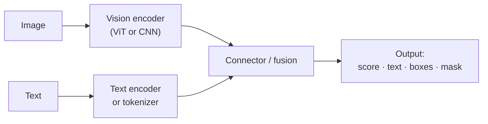
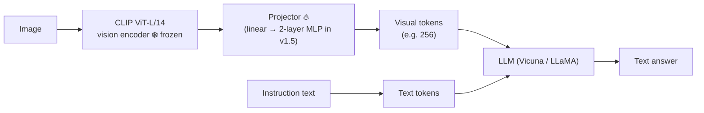
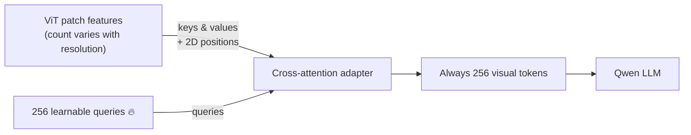

# 07 · VLM architectures — CLIP, LLaVA, Qwen-VL and SAM

**Session:** 29 August 2026 · Faculty not named in the course files · Module 4, Lecture 1, *Vision-Language Model Architectures*
**Read time:** 40–50 min · **Builds on:** transformers and attention from the 1st exam; Chapter 03 (adapters) and Chapter 04 (LoRA) for the "frozen backbone + small trainable part" idea

---

## In one minute

A **vision-language model (VLM)** takes an image (plus some text) and produces text, a label, a similarity score or a mask. This lecture covered four famous models, and each one stands for a *different way* of combining vision and language:

| Model | One-line job | Output |
|---|---|---|
| **CLIP** | *Match* images and text in one shared space | A similarity score or label |
| **LLaVA** | *Describe and chat* about an image | Free-form text |
| **Qwen-VL** | Chat, but also *point and read* (grounding and OCR) | Text plus bounding boxes |
| **SAM** | *Cut out* exactly the object you point at | A pixel mask |

They all share one ingredient: a **Vision Transformer (ViT)** that turns an image into a sequence of patch tokens. What differs is **the connector** (how vision meets language) and **what the output is used for**.

If you remember one sentence, make it this one: **same eyes (ViT), different jobs: match, describe, ground, segment.**

---

## Exam radar

How likely each topic is to be tested, based on slide time, the in-class quick-check quizzes, the 39-question Q&A sheet and whether it came back in the next lecture (Chapter 08).

| Topic | Likelihood | Why we think so |
|---|---|---|
| CLIP's contrastive training: the image–text grid, positives vs negatives, temperature, zero-shot classification | 🔴 High | Heaviest slide time, a 6-question quick check, ~12 Q&A questions |
| LLaVA: frozen CLIP encoder + projector + LLM, and **what is trained in Stage 1 vs Stage 2** | 🔴 High | 6-question quick check; classic "which part is frozen" question |
| Qwen-VL: the cross-attention adapter with **256 learned queries**, grounding tokens, 3 training stages | 🔴 High | A stated learning objective: "trace how a pixel becomes a token" |
| Choosing the paradigm (contrastive vs generative vs promptable) and "where fusion happens" | 🔴 High | The anchor table of the lecture; easy scenario material |
| SAM: heavy encoder run once, light decoder per prompt, 3 candidate masks, prompt types, data engine | 🟠 Medium–High | 6-question quick check, and re-taught in the next lecture |
| ViT basics: patches, positional embeddings, [CLS] | 🟠 Medium | Several Q&A questions |
| LLaVA's GPT-4-generated data, LLaVA-1.5 and LLaVA-NeXT upgrades | 🟠 Medium | Quick-check items |
| Limitations of each model | 🟠 Medium | "Why does it fail?" scenario questions |
| Variant tables, exact parameter counts, history dates | 🟢 Low | Professor said "no need to remember" |

---

## The big picture: one template, four variations

The professor drew one generic diagram and said *every model is a variation on it*:

The most useful lens is **where the two modalities meet** ("where fusion happens"):

| Fusion style | How it works | Model |
|---|---|---|
| **No fusion (dual encoder)** | Two separate towers. They only "meet" in a final similarity score | CLIP |
| **Early fusion into an LLM** | Image tokens are fed into the LLM alongside the words, and ordinary self-attention mixes them | LLaVA, Qwen-VL |
| **Cross-attention module** | A dedicated attention block lets one set of tokens look at another | Qwen-VL's adapter, SAM's mask decoder |

And the three **paradigms**:

| Paradigm | Input | Output | Example |
|---|---|---|---|
| Contrastive | Image + candidate text labels | Similarity scores | CLIP |
| Generative / instruction-following | Image + a free-text instruction | Generated text | LLaVA, Qwen-VL |
| Promptable dense prediction | Image + a spatial prompt (click or box) | Pixel mask | SAM |

---

## Concept 1 — The Vision Transformer (ViT): how a picture becomes tokens

### The idea in plain words

A text transformer reads a sentence as a sequence of word tokens. A ViT does the same for images:

1. **Cut the image into small square patches**, for example 16 × 16 pixels each.
2. **Flatten each patch into a vector** and pass it through a learned linear layer, just like a word embedding.
3. **Add a positional embedding** to each patch. Attention on its own doesn't know order, so this tells the model *where* each patch came from.
4. Optionally add a special **[CLS] token** whose final output summarises the whole image.
5. Run the sequence through ordinary **transformer encoder layers**.

The standard example: a 224 × 224 image with 16 × 16 patches gives **196 patch tokens** (197 with [CLS]).

!!! example "Everyday analogy"
    Cut a photo into a grid of jigsaw pieces, write a "description card" for each piece and number the cards by position. The ViT reads the cards in order, like words in a sentence.

### Why it matters

CLIP, LLaVA's vision tower, Qwen-VL's encoder and SAM's encoder are **all ViT variants**. Learn it once and it explains all four models.

### Common misunderstandings

- **"The positional encoding is just the numbers 1, 2, 3…"** No. Each position gets a *vector* that is added to the patch vector.
- **"A ViT reads text in an image like OCR software."** No. It sees text as visual patterns. Reading ability comes from training that links those patterns to language.
- **"ViT always beats CNNs."** Not always. The Q&A answer: a **ResNet (CNN) can be better on smaller datasets** or when efficiency matters. ViT shines with lots of data and compute.

---

## Concept 2 — CLIP: teaching images and captions to meet in one space

**CLIP** (OpenAI, 2021) stands for *Contrastive Language–Image Pre-training*.

### The problem it solves

A classic image classifier (like a ResNet trained on ImageNet) knows a **fixed list of about 1,000 classes**. To add a new class, you collect labelled photos and retrain. It can't recognise anything outside its list.

### The idea in plain words

Instead of a fixed list of labels, learn from **400 million (image, caption) pairs** scraped from the web (the WIT dataset). Train two separate encoders:

- an **image encoder** (a ViT or ResNet) that turns an image into a vector, and
- a **text encoder** (a transformer) that turns a caption into a vector.

Both vectors land in the **same shared space**. Training pulls each image *close to its own caption* and pushes it *away from every other caption*. That's what **contrastive** means.

The professor's framing: *treat labels as text, put them as points in the same space as images, and classification becomes a nearest-neighbour search.*

!!! example "Everyday analogy"
    A party where every guest (an image) has a matching name badge (a caption) mixed into a pile. The game: each guest must find their own badge and stay far away from everyone else's. After enough rounds, guests and badges that belong together always end up standing side by side.

### How one training step works (the grid picture)

Take a batch of N image–caption pairs. Compare **every image with every caption**, which makes an N × N grid of similarity scores.

| | Caption 1: "two dogs running across a frosty field" | Caption 2: "whale fin above the ocean" | Caption 3: "dirt path in a pine forest" |
|---|---|---|---|
| **Image 1 (dogs)** | ✅ match | ✖ | ✖ |
| **Image 2 (whale)** | ✖ | ✅ match | ✖ |
| **Image 3 (forest)** | ✖ | ✖ | ✅ match |

- The **diagonal** cells are the true pairs (**positives**).
- Every **off-diagonal** cell is a wrong pair (a **negative**). For each image, the other N − 1 captions in the batch are its negatives, so **no one has to hand-pick negatives**.
- The loss is called **InfoNCE**, and CLIP uses a **symmetric** version. Each row asks "which caption matches this image?" and each column asks "which image matches this caption?". Both are treated as classification problems and the two losses are averaged.

**Bigger batches = more negatives = better learning.** CLIP used a huge batch of 32,768 pairs.

### Two small details that get asked

| Detail | What it means |
|---|---|
| **L2-normalised embeddings** | Every vector is scaled to length 1, so the dot product equals the **cosine similarity** |
| **Temperature τ (tau), learned** | Rescales the scores before the softmax. **Lower τ = sharper, more confident choices; higher τ = softer.** CLIP *learns* τ instead of fixing it |
| **Projection layers** | The image and text encoders output different-sized vectors. Small learned projection layers map both into the same shared size |
| **Text embedding taken at the [EOS] token** | The caption's vector is the text encoder's output at the end-of-sequence token, not an average over all tokens |

### Common misunderstandings

- **"CLIP is a Siamese network."** Related idea, but a Siamese network *shares one encoder*. CLIP has **two separate** encoders, one per modality.
- **"An accidentally mismatched caption in the data is a negative."** No. Negatives are the *intentional* wrong pairings inside the batch. A wrong caption in the data is **label noise**.
- **"You could just use PCA to align image and text vectors."** No. Alignment has to be *learned* through the contrastive objective.
- **"The shared space is universal."** No. It's specific to that trained model.

---

## Concept 3 — Zero-shot classification with CLIP

### The idea

**Zero-shot** means doing a task **without any training examples for that task**. With CLIP, you classify an image into classes it was never explicitly trained on:

1. Embed the image once.
2. Turn each class name into a sentence such as **"a photo of a {label}"** and embed each one with the text encoder.
3. Compute the similarity between the image and each class sentence.
4. A softmax turns the similarities into probabilities, and the highest one wins.

**Prompt wording matters.** Averaging over about 80 hand-written templates ("a photo of a big {label}", "a sketch of a {label}") improves accuracy.

!!! example "Small example"
    Classes: *cat, dog, giraffe.* You embed "a photo of a cat", "a photo of a dog" and "a photo of a giraffe". A picture of a giraffe lands closest to the third sentence, so CLIP says "giraffe", even if nobody ever trained it on a labelled "giraffe" class.

### Zero-shot vs linear probe

| | Linear probe | Zero-shot |
|---|---|---|
| What you do | Freeze the encoder and train a small classifier on labelled target data | No training at all. Class names are embedded as text |
| Needs labels? | Yes | No |

The headline result: zero-shot CLIP reached **76.2% top-1 on ImageNet**, matching a fully supervised ResNet-50. It was also much more robust on shifted data such as sketches.

### Where CLIP is weak

- Fine detail: **counting**, reading small text (OCR) and **spatial relations** ("left of", "behind").
- Sensitive to prompt wording.
- Inherits web biases.
- **It can't generate text.** It only scores matches. That gap is exactly what LLaVA fills.

### Common misunderstanding

- **"Zero-shot = unsupervised."** No. CLIP was trained with (noisy) supervision from captions. "Zero-shot" only means no examples *for the new task*.

---

## Concept 4 — LLaVA: plugging an image into a chatbot

**LLaVA** = *Large Language and Vision Assistant* (2023). The two Ls stand for "Large Language".

### The problem it solves

CLIP can match but can't describe, explain or answer questions. GPT-4V showed multimodal chat was possible, but it was closed. LLaVA's question was: can we reuse an existing vision encoder and an existing LLM, and just teach them to work together cheaply?

### The idea in plain words

**"Treat the image as a foreign language."**

1. A **frozen CLIP vision encoder** turns the image into patch features.
2. A small **projector** translates those features into vectors that look like the LLM's word embeddings. LLaVA v1 used a single linear layer; **LLaVA-1.5 uses a 2-layer MLP**, which adds non-linear capacity and improves accuracy.
3. The resulting **visual tokens** are placed in the input sequence next to the text tokens: `[system prompt][visual tokens][user question][assistant answer]`.
4. The **LLM** reads everything with its normal self-attention and writes the answer. There's no separate cross-attention module.

### Why the projector is needed

Even if the CLIP vector and the LLM's word vectors have the same size, they live in **unrelated "geometries"**. Without the projector, a dog-image vector would be a random point to the LLM. The projector learns *where* that vector should land, a bit like a rotation and shift between two coordinate systems.

!!! example "Everyday analogy"
    The CLIP encoder is a photographer who speaks only Japanese; the LLM is a writer who speaks only English. The projector is a small, cheap interpreter between them. You don't retrain the photographer or replace the writer. You just hire the interpreter.

### Where the training data came from

No dataset of (image, instruction, answer) existed. The trick: take COCO image **captions and bounding boxes**, write them out as text, and ask a **text-only GPT-4** (it never sees the image) to create Q&A. This produced about **158K examples** of three types: **conversation**, **detailed description** and **complex reasoning**.

### The two training stages (very likely to be asked)

| Stage | Goal | Vision encoder | Projector | LLM | Data |
|---|---|---|---|---|---|
| **1 · Feature alignment** | Teach the projector to map image features into the LLM's word space | ❄️ Frozen | 🔥 Trained | ❄️ Frozen | ~595K image–caption pairs |
| **2 · Instruction tuning** | Teach the whole system to follow instructions and chat | ❄️ Frozen | 🔥 Trained | 🔥 Trained | ~158K GPT-4-generated samples |

- The loss is ordinary next-token prediction, computed **only on the assistant's answer tokens**.
- The projector carries over from Stage 1 into Stage 2. It isn't reset.
- **Stage 2 is still needed even if the LLM was already instruction-tuned on text**, because it has never learned to interpret visual tokens.

### Upgrades worth recognising

- **LLaVA-1.5:** MLP projector, academic VQA data mixed in, and higher input resolution (336 px).
- **LLaVA-NeXT (1.6), "AnyRes":** split a high-resolution image into tiles, encode each tile, and add a downsized global view. This is better for small text, charts and documents, at the cost of more visual tokens.

### Limitations

Hallucination, small text lost at low resolution, weak counting and localisation, and it inherits CLIP's blind spots because the encoder is frozen.

### Common misunderstandings

- **"LLaVA can output images or masks."** The original outputs **text only**. Masks need another model, such as SAM.
- **"The projector is the expensive part."** No. Cost is driven by **the LLM and the number of visual tokens**. To cut cost, use a smaller or quantised LLM, fewer visual tokens or a lower resolution, and keep the encoder frozen.

---

## Concept 5 — Qwen-VL: a fixed-size summary that remembers *where*

**Qwen-VL** (Alibaba, 2023) targets what LLaVA is weak at: **grounding** (pointing at regions), **OCR** (reading dense text), and **multi-image / multi-round** chat.

### The problem it solves

At higher resolution (448 × 448), the ViT produces **hundreds to over a thousand** patch tokens per image. Feeding all of them into the LLM is expensive, especially with several images in one conversation.

### The idea: the position-aware adapter

Between the ViT and the LLM, Qwen-VL puts **a single cross-attention layer** with **256 learnable "query" vectors**:

- Each of the 256 queries *looks at all the patch features* (cross-attention) and produces one output token.
- **2D positional encodings** are added so the summary still knows *where* things were in the image.
- Whatever the image resolution or patch count, **exactly 256 visual tokens** come out.

!!! example "Everyday analogy"
    A news editor (the adapter) with **256 reporters** (the queries). The raw footage might be 200 or 2,000 clips depending on the event. Each reporter watches *all* the footage and files **one** summary, tagged with *where* it happened. The newsroom (the LLM) always receives exactly 256 reports.

### LLaVA vs Qwen-VL connector

| | LLaVA | Qwen-VL |
|---|---|---|
| Connector | Linear / MLP projector (keeps every patch) | Cross-attention adapter with 256 queries |
| Visual token count | Grows with resolution or tiles | **Fixed** (256) regardless of resolution |
| Grounding | Not built in | **Native**, via special tokens |
| Multi-image | Limited in the base model | Designed in |
| Training stages | 2 | 3 |

### Grounding with special tokens

Qwen-VL emits boxes as **plain text inside special tags**, using normal next-token prediction. There's no special output head.

- `<ref>…</ref>` wraps the phrase being referred to.
- `<box>…</box>` wraps coordinates, written as numbers normalised to **0–1000**.
- `…</img>` marks where an image's tokens go. Several `` blocks allow multiple images ("Picture 1", "Picture 2").

Example: *"Find the red umbrella."* → `<ref>the red umbrella</ref><box>(342,128),(410,256)</box>`

The model learns to write these coordinates from **region-annotated training data**. Positional embeddings help, but they don't directly turn into boxes.

### Three training stages

| Stage | Resolution | What's trained | Data |
|---|---|---|---|
| 1 · Pre-training | 224 px | Vision encoder + adapter. **LLM frozen** | ~1.4B weakly labelled web image–text pairs |
| 2 · Multi-task pre-training | 448 px | **Whole model** | Seven tasks together: captioning, VQA, grounding, OCR and more |
| 3 · Supervised instruction fine-tuning | 448 px | LLM + adapter. Vision encoder frozen again | Chat, multi-image and multi-round data → **Qwen-VL-Chat** |

### Limitations

The fixed 256 tokens can **lose fine detail** in very dense images such as large tables. The 3-stage recipe is costlier and harder to reproduce. Qwen2-VL later moved to **dynamic resolution**.

### Common misunderstanding

- **"256 tokens means the image is resized to 256 pixels."** No. It's 256 *summary tokens*, produced by attention over all patches at whatever resolution the encoder used.

---

## Concept 6 — SAM: cut out whatever you point at

**SAM** = *Segment Anything Model* (Meta AI, 2023).

### The problem it solves

Language had prompt-driven foundation models; segmentation didn't. Old segmentation models were trained per dataset and had to be retrained for new domains. SAM's task is **promptable segmentation**: given an image and a prompt (a click, a box or a rough mask), return a valid mask, even for objects and domains it never saw (**zero-shot transfer**).

### The three parts

| Part | What it does | Cost |
|---|---|---|
| **Image encoder** (big ViT-H, MAE-pretrained) | Turns the image into an embedding, **once per image**, and caches it | Heavy, ~0.15 s. **The most expensive step** |
| **Prompt encoder** | Encodes clicks and boxes (positional encodings + learned type embeddings), or a rough mask (convolutions). Text is only experimental | Light |
| **Mask decoder** (2-layer transformer, **two-way attention**) | Prompt tokens look at image tokens *and* image tokens look at prompt tokens, then it outputs masks | Light, ~50 ms per prompt |

**Why it feels instant:** the heavy encoder runs once, and every new click only re-runs the cheap decoder.

!!! example "Everyday analogy"
    A tailor who takes your full measurements once (the image encoder). After that, each alteration you ask for, like "shorten this sleeve" or "take in the waist" (the prompts), is quick, because the tailor doesn't re-measure you every time.

### Handling ambiguity: three masks

One click on a shirt button could mean *the button*, *the shirt* or *the whole person*. So SAM returns **3 candidate masks** (sub-part, part, whole), and a small **IoU-prediction head** scores each one so the best can be picked.

### Prompt types

| Prompt | Good for |
|---|---|
| Point (foreground or background click) | Fast interactive selection |
| Box | Precisely selecting one object |
| Rough mask | Refining an existing mask |
| Text (experimental) | Uses a CLIP text embedding |

**Not a prompt:** audio. (This was a quick-check question.)

### The data engine (how SA-1B was built)

1. **Assisted-manual:** annotators draw masks with SAM's help, and SAM is retrained periodically.
2. **Semi-automatic:** SAM proposes confident masks; annotators add what it missed.
3. **Fully automatic:** SAM is prompted with a **regular grid of points (32 × 32)**, keeps confident and stable masks, and removes near-duplicates.

The result, **SA-1B**, has about **1.1 billion masks on 11 million images**. It's a loop: *model annotates → new data trains model → better model annotates*.

### Where SAM stops

SAM knows **"where"**, not **"what"**. It gives a precise outline but doesn't name the object or answer questions. To get "find the red umbrella and cut it out", you **compose**: a grounding model finds and names it (box), then SAM turns the box into a pixel mask. This combination is known as **Grounded-SAM**. **SAM 2** extends SAM to video using a memory of previous frames.

### Common misunderstandings

- **"The prompt is a question like 'what is in this picture?'"** No. A prompt is a way of *pointing* at what to cut out.
- **"The mask decoder is the slow part."** No. The **image encoder** is.
- **"SAM outputs a cropped or zoomed image."** No. It outputs a mask laid over the same image.

---

## Putting it together: the four models side by side

| | CLIP | LLaVA | Qwen-VL | SAM |
|---|---|---|---|---|
| Who / when | OpenAI, 2021 | Wisconsin / Microsoft, 2023 | Alibaba, 2023 | Meta AI, 2023 |
| Paradigm | Contrastive | Generative (chat) | Generative + grounded | Promptable segmentation |
| Vision backbone | ResNet or ViT, trained from scratch | **Frozen** CLIP ViT-L/14 | ViT initialised from OpenCLIP | MAE-pretrained ViT-H |
| Connector / fusion | Shared embedding space (no fusion) | Linear / MLP projector | Cross-attention adapter (256 tokens) | Two-way attention decoder |
| Output | Similarity or label | Free text | Text + boxes | Mask + quality score |
| Training signal | 400M web pairs | 158K GPT-4 instructions | 1.4B pairs + multi-task + instructions | 1.1B masks from a data engine |

The professor's summary: *"What differs is not how we see, but what we do with what we saw: match, describe, ground, segment."*

### Which one when?

| You need… | Choose | Why |
|---|---|---|
| Image search, tagging, zero-shot labels, content moderation | **CLIP** | Fast similarity, no generation needed |
| A conversational description or general visual Q&A | **LLaVA-style** | Frozen encoder + LLM = chat |
| Pointing at regions, reading text, documents, multiple images | **Qwen-VL** | Grounding tokens, OCR training, fixed token budget |
| The exact pixel outline of an object | **SAM** (often with a detector or VLM for the "what") | Promptable, ambiguity-aware masks |
| Grounding added to a LLaVA-like model with minimal change | Emit coordinates **as text tokens**, Qwen-VL style | No new output head needed |

### Design trade-offs to recognise

- **Frozen backbone** (LLaVA: cheap) vs **fine-tuned backbone** (Qwen-VL: more capable, costlier).
- **Token efficiency** (Qwen-VL's fixed 256) vs **spatial detail** (LLaVA-NeXT tiling keeps more patches).
- **Huge noisy web data** (CLIP, Qwen-VL) vs **curated or human-in-the-loop data** (LLaVA, SAM).
- **Specialist** (SAM) vs **generalist** (Qwen-VL).

---

## What the hands-on showed

!!! warning "Inferred"
    The hands-on for this session was shared only as a short link, and no notebook content is in the course files. The Q&A refers to Hugging Face TRL's `SFTTrainer` and a LoRA hands-on from the previous day. That suggests fine-tuning a VLM with LoRA, but we couldn't confirm the notebook's exact contents.

---

## Where students got confused (from the live Q&A)

| Student question | The clarified answer |
|---|---|
| "How many tokens does a 224 × 224 image give with 16 × 16 patches?" | 196 patch tokens (plus 1 if there's a [CLS] token). |
| "Is the positional encoding just a number per patch?" | No. It's a *vector* per position, added to the patch vector. |
| "Why does ViT need [CLS] but GPT doesn't?" | ViT needs one global image summary. A decoder-only GPT produces outputs token by token. |
| "Is CLIP a Siamese network?" | Related idea, but Siamese networks share one encoder. CLIP has two separate ones. |
| "Encoders give different-sized vectors. How do they match?" | Learned projection layers map both into the same shared space. |
| "What does temperature do?" | Lower τ = sharper softmax; higher τ = softer. |
| "Is a wrongly captioned web image a negative?" | No. That's label noise. Negatives are the other pairs in the batch. |
| "Can PCA align image and text spaces?" | No. Alignment must be learned with the contrastive objective. |
| "Is zero-shot the same as unsupervised learning?" | No. Zero-shot means no task-specific examples; training was still supervised by captions. |
| "Can LLaVA output a mask or an image?" | The original LLaVA outputs text only. |
| "Why is LLaVA Stage 2 needed if the LLM is already instruction-tuned?" | The LLM has never learned to interpret visual tokens. |
| "Is the projector reset between stages?" | No. It's trained in both stages. |
| "How do I make LLaVA cheaper to train?" | Use a smaller or quantised LLM and fewer visual tokens, and keep the encoder frozen. |
| "How does Qwen-VL output boxes?" | It writes coordinates as text inside `<box>` tags, learned from region-annotated data. |

---

## Traps to watch for in MCQs

- ❌ "CLIP generates captions." → It only **scores** image–text similarity.
- ❌ "CLIP needs manually mined negatives." → Negatives come free from the **other pairs in the batch**.
- ❌ "Higher temperature makes CLIP's predictions sharper." → **Lower** τ is sharper.
- ❌ "In LLaVA Stage 1, the LLM is fine-tuned." → Stage 1 trains **only the projector**.
- ❌ "In LLaVA Stage 2, the vision encoder is updated." → It stays **frozen**. Projector and LLM are trained.
- ❌ "LLaVA uses cross-attention to fuse the image." → It uses a **projector** and ordinary self-attention inside the LLM. Cross-attention is Qwen-VL's adapter.
- ❌ "Qwen-VL's visual token count grows with image resolution." → It's **fixed at 256**.
- ❌ "Qwen-VL predicts boxes with a detection head." → Boxes are **text tokens** inside `<box>` tags.
- ❌ "SAM tells you what the object is." → SAM tells you **where** (a mask), not what.
- ❌ "SAM re-runs its image encoder for every click." → The encoder runs **once**; only the decoder re-runs.
- ❌ "SAM returns one mask per prompt." → **Three**, scored by an IoU head.

---

## Recap

1. **One template:** ViT eyes → connector → output. The four models differ in the connector and the output.
2. **CLIP** = two encoders, one shared space. Contrastive training on an image–caption grid gives **zero-shot classification** via "a photo of a {label}". It can't generate text.
3. **LLaVA** = frozen CLIP encoder + **projector** + LLM. **Stage 1 trains only the projector; Stage 2 trains projector + LLM.** The encoder is always frozen.
4. **Qwen-VL** = cross-attention adapter with **256 learned queries** (fixed token count, positions kept) + `<ref>`/`<box>` grounding tokens + 3 training stages. Strong at OCR, grounding and multiple images.
5. **SAM** = heavy encoder **once**, light decoder **per prompt**, **3 candidate masks**, built on a self-improving **data engine** (SA-1B). It knows "where", not "what".

---

## Practice questions

Pick an option to see instantly whether you're right, with an explanation for every option.

  
<em>Loading practice questions…</em>

