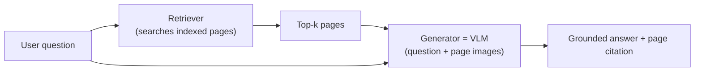

# 09 · Multimodal RAG — finding the right page, then answering from it

**Session:** 12 September 2026 · Faculty not named in the course files · Module 4, Lecture 3, *Multimodal RAG for QA, Text Search and Image Search*
**Read time:** 35–45 min · **Builds on:** Chapter 07 (VLM architectures, CLIP) and Chapter 08 (VLM applications, document intelligence)

---

## In one minute

Ordinary RAG (Retrieval-Augmented Generation) finds relevant **text** and gives it to an LLM so it can answer from real sources instead of from memory. Real documents, though, are full of **charts, tables, diagrams and scanned pages**. The key number in a financial report often lives in a bar chart, not in a sentence. Text-only RAG simply can't see it.

This lecture covers three tasks that share one pattern, **embed → nearest-neighbour search → (optionally) generate**:

- **Text search:** find passages that match a question. This is the retrieval half of every RAG system.
- **Image search:** find images that match a text description or another image, using CLIP's shared embedding space.
- **Multimodal RAG for QA:** retrieve whole document **pages**, including charts and tables, then have a **VLM** read those pages and answer.

The deep dive is **ColPali**. Instead of running OCR to pull text out of a page, it takes a **picture of the page**, turns it into about **1,000 small patch vectors**, and matches each word of your question against the best-matching patch. This is called **late interaction**.

If you remember one sentence, make it this one: **retrieval and generation are separate skills. A great generator with poor retrieval still gives poor answers.**

---

## Exam radar

How likely each topic is to be tested, based on the lecture quiz, the quick-check questions and the Q&A.

### 🔴 High: expect questions here

**Parse-then-embed versus retrieval in vision space.** Know the difference between the OCR pipeline and ColPali, and why OCR pipelines fail on charts and tables. It's in the lecture quiz and repeated in the pre-read, slides, post-read and Q&A.

**Which strategy to use when.** Text search vs image search vs multimodal RAG, and a PDF parser vs ColPali on cost. There's a dedicated slide plus many Q&A answers, so it's ideal scenario material.

**Late interaction.** Many vectors per page, each query token finds its best patch, and the scores are added. It's in the lecture quiz, has a formula slide, and comes from ColBERT.

**Pitfalls.** Retrieval failure, hallucination despite retrieval, irrelevant context and over-trusting citations. It's in the lecture quiz, and a key takeaway was "grounding reduces but does not eliminate hallucination".

**Text-search basics.** Keyword vs semantic vs hybrid, bi-encoders, ANN indexes and reranking. A full set of five quick-check quiz questions covers them.

**Image search with CLIP.** A shared space, no translation step, the same ANN infrastructure, and weakness on compositional queries. Another set of five quick-check quiz questions covers it.

### 🟠 Medium: likely to show up in one question

**Metrics.** Recall@K, nDCG@5 and the ViDoRe benchmark: what each measures, not how to compute it. There are quiz questions on what they mean.

**Cost and memory.** ColPali needs a much bigger index and more GPU memory. Several Q&A answers make this point.

**Three storage designs.** Convert everything to text, use a shared space, or keep separate indexes. There's a slide plus Q&A.

**The chunking trade-off and page-level indexing.** There's a dedicated slide.

**Do you need to fine-tune the LLM for a domain?** Usually no, because RAG supplies the knowledge. Two Q&A answers cover it, and it's a classic scenario.

### 🟢 Low: understand the idea, skip the details

**Keeping the index fresh with incremental ingestion (🟢 Low–Medium).** It came up in the Q&A only.

**Survey details, EM/latent-variable training and application names.** These appear in "technically curious" boxes only.

---

## Concept 1 — Text search: keyword, semantic and hybrid

### The problem it solves

Given a question, find the most relevant passages from a big pile of text. The output is a **ranked list of existing passages**. Nothing new is generated at this stage.

### Three ways to search

**Keyword search (TF-IDF, BM25) matches exact words.** Each word is weighted by how rare and important it is. It's fast, easy to explain, and great for exact terms and IDs, but it misses synonyms and paraphrases.

**Semantic search (dense embeddings) matches meaning, using vectors.** It finds paraphrases even when no words are shared, but it can blur exact numbers, negation and rare terms.

**Hybrid search (BM25 + dense) blends both signals.** You get the best of both, which is why it's common in production. The cost is more moving parts.

!!! example "Everyday example"
    You search a help centre for *"canceling a subscription"*. The article you need is titled *"How to end my plan"*. Keyword search misses it because no words overlap. Semantic search finds it because the **meaning** is the same.

### Common misunderstanding

- **"Text search generates an answer."** No. It only ranks passages that already exist. Generation is the second half of RAG.

---

## Concept 2 — How dense retrieval works: bi-encoders and ANN indexes

### The idea in plain words

1. A **text encoder** turns the query into a vector (a list of numbers that captures meaning).
2. Every document passage was turned into a vector **ahead of time (offline)** and stored in an **index**.
3. Query and passage vectors live in the **same space**, so "finding relevant passages" just means **finding the nearest vectors**, usually by cosine similarity.

This setup is called a **bi-encoder**: one encoder for queries and one for documents (sometimes the same network), trained so their outputs land in one shared space. Each side is encoded **separately**.

**ANN (Approximate Nearest Neighbour)** indexes such as **FAISS** and **HNSW** make the search fast across millions of passages. They give up a tiny bit of accuracy in exchange for a huge speed-up. Exact search simply doesn't scale.

**Reranking:** cheaply retrieve, say, the top 100, then re-score only those with a slower, more accurate model. This improves precision.

!!! example "Everyday analogy"
    A library where every book has been given a spot on a giant map based on its topic. Your question is also dropped onto the map, and you grab the books standing closest to it. ANN is like checking only the nearby shelves instead of walking every aisle. You might very occasionally miss a book, but you're done in seconds.

### How these models are trained (conceptually)

- **Contrastive training:** pull each query and its correct passage together, and push mismatched pairs apart. It's the same idea as CLIP, but text-to-text.
- **Hard negative mining:** train against **near-miss wrong answers** that look plausible, not random ones. This sharpens precision. It does **not** make the index faster.

### Remaining weaknesses to know

- **Chunking:** chunks that are too small lose context; chunks that are too big dilute the match. There's no universal chunk size.
- **Domain shift:** a model trained on web search does worse on legal or medical text.
- **Negation and numbers:** "revenue grew" and "revenue did **not** grow" can end up with very similar vectors.
- **Relevant but not answering:** a passage can be on-topic without containing the answer.

---

## Concept 3 — Image search with CLIP: "only what's embedded changes"

### The idea

CLIP (Chapter 07) trains a **text encoder** and an **image encoder** together, on hundreds of millions of image–caption pairs, so that matching pairs land close together **in the same space**. That means a text query can be compared **directly** with image vectors. No captioning or translation step is needed.

Two directions:

- **Text → image:** type "snow-capped mountains at sunset" and get matching photos (e-commerce product search, stock photos, content moderation).
- **Image → image:** give an example picture and get visually similar ones (reverse image search, similar fashion items, medical image matching).

The infrastructure is the **same** as text search: the same FAISS or HNSW indexes and nearest-neighbour lookup. The lecture's motto was **"only what's embedded changes."** Strong visual encoders mentioned in class include **DINOv2/DINOv3** and **SigLIP-2**.

!!! example "Everyday example"
    The photos in your gallery have **no tags or captions**, yet searching for "mountains at sunset" still finds them. The match comes purely from where CLIP placed the query and the images in the shared space.

### Weak spots

- **Compositional queries** with several constraints at once ("a red car with an open door, parked near a bridge, at night"). Each extra constraint dilutes the others.
- **Very fine-grained queries** ("the specific red sedan facing left in the third row").
- **Bias** inherited from web-scraped training data.
- **Long, detailed text queries**, because the text encoder was trained on short captions.

---

## Concept 4 — Why real documents need multimodal RAG

### The problem

Ordinary RAG extracts **only text** from documents. The visual parts (charts, tables, diagrams, layout) are thrown away, and that's often exactly where the answer is.

**Multimodal RAG** extends RAG so that the retrieved content can be **images, tables, charts or whole rendered pages**, and a **VLM** generates the answer while looking at the actual page pixels.

The architecture is the same **Retriever + Generator** pair as text RAG. **Only the index and the retriever change.**

!!! example "Worked example from class"
    Question: *"What was Q3 revenue growth?"* The retriever brings back the *Q3 Regional Sales Report* page, which contains a bar chart. The VLM reads the chart and answers that Q3 grew about 46% over Q2, citing the chart. Text-only RAG would have found no sentence stating that number.

### Two independent failure points

1. **The retriever** may not find the right page.
2. **The generator** may misread it or ignore it.

Both must be checked separately. Fixing the prompt can't rescue a page that was never retrieved.

---

## Concept 5 — Two strategies: parse-then-embed vs retrieval in vision space

This is the heart of the chapter.

### Strategy A: parse-then-embed (the traditional pipeline)

1. Run **OCR** on the page to read the characters.
2. Run **layout analysis** to find headings, tables and figures.
3. Cut the extracted text into chunks.
4. Embed the chunks with a **text** encoder.
5. Store them in a vector index and search.

**Weakness:** OCR and layout analysis are **brittle and lossy**, especially on charts, tables, unusual fonts and multi-column layouts. Every step can drop information, and errors pile up.

### Strategy B: retrieval in vision space (ColPali)

1. **Render the page as an image**, like a screenshot.
2. Feed the image straight into a **VLM-based encoder**.
3. The encoder outputs **one vector per small image patch**, about 1,000 per page.
4. Store all the patch vectors.
5. At query time, encode the question and score every page with **late interaction** (Concept 6).

**Advantage:** there's no OCR and no layout parsing, so there are no brittle steps to break. Charts, tables and layout all contribute directly.

!!! example "Everyday analogy"
    Strategy A is like asking someone to **transcribe** a magazine page into plain text and then searching the transcript. Any chart they couldn't describe is lost. Strategy B is like keeping a **photo of every page** and searching the photos directly.

### Comparison

Here's how the two strategies compare, point by point.

**The pipeline.** Parse-then-embed goes OCR → layout → text chunks → text embedding. ColPali goes page image → VLM encoder → patch vectors.

**Where it breaks.** Parse-then-embed breaks at the OCR and layout steps on charts, tables, scans and odd layouts. In ColPali, those steps don't exist.

**Vectors per page.** Parse-then-embed stores a few, one per text chunk. ColPali stores about 1,000, one per patch.

**Index size and GPU memory.** Parse-then-embed is smaller and cheaper. ColPali is **much larger and more expensive**.

**Offline indexing speed.** Parse-then-embed is slow, because of OCR + layout + embedding. ColPali is **much faster**, about 18× in the paper.

**Query speed.** The two are comparable, both in milliseconds.

**Best for.** Parse-then-embed suits mostly plain text or clean tables on a tight budget. ColPali suits complex layouts, charts, scanned pages and visual context.

!!! warning "Classic trap"
    ColPali is **faster at indexing** but **heavier to store and serve**. The two systems are about equally fast at *query* time. The real cost difference is index size and GPU memory, not query latency.

---

## Concept 6 — Late interaction and MaxSim (no math needed)

### The problem with one vector per page

Squeezing a whole page into **one** vector blends everything together. A small chart in the corner gets drowned out by the rest of the page.

### The idea

**Late interaction** keeps **many small vectors**: one per query word (token), and one per page patch. Scoring works like this:

1. For **each word in the question**, find the **single best-matching patch** on the page. That's the "Max" in **MaxSim**.
2. **Add up** those best-match scores across all the question's words.
3. The page with the highest total wins.

The idea comes from **ColBERT** (text retrieval). **ColPali** applies it to page images.

!!! example "Everyday analogy"
    You're checking whether a page matches the question "Q3 revenue chart". The word "Q3" looks for the patch with the Q3 label. "Revenue" looks for the patch with the revenue heading. "Chart" looks for the patch with bars. Each word finds its own best spot, and the page's score is how well **all** the words found a match. It's not one blurry overall impression.

### ColPali in a nutshell

- Built on **PaliGemma-3B**, a pre-trained VLM, then fine-tuned on (question, page image) pairs.
- Each patch vector is projected to a small size, the same as ColBERT.
- The **same model** encodes both questions and pages, so they share one space. Two different models with the same vector *length* aren't enough; they must be **trained into the same space**.
- **The retrieval unit is the page.** A large chart isn't cut into separate chunks; its patches all contribute to the page's score.
- **Explainability bonus:** each patch's best-match score can be shown as a **heatmap** over the page. For a chart question, the chart lights up.
- Newer relatives: **ColQwen2** (Qwen2-VL backbone) and **VisRAG**.

### How it differs from neighbouring ideas

**Small chunks change the retrieval unit.** The unit becomes smaller pieces.

**Late interaction keeps the whole page as the unit.** Internally, though, it compares at a fine-grained token/patch level.

**A cross-encoder reranker runs the query and document together through a transformer.** It's more accurate but **much slower**, so it's only used on a short list.

A typical pipeline goes: bi-encoder retrieval (cheap) → late interaction (medium) → cross-encoder rerank (expensive, top few only).

---

## Concept 7 — Storing multimodal content: three designs

**Design 1: convert everything to text (a unified representation).** Caption the images and tables, then use one text encoder and one database. It's simple, but it **loses visual detail**.

**Design 2: a shared embedding space (cross-modal search).** Embed each modality separately into the *same* space, CLIP-style. This preserves visual content and gives you one multimodal index.

**Design 3: separate indexes per modality.** A text index and an image index are searched in parallel and the results are fused. It's the most flexible design, but also the most complex.

**Chunking still matters.** Chunks that are too small lose context ("Revenue was $4.2B" without saying which quarter). Chunks that are too large dilute relevance (a 50-page report as one vector). ColPali uses **page-level** indexing, which also lets you cite **which page** the answer came from, not just which document.

---

## Concept 8 — Generating a grounded answer

The retrieved pages (as images, text or both) go to a VLM **together with the question**.

**Grounded prompting (recommended):**

1. Tell the model to answer **only** from the retrieved content.
2. Ask it to **cite the page**.
3. Explicitly allow *"Not found in the retrieved documents."*

The professor's warning: **"Abstention is easier said than done."** Models often still try to answer.

**Unconstrained prompting (risky):** the model may answer from its training memory. The result can be fluent and confident, but outdated or contradicting the chart.

---

## Concept 9 — Pitfalls (high exam value)

**Retrieval failure.** The right page is never retrieved, so no prompt can fix the answer. It's like asking a brilliant student to answer from the wrong textbook.

**Hallucination despite retrieval.** The model ignores the retrieved page and answers from memory. The student has the right book open but answers from memory anyway.

**Irrelevant context.** An on-topic but unhelpful page distracts the generator, like getting a page about Q2 when you asked about Q3.

**Over-trusting citations.** A cited page number doesn't prove the answer came from that page. Think of a footnote that doesn't actually say what the essay claims.

**Grounding reduces hallucination, but it does not eliminate it.** Verify citations instead of trusting them.

---

## Concept 10 — Measuring retrieval quality (what the metrics mean)

You won't need to compute these, but you should know what each one rewards.

**Precision, Recall and F1 @k.** These tell you how many of the top-k results are relevant, and how many of all the relevant items you found.

**Recall@K, used for image search on Flickr30K and MS COCO.** Did the correct item appear **anywhere in the top K**? That's why Recall@5 is always ≥ Recall@1.

**nDCG@5.** This measures the ranking quality of the top 5, rewarding the right result **near the very top**. Scores run from 0 to 1, with 1 being ideal.

**ViDoRe.** A benchmark for **visually rich document page retrieval**, scored with nDCG@5. ColPali beat OCR + BM25 and OCR + text-embedding pipelines on it.

**MS MARCO, BEIR and MTEB.** These are for text retrieval: training data, zero-shot generalisation across many tasks, and a broad embedding leaderboard, respectively.

---

## Which strategy when?

Start from the situation, and the choice follows.

**A plain text corpus, such as policies or articles, calls for text RAG (dense or hybrid).** There's no visual content, so multimodal would add cost for nothing.

**Product photos with simple descriptive queries call for image search with CLIP-style embeddings.** Text and images share one space.

**Reports that mix text, tables and charts, or scanned pages, call for multimodal RAG, ideally with vision-space retrieval.** Here it's "worth the added cost".

**Yearly mutual-fund PDFs with clean tables, where you extract fixed fields cheaply, call for a PDF parser + text RAG.** It's cheaper, and ColPali only pays off for complex visuals.

**Exact values and calculations from tables call for table / structured RAG.** You need exact numbers, not similarity.

**Exact codes or IDs plus meaning call for hybrid search (BM25 + dense).** You get keyword precision plus semantic recall.

**Multi-hop questions across linked entities call for Graph RAG.** It follows relationships.

**A real production mix calls for a hybrid: parse the text and tables, and use vision retrieval for complex pages.** There's no single best approach.

**Fine-tune the LLM for a new domain?** Usually **no**. Domain knowledge comes from RAG. Fine-tune only for domain-specific behaviour, terminology or output format. If **retrieval** is weak, fine-tune the **embedding or reranker** model instead.

---

## What the hands-on showed (partly inferred)

!!! info "Inferred from the Q&A sheet"
    The lab notebook was shared only as a Colab link. These points are pieced together from student questions.

- Images were loaded from **CIFAR-10, DocVQA and InfographicVQA** into a Python list, where each item held a source, a label and the image.
- GPU memory was monitored as the models ran.
- **PCA** squeezed embeddings to 2D **only for plotting**. Real search uses the full-size vectors.
- The lab's task: build a query, **choose a retrieval strategy** (text, image or page), and **ground the answer**.
- The lesson: the **same model** must embed both the queries and the items being searched.

---

## Where students got confused (from the live Q&A)

These are real questions students asked during the session, with the answers they were given.

**"Does the vector DB hold both image and text vectors?"** It can, but there are three designs: a shared space, separate embeddings with cross-modal search, or separate DBs per modality.

**"Can I use a different model for queries if it also outputs 768-d vectors?"** No. Matching the size isn't enough; both must be **trained into the same space**.

**"Does ColPali split a big chart into chunks?"** No. The page is the unit, and the chart's patches all contribute to the page's score.

**"Is ColPali cheaper than a PDF parser?"** It's generally **more expensive**, because of the many vectors per page and the big model. Use a parser for plain text and clean tables.

**"Does ColPali need less GPU memory than OCR + text embeddings?"** No, it needs **more**: a large VLM backbone plus many patch vectors.

**"What's the difference between late interaction and just using small chunks?"** Small chunks change the retrieval unit. Late interaction keeps the page and compares at a fine-grained level inside it.

**"How does ColBERT compare with a reranker?"** ColBERT's token-level matching is cheaper. A cross-encoder reranker processes the query and document jointly, which is more accurate but slower.

**"Must the LLM be fine-tuned for my domain?"** Usually no, because RAG provides the knowledge. Fine-tune the embedder or reranker if retrieval is poor.

**"How do I keep the index fresh as documents arrive daily?"** Use incremental ingestion: detect changes (by timestamp, hash or webhook) → extract → chunk → embed → upsert, and remove deleted documents.

**"What do offline and online mean?"** Offline means building the index ahead of time. Online means encoding the query and searching at request time.

---

## Traps to watch for in MCQs

- ❌ "Text search returns a newly generated answer." → It returns a **ranked list of existing passages**.
- ❌ "ANN is used because it's more accurate than exact search." → It's used because it's **much faster at scale**, with a small accuracy loss.
- ❌ "Hard negative mining speeds up the index." → It improves **precision** against near-miss wrong answers.
- ❌ "Image search needs captions on images first." → CLIP compares text and images **directly** in a shared space.
- ❌ "ColPali uses OCR to read the page first." → **No OCR.** It embeds the page image.
- ❌ "ColPali has a smaller index than OCR pipelines." → It's **much larger** (about 1,000 vectors per page).
- ❌ "Late interaction compresses the page into one vector." → The opposite: **many vectors**, matched at fine-grained level.
- ❌ "With RAG and citations, hallucination is solved." → It's **reduced, not eliminated**. Citations can still be wrong.
- ❌ "Multimodal RAG is always the best choice." → Use it only when visual content matters. Plain text → plain text RAG.

---

## Recap

1. **Same pattern everywhere:** embed → nearest-neighbour search (ANN) → generate. *Only what's embedded changes.*
2. **Text-only RAG can't see charts and tables.** Multimodal RAG retrieves pages and lets a VLM read them.
3. **Parse-then-embed** (OCR → layout → text) is brittle on visuals. **ColPali** embeds page images as ~1,000 patch vectors and uses **late interaction** (each query token finds its best patch, then the scores are added).
4. **The trade-off:** ColPali is more accurate on visual documents and faster to index, but needs a **bigger index and more GPU memory**. Pick the strategy by document type and budget, and use a hybrid in production.
5. **Retrieval and generation fail independently.** Grounded prompts and citations reduce hallucination but don't remove it.

---

## Practice questions

Pick an option to see instantly whether you're right, with an explanation for every option.

  
<em>Loading practice questions…</em>

