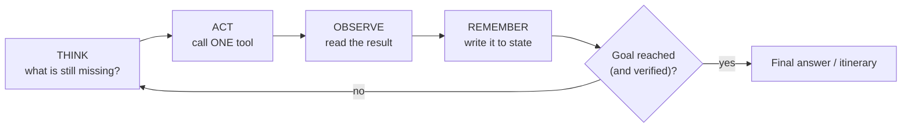

# 10 · From RAG to assistants and agents

**Session:** 19 September 2026 · Dr. Debaditya Roy (IIT Kharagpur) · Module 4, *RAG to Assistants and Agents*
**Read time:** 40–50 min · **Builds on:** the RAG chapters from the 1st exam (chunking, embeddings, retrieval)

---

## In one minute

RAG is great at **answering a question** from your documents. But many real requests are **tasks**, like "plan my trip within policy and budget". A task needs several steps, and the next step depends on what the last one returned. RAG can't do that on its own.

The lecture climbs a ladder. Each rung adds **exactly one** new ability:

**LLM → RAG (+ knowledge) → Assistant (+ conversation context) → Tool-using assistant (+ actions) → Agent (+ its own decisions) → Multi-agent (+ delegation)**

The key definition is about **who decides the order of steps**:

- **Workflow / tool-using assistant:** *you* (the developer) decide the order in advance.
- **Agent:** *the model* decides the next step at run time, based on what just came back.

If you remember one sentence, make it this one: **"RAG answers. Agents finish."** And the test for whether you need an agent: **if you can draw the flowchart before the request arrives, you don't need an agent.**

---

## Exam radar

How likely each topic is to be tested, based on slide time, how often it appears across the pre-read, slides and post-read, and how many student questions it drew.

### 🔴 High: expect questions here

**Workflow vs agent.** Who controls the order of steps, the "draw the flowchart" test, and when to pick each. It has a dedicated slide, appears in the pre-read and post-read, and drew 4+ Q&A threads.

**The six-rung ladder.** What each rung adds, and how to match a request to the right rung. It opens and closes the slides, and came up in the Q&A.

**Tool calling.** The model *emits a request*; your code *executes* it. The slide puts it bluntly: "the model never touches the API". It was repeated in the Q&A.

**MCP.** `list_tools()` and `call_tool()`, discovery at run time, and the server owning the schema. It drew 10+ Q&A questions, more than any other topic.

**The agent loop and its three properties.** Think → Act → Observe → Remember, and the loop must be bounded, observable and recoverable. It's on a slide and in the notebook's guards, along with the rule "verify, don't trust the claim".

**ReAct vs Plan-and-Execute vs Reflection.** Their trade-offs were shown side by side on a slide, and students asked about token cost.

### 🟠 Medium: likely to show up in one question

**Three kinds of memory.** Conversation, task state and long-term. There's a slide table and a post-read section, which makes this an easy "classify this item" MCQ.

**Agentic RAG.** Retrieval becomes one tool among others: the agent can rewrite the query, retrieve again or skip retrieval. It has a dedicated slide.

**Why the loop gets expensive.** The whole history is re-sent at every step. It's on a slide; the concept matters, the numbers don't.

**Safety at the execution boundary.** Write tools need approval, and retrieved text is data, not instructions. This comes from the post-read and the Q&A about duplicate bookings.

### 🟢 Low: understand the idea, skip the details

**The framework landscape** (Agents SDKs, ADK, Pydantic AI…). It's one slide, and its message is "pick by stack, not by benchmark".

---

## The story that runs through the lecture: a trip to Paris

The whole lecture (and the next one, on multi-agent systems) uses one request:

> "Plan my Paris trip for next week for 4 days, staying within the **company travel policy** and a **fixed budget**."

The slides use a ₹80,000 budget, while the hands-on notebook uses ₹1,00,000. The exact figure never matters for understanding, so this chapter just says "the budget".

The professor pointed out four things that make this request hard:

1. **Private knowledge.** The travel policy is an internal PDF. No model learned it during training.
2. **Data that changes over time.** Flight fares and hotel availability change by the hour, so they can't be stored in a model's weights.
3. **Hard constraints that must hold together.** The plan must follow the policy **and** stay under budget.
4. **Unknown control flow.** You can't know the next step until you see the result of the previous one.

Each rung of the ladder fixes one of these. Keep the Paris trip in mind; most scenario questions are this story in disguise.

---

## Concept 1 — The ladder: each rung adds exactly one thing

There are six rungs. Each one keeps everything below it and adds exactly one new ability. The Paris trip shows what each step up buys you.

**Rung 1, the LLM, generates language.** On its own it writes a plausible itinerary with no facts behind it. It's fine for a request like "What is the capital of France?"

**Rung 2, RAG, adds knowledge through retrieval.** Now it can fetch the real company travel policy, so it can answer "What is our international travel policy?"

**Rung 3, the assistant, adds context: it remembers the conversation.** It keeps hold of the trip dates and budget from earlier messages, so it can handle "I'm in Paris next week for 4 days. What does the policy allow?"

**Rung 4, the tool-using assistant, adds tools so it can act in the world.** It calls live flight and hotel search APIs, which lets it answer "Find flights to Paris."

**Rung 5, the agent, adds decisions: it chooses its own next step.** When a policy check fails, it re-plans. That's what "Plan my Paris trip within policy and budget" needs.

**Rung 6, multi-agent, adds delegation: it hands sub-tasks to specialists.** Separate agents handle flights, hotels, meetings and expenses, for a request like "Plan the whole trip, meetings and expenses."

Nothing below is thrown away as you climb. An agent still uses retrieval, context and tools. The hands-on notebook added one more rung, **Workflow** (a fixed sequence written by the developer), between rungs 4 and 5.

!!! example "Everyday analogy"
    Think of a new office intern.

    - **LLM:** a smart intern on day one who has read a lot but knows nothing about *your* company.
    - **RAG:** you hand them the policy handbook.
    - **Assistant:** they remember what you said five minutes ago.
    - **Tool-using assistant:** you give them access to the booking website, but you tell them exactly which steps to follow.
    - **Agent:** you just say "get it done within policy" and they work out the steps themselves.
    - **Multi-agent:** they lead a small team and hand out parts of the job.

### Why a plain LLM isn't enough

The professor asked the same model two questions:

- "What is the capital of France?" It answered correctly from its weights.
- "What does our travel policy allow?" It **confidently invented** an answer ("business class on international routes").

The four limits of a plain LLM are: a **knowledge cutoff**, **no access to private data**, **hallucination** ("fluent is not the same as correct") and **no traceability** (it can't point to a source).

### Why RAG isn't enough either

RAG answers questions. The Paris request is a task, and tasks differ from questions in five ways.

**The input is different.** RAG gets a question. A task gets a goal plus constraints.

**The work is different.** RAG does one retrieval and one generation. A task takes many steps, in an order decided at run time.

**The output is different.** RAG produces text. A task produces a decision, a change in the world.

**Failure looks different.** When RAG fails, you get a wrong sentence. When a task fails, you get a booking that breaks policy.

**The ending is different.** RAG ends when the model stops generating. A task ends when the goal is met, **or** when it's judged impossible.

A task needs three things RAG doesn't have: **actions** (calling external tools), **decisions** (choosing between actions) and **interaction** (asking for clarification or approval).

### Common misunderstandings

- **"An agent is just a smarter model."** No. The dividing line is **task completion**, not intelligence. The same model can sit inside a RAG pipeline or an agent.
- **"You need RAG to have an agent" (or the reverse).** No. Each can exist without the other. An agent might use only tools; a RAG pipeline makes no decisions.

---

## Concept 2 — The assistant: context is state

An **assistant** is RAG plus **memory of the conversation**. Look at this exchange:

1. User: "I'm travelling to Paris next week for 4 days. What does the policy allow?" → "Economy class, booked 7 days ahead [clause 4.2]."
2. User: "And the hotel?" → "Up to the Europe nightly cap [clause 4.7]."
3. User: "Find me one under that." → "I can read the policy, but I have no way to search hotels."

Turn 2 only makes sense if the assistant remembers turn 1 ("the hotel" means *the Paris hotel*). The professor's line: **"Context is state, not a longer prompt."** In the notebook this state was literally just a Python list of messages.

Turn 3 fails for a different reason: a missing **capability**. That leads to tools.

An assistant has three layers: **knowledge** (retrieval), **context** (conversation history) and **capabilities** (tools).

---

## Concept 3 — Tool calling: the model asks, your code acts

### The idea in plain words

With **tool calling** (also called **function calling**), the model doesn't run anything itself. It **writes out a structured request**, such as:

```json
{"name": "search_flights",
 "arguments": {"origin": "BOM", "dest": "CDG", "date": "2026-08-22", "cabin": "economy"}}
```

**Your code** reads that request, calls the real flight API, and hands the result back to the model as new context. The slide said it plainly: **"The model never touches the API. It emits a request; your code executes it."**

Notice the `cabin: "economy"` argument. The user never said "economy"; it came from the retrieved policy. **Knowledge is already shaping the action.**

!!! example "Everyday analogy"
    A restaurant customer and a waiter. The customer (the model) says "one masala dosa, less spicy." The waiter (your code) is the one who actually goes to the kitchen, places the order, and brings back the food. The customer never walks into the kitchen.

### Why this matters: the execution boundary

Because your code sits between the model's request and the real action, that's **where safety checks belong**:

- **Read tools** (search, look up) don't change anything, so they're low risk.
- **Write tools** (book, pay, send) change the real world. They need stronger guards: validation, **human confirmation** for anything costly or irreversible, and protection against duplicates (for example, a unique booking key).
- **A failed tool call is returned as data** (an error message the model can read), not a crash.
- **Retrieved text is data, not instructions.** If a document says "ignore the budget", that must not change what the agent is allowed to do. (This is called *indirect prompt injection*.)

### Good tool design (from the post-read)

A clear name, a precise description of what it returns, constrained parameters (for example, a fixed list of allowed values), stated limitations, and not too many overlapping tools.

### Common misunderstandings

- **"The LLM calls the API."** That's shorthand. The LLM *emits* a request; your code *executes* it.
- **"Duplicate bookings can be prevented with a better prompt."** The course says to put the guard in the **execution layer** around the booking tool, not only in the prompt.

---

## Concept 4 — MCP: tools you connect to, not re-declare

### The problem it solves

With plain tool calling, you hand-write a JSON schema (about 20 lines) for every tool and paste it into the prompt. If a tool is added or a field changes, you edit the prompt and redeploy the agent. That doesn't scale past a handful of tools.

### The idea in plain words

**MCP (Model Context Protocol)** is a **standard protocol** for AI applications to **discover and use** external tools and data.

- The agent acts as an **MCP client**.
- Each **MCP server** offers tools (for example, a Flights server or a Calendar server) or resources (for example, Policy docs).
- The client **discovers** the available tools with `list_tools()` and **runs** one with `call_tool()`.
- The **server owns the schema**. New tools appear without editing the prompt or redeploying the agent.

```python
session = connect("travel.corp/mcp")
tools = session.list_tools()          # discover what's available
session.call_tool("search_flights", {...})   # use one
```

!!! example "Everyday analogy"
    USB. Before USB, every printer, mouse and camera needed its own special port and driver. With USB, any device plugs into the same socket and announces what it is. MCP is a "USB port" for AI tools: plug in a server and the agent can see what it offers.

### Facts the Q&A kept returning to

- MCP is **a protocol**: not an agent, not a tool, and **not a replacement for APIs**. It sits on top of them.
- **Tools execute on the MCP server** (or downstream of it), not inside the LLM.
- One server can expose **many** tools. Group them by domain (Flights, Calendar, Finance).
- `list_tools()` is called at **connection or session start**, not continuously. If the server changes its tools, the client sees the change only after calling `list_tools()` again or reconnecting.
- MCP is **not mandatory**. Plain function calling is fine for a small, app-specific set of tools. MCP pays off with many tools, tools that change, or several external systems.
- MCP doesn't stop breaking changes. You still need versioning.
- Discovering *which* MCP servers exist is a separate problem (configuration or a directory).

### Common misunderstanding

- **"MCP lets agents talk to other agents."** No. MCP connects an agent to **tools and data**. Agent-to-agent communication uses a different standard, **A2A** (Chapter 11).

---

## Concept 5 — Workflow vs agent: who controls the order?

This is the single most important definition in the chapter.

**In a tool-using assistant or workflow, *you* pick the next step, at development time.** The model only fills in arguments and interprets messy language. In the Paris example the order is always the same: retrieve_policy → search_flights → search_hotels → rank.

**In an agent, *the model* picks the next step, at run time.** It decides which tool to call next based on the last result. In the Paris example it goes goal + tools → decide → act → observe → decide again…

**The test:** *"If you can draw the flowchart before the request arrives, you do not need an agent."*

### When to choose which

**Use a workflow when the path is predictable.** That means the steps are the same for every input, auditors need the same path every time, latency and cost must be bounded exactly, or an extra wrong tool call would be expensive or irreversible. Monthly expense-report generation is a good example.

**Use an agent when the path can't be known in advance.** That means the number of steps depends on the data, a later step can invalidate an earlier one, tools fail often and recovery has to be worked out on the fly, or the range of possible requests is open-ended. The Paris trip and triaging a live incident are good examples.

In practice you **ship both**: a deterministic workflow for the parts you can name, with an agent embedded at the one step where the path is genuinely unknown.

!!! example "Everyday analogy"
    A **workflow** is a recipe card: step 1, step 2, step 3, same every time. An **agent** is a cook told "make dinner from what's in the fridge". They open the fridge, see what's there, decide, taste, adjust.

### Why use an LLM inside a fixed workflow at all?

To handle **language**: understanding messy user input and writing a good response, while the order stays fixed. If a process is fully rule-based with clean inputs (like expense reports), ordinary automation is cheaper, faster and more predictable.

### The bug that proves the point (from the hands-on)

The notebook's fixed workflow ran retrieve_policy → search_flights → pick the cheapest affordable fare. The departure was only 5 days away, but the policy needs 7 days' notice for international bookings. The workflow returned a plan that was **"within budget and non-compliant, with total confidence, in three calls"**, because nothing in the flowchart ever called `check_policy`.

### Common misunderstandings

- **"Using an LLM makes it an agent."** No. An LLM following steps *you* fixed is a workflow or tool-using assistant.
- **"Agents are always better."** No. When the path is known, a workflow is cheaper, more predictable and easier to audit.

---

## Concept 6 — The agent loop: Think → Act → Observe → Remember

### The idea in plain words

An agent isn't a pipeline; it's a **closed loop**:



**"The plan is never written in advance; it is regenerated after every observation."** "Agent decides" literally means: the tool result is appended to the context and the LLM is called again.

### The Paris trace (simplified)

Here is how the agent worked through the Paris request, one Think → Act → Observe step at a time.

1. **Think:** "I need the rules before I can price anything." **Act:** `retrieve_policy`. **Observe:** economy only, a hotel cap per night, and booking must be ≥ 7 days ahead.
2. **Think:** "Search within the allowed cabin." **Act:** `search_flights` for the first date. **Observe:** several fares.
3. **Think:** "Find a hotel under the cap with the money left." **Act:** `search_hotels`. **Observe:** several hotels under the cap.
4. **Think:** "The total is under budget. Now *check* compliance." **Act:** `check_policy`. **Observe:** **FAIL.** Departure is 5 days away, and the policy needs 7.
5. **Think:** "The budget was never the problem. Move the date." **Act:** `search_flights` a week later. **Observe:** a fare that departs in 8 days.
6. **Think:** "Compliant and under budget." **Act:** `draft_itinerary`. **Observe:** present it to the user for approval.

**Step 4 is the reason agents exist.** A fixed pipeline would have returned the non-compliant itinerary. Also note: *"Believing a plan is compliant is not the same as checking it."*

### Three properties every agent loop needs

**Bounded.** The loop needs a step budget and a cost ceiling, "or it never stops". The notebook did this with `for i in range(max_steps)`, with a default of 10.

**Observable.** Every Think/Act/Observe step is logged and can be replayed. The notebook kept a history of (thought, tool, args, observation).

**Recoverable.** A failed tool is an *observation*, not a crash. The notebook returned errors as `{"error": ...}` data, so the model could read them and react.

The notebook added two more guards:

- **Terminating:** stop as soon as `check_policy` passes.
- **Verified:** if the model says "done" but `check_policy` was never run, the code refuses once, and otherwise tags the answer "(UNVERIFIED)". The check reads the **history**, not the model's claim.

The lesson: **"You cannot fix a false claim of success with a better prompt. The guardrail lives in your code."** The notebook also detected repeated identical tool calls and nudged the model out of the rut.

!!! example "Everyday analogy"
    Using a GPS while driving. It doesn't print one fixed route and hope. After every turn it checks where you actually are and recalculates. But you also give it limits (no toll roads, arrive by 6 pm), and a sensible driver stops and asks for help instead of circling forever.

### What the loop costs

The model is **stateless**: at every step it is sent the goal, the tool descriptions and **every previous step** again. So each new step pays for all the steps before it, and **doubling the step budget more than doubles the bill**. Long tool outputs can also hit the **context-window limit** before the step budget runs out.

The fix is **context engineering**: truncate long observations, summarise old steps (keeping constraints and commitments), and keep only the last few steps in full.

### Common misunderstandings

- **"The agent remembers on its own between steps."** No. It "remembers" only because your code re-sends the history each time.
- **"If the model says the task is done, it's done."** Verify with an executable check (like `check_policy`) before accepting.

---

## Concept 7 — Three shapes of the loop: ReAct, Plan-and-Execute, Reflection

The three shapes differ in when the thinking happens and what gets looped over.

**ReAct interleaves one thought and one action at a time.** Each step is decided from the last result. It's the cheapest to run and the easiest to debug, but it can wander on long tasks. The Paris trace is a ReAct loop.

**Plan-and-Execute drafts the whole plan first, then runs it, and re-plans on failure.** Because the plan exists up front, steps can run in parallel and cost is predictable. The weakness is that the plan is written before any evidence arrives. It suits deep research and batch jobs.

**Reflection produces a draft, critiques it, then revises it.** It loops on the *draft*, not on the task. You get a visible quality improvement on written output, but it doubles or triples token spend. It suits writing up the itinerary, or code review.

**In the Paris story:**

- **ReAct:** need rules → get policy → search flights → check fails → shift dates → done.
- **Plan-and-Execute:** plan steps 1–5 → run them → step 5 fails → **re-plan only the tail** → re-run, ship.
- **Reflection:** draft itinerary → critique ("departs in 5 days, needs 7") → revise (move a week later) → critique ("looks fine") → done.

**Why Reflection costs more than Plan-and-Execute** (a Q&A question): Reflection repeatedly makes full passes over the same output (draft → critique → revise), while Plan-and-Execute makes one plan and re-plans only when something fails.

!!! example "Everyday analogy"
    - **ReAct:** finding a friend's house by asking directions at every corner.
    - **Plan-and-Execute:** planning the full route on a map first, then driving it, re-routing only if a road is closed.
    - **Reflection:** writing an essay, reading it back critically, and rewriting it.

---

## Concept 8 — Retrieval becomes one tool among many (Agentic RAG)

In **pipeline RAG**, retrieval always runs, exactly once, before generation. Inside an agent, retrieval is **just one tool**, sitting next to `search_flights`, `search_hotels` and `check_policy`. **The agent decides whether to retrieve, with what query, and how often.**

Four new behaviours:

1. **Query rewriting.** "Plan my Paris trip" is a terrible search query. The agent searches "international cabin class policy" instead.
2. **Retrieving more than once.** It gets the policy at step 1, then the per-diem clause again at step 4 when the numbers don't add up.
3. **Skipping retrieval.** Today's fare isn't in the policy store, so the agent calls the flight API instead of the index.
4. **Verifying against the source.** After drafting, it re-retrieves and checks the plan clause by clause.

**Basic RAG:** query → retrieve → LLM → answer.
**Agentic RAG:** query → agent decides → retrieve or call a tool → check the results → maybe retrieve again → answer.
The difference is **decision-making plus iteration**.

One warning from the post-read: inside an agent, **chunk quality now drives actions**. A wrong chunk means a wrong *booking*, not just a wrong sentence.

??? note "Post-read extras (lower priority)"
    - **Hybrid retrieval:** dense embeddings for meaning, plus BM25 keyword search for exact identifiers like clause numbers; the rankings are then combined.
    - **Reranker:** a cross-encoder looks at the query and passage together. It's more accurate but costlier, so retrieve cheaply, then rerank a shortlist.
    - **Diagnosis:** low Recall@k means a *retrieval* problem. High recall but low faithfulness means a *generation* problem (the model isn't using the evidence properly).

---

## Concept 9 — Three things an agent must remember

An agent needs three kinds of memory. The difference is how long each one lives.

**Conversation state lives for one thread.** It records what the user said and what we replied. In the Paris example: "next week" means specific dates, the user prefers direct flights, and they approved the budget.

**Task state, the scratchpad, lives for one run.** It records what's done and what's left. In the Paris example: the policy has been retrieved, a flight is held, there's a budget remaining, and a compliance re-check is needed.

**Long-term memory lives across sessions.** It holds durable facts that outlive the task. In the Paris example: the employee's grade, their home airport, and the fact that their last trip was rejected for late booking.

**"Without task state there is no loop"**: the question "what is still missing?" can only be answered against a record of what has already happened.

Temporary things (intermediate results, held fares, today's dates) belong in **task state**, not long-term memory.

**Checkpoints:** save state after important steps, so a run can recover from a crash or pause for a human decision. The slogan is **"durable checkpoints, and a human before anything irreversible."** (Chapter 12 shows how LangGraph does this.)

!!! example "Everyday analogy"
    - **Conversation state:** what was said in today's phone call.
    - **Task state:** your to-do checklist for this one errand, with ticks against finished items.
    - **Long-term memory:** your contact book, which is still there next month.

**Other names you may see.** The official practice set uses general agent vocabulary. **Working memory** means the current task's context, close to task state. **Episodic (experience) memory** means storing past episodes or successful solutions and retrieving them for similar tasks later; it's a kind of long-term memory. These are usually stored in a **vector database** so they can be found by similarity. But **similar doesn't always mean useful** for the task at hand. *(These terms are from the practice set, beyond the course slides.)*

---

## Concept 10 — When one agent isn't enough (preview of Chapter 11)

When the request grows to "flights, hotel, three client meetings and an expense estimate", one agent starts to struggle:

- **Too many tools** (around 14): picking the right tool gets worse as the list grows.
- **One context window:** meeting notes crowd out the policy clauses.
- **One prompt:** it has to be "a flight expert AND a scheduler AND an accountant".
- **One failure domain:** a calendar timeout also stalls the fare search.

The fix is to **"split the goal, not the model"**: an orchestrator plus specialist agents. But **every handoff is a chance to lose context, so start with one agent** and split only when the problem is structural.

---

## Choosing the right rung

Pick the lowest rung that can do the job. Each step up adds cost and unpredictability.

**For a general-knowledge question, a plain LLM is enough.** The answer is already in its weights.

**For a question about private or recent documents, use RAG.** The answer needs grounded, citable evidence.

**For follow-up questions in a chat, use an assistant (RAG + conversation context).** A question like "And the hotel?" only makes sense with the earlier turn.

**When the same fixed sequence of API calls happens every time, use a workflow or tool-using assistant.** It's predictable, auditable and cheaper.

**When the process is fully rule-based with clean inputs, use ordinary automation with no LLM at all.** It's cheaper, faster and more predictable.

**When the goal is open-ended and later steps may undo earlier ones, use an agent.** It needs run-time decisions and re-planning.

**When there are many tools that change, across several systems, use MCP for tool access.** Tools are discovered at run time, and the server owns the schema.

**When there are many specialised sub-tasks and the context is getting crowded, go multi-agent** (Chapter 11). You get specialisation and context isolation.

---

## What the hands-on showed

The notebook "From RAG to Agents" rebuilt the ladder in code:

- **RAG part:** a tiny vector store, top-3 retrieval, and a system prompt that said "answer only from the excerpts, cite the clause, never guess." The lesson: **retrieval grounds the content, not the citation**. A model can still invent a clause number.
- **Assistant part:** the stateless version failed the follow-up questions. The fix was to keep a `messages` list ("the state is just a list").
- **Tools via MCP:** three mock tools (`search_flights`, `check_policy`, `retrieve_policy`) were published on an in-process MCP server. The prompt's tool descriptions were **generated from `list_tools()`**, not written by hand. Failures came back as `{"error": ...}` data.
- **Workflow vs agent:** the fixed workflow produced the confident, non-compliant answer. The agent, with rules like "retrieve policy first", "don't finish until `check_policy` passes" and "exactly one tool per step", fixed the cause (moved the date).
- **Same code, different decisions:** calling the same `step()` line three times gave three different actions, because the history had grown. That's "the whole difference between a workflow and an agent."
- **Guards:** a step limit, recoverable errors, stop-on-pass, a verified-success check, and duplicate-call detection.
- **The date problem:** the model only "knows" today's date because the notebook injected "Today is …" into the system prompt.

---

## Where students got confused (from the live Q&A)

These are real questions students asked during the session, with the answers they were given.

**"If RAG gives the document, why does the quiz say the model lacks access to the policy?"** The quiz meant the **base LLM** without RAG. Once RAG supplies the document, that limit goes away. RAG fixes knowledge *access*, not reasoning.

**"Does the LLM actually call the tool?"** No. It emits `{"tool": …, "args": …}`, and your code executes it and returns the result.

**"What's the difference between an assistant and an agent?"** With an assistant, you choose the workflow and it helps you. With an agent, the model chooses the workflow at run time and acts for you.

**"Is MCP an agent or a tool?"** Neither. It's a standard protocol for discovering and calling tools and data.

**"Does the client keep polling `list_tools()`?"** No. It's called at session start, and changes are seen only after calling it again or reconnecting.

**"Do tools run inside the LLM?"** No. They run on the MCP server or the systems behind it.

**"Is MCP required?"** No. Plain function calling works fine. MCP helps when there are many tools or the tools keep changing.

**"How do we stop duplicate bookings?"** With a guard in the execution layer: a unique key, a check for existing bookings, and human approval. Not just a line in the prompt.

**"Skill vs knowledge base?"** A knowledge base is *information*, like the policy PDF. A skill is a *capability*, like `check_travel_policy()`.

**"Will huge context windows replace RAG?"** No. RAG is still better for large, changing, private data. The future is large context + RAG + agents together.

**"What is a 'harness'?"** The software around the agent: prompts, tools, state, memory, retries, limits, logging and approvals.

**"Which model should an agent use?"** A small, cheap model for simple high-volume tasks, and a strong reasoning model for long multi-step tasks that need recovery.

---

## Traps to watch for in MCQs

- ❌ "An agent is defined by using a more powerful LLM." → It's defined by **who controls the control flow** (the model, at run time).
- ❌ "If the steps are known in advance, an agent is still the better choice." → Use a **workflow**: cheaper, bounded, auditable.
- ❌ "The model executes the API call." → The model **emits** a request; **your code** executes it.
- ❌ "MCP replaces REST APIs" or "MCP is for agent-to-agent communication." → MCP sits **on top of** APIs and connects agents to **tools and data**. A2A is for agent-to-agent.
- ❌ "MCP is mandatory for tool use." → Plain function calling is fine for a few tools.
- ❌ "A failed tool call should stop the agent." → It's an **observation** the agent can recover from.
- ❌ "Reflection is the cheapest loop shape." → **ReAct** is the cheapest; Reflection costs the most tokens.
- ❌ "Intermediate results belong in long-term memory." → They belong in **task state** (one run).
- ❌ "In Agentic RAG, retrieval runs exactly once." → That's pipeline RAG. An agent may rewrite, repeat or skip retrieval.
- ❌ "A better prompt is enough to stop false 'done' claims." → Verify in **code** (for example, require `check_policy` to have passed).

---

## Recap

1. **The ladder:** LLM → RAG (knowledge) → Assistant (context) → Tool-using assistant (actions) → Agent (decisions) → Multi-agent (delegation). "RAG answers. Agents finish."
2. **Workflow vs agent:** who picks the next step. If you can draw the flowchart in advance, build a workflow.
3. **Tool calling:** the model emits a request and your code executes it. Safety checks live at that boundary. **MCP** standardises tool discovery (`list_tools`) and use (`call_tool`).
4. **The agent loop:** Think → Act → Observe → Remember, and it must be **bounded, observable and recoverable**, with success verified in code.
5. **Loop shapes:** ReAct (cheap, step by step), Plan-and-Execute (plan first, predictable), Reflection (critique and revise, costly). **Memory** comes in three kinds: conversation, task state and long-term.

---

## Practice questions

Pick an option to see instantly whether you're right, with an explanation for every option.

<div class="practice-quiz" data-quiz="ch10">
  <p><em>Loading practice questions…</em></p>
</div>
