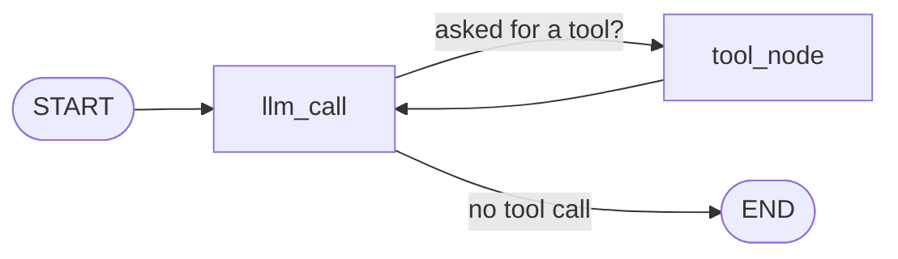
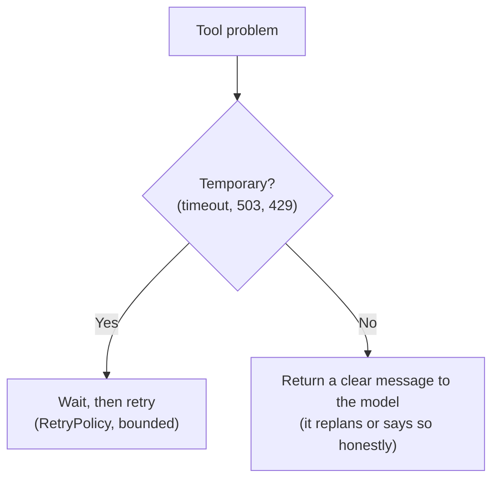

# 12 · LangChain & LangGraph — building agents that don't fall over

**Session:** 3 October 2026 · Dr. Debaditya Roy (IIT Kharagpur) · Agentic AI, *LangChain & LangGraph*
**Read time:** 40–50 min · **Builds on:** Chapter 10 (RAG → assistants → agents) and Chapter 11 (multi-agent systems)

---

## In one minute

An LLM on its own just turns text into text. It has no memory between calls, it can't run tools itself, and it doesn't keep working until a job is done. Anything bigger than one prompt needs **scaffolding** around the model.

This session covered two libraries that provide that scaffolding:

- **LangChain** is the **toolbox**. It gives you standard building blocks: one way to call any model, tools, messages, typed (structured) output, chains, and middleware.
- **LangGraph** is the **flowchart**. It controls *what runs next*. You describe your app as a graph of **State + Nodes + Edges**, and a **checkpointer** saves the state after every step.

Saving state after every step is what makes the important features possible: memory, resuming after a crash, pausing for a human's approval, and rewinding to an earlier step ("time travel").

The second half of the lecture was about **reliability**: retries, timeouts, idempotency keys, loop limits and fallbacks.

If you remember one sentence, make it this one: **LangChain standardises the components; LangGraph orchestrates them, and persisted state is what lets an agent remember, pause, resume and recover.**

---

## Exam radar

How likely each topic is to be tested, based on how much slide time it got, how often it appears across the pre-read, slides, post-read and notebook, how many student questions it drew, and whether it was a live Mentimeter quiz.

| Topic | Likelihood | Why we think so |
|---|---|---|
| Idempotency: retrying a booking safely (lost reply → duplicate ticket) | 🔴 High | Dedicated slide, a Mentimeter quiz, a notebook demo, and a student asking about the quiz's answer options |
| What to retry vs what to hand back to the model | 🔴 High | Two slides, a post-read section, several Q&A rows |
| State and reducers (overwrite vs append/accumulate/add) | 🔴 High | Its own slide; one of the most-asked Q&A topics |
| Checkpointer vs Store, and `thread_id` | 🔴 High | Slides 18–19, a post-read table, the largest Q&A cluster |
| Human-in-the-loop: `interrupt()` and `Command(resume=...)` | 🔴 High | Slide plus Mentimeter quiz; a whole notebook part |
| LangChain vs LangGraph roles; workflow vs agent | 🔴 High | Pre-read, takeaway slide, misconceptions table |
| Graph anatomy: nodes, fixed vs conditional edges, super-steps, `recursion_limit` | 🟠 Medium | Several slides plus Mentimeter; a common source of misconceptions |
| Bounding loops; three nested timeouts; fallbacks | 🟠 Medium | One slide each, plus post-read sections |
| Structured output, `@tool`, chains (`prompt \| model \| parser`) | 🟠 Medium | Slides 4–7, notebook Part 1 |
| Time travel and streaming modes | 🟠 Medium | One slide, several Q&A rows |
| Multi-agent as graphs: handoffs (`Command`), fan-out (`Send`) | 🟠 Medium | Slides 21–22. Covered in depth in Chapter 11 |
| Planning architectures (ReAct, Plan-and-Execute, ReWOO, LLMCompiler), framework comparison, release dates | 🟢 Low | Post-read only |

!!! tip "The professor's only exam hint"
    A student asked whether the notebook code would be in the exam. The answer was: *"You don't have to learn everything. Just focus on the concepts."* So don't memorise code. You should still be able to **read** a short snippet and say what it does.

---

## The story that runs through the whole lecture: the Paris trip

The entire session uses one example, a corporate travel agent. The user says:

> *"I'm Marco Polo, employee e-4471 (grade L4) from Mumbai. Book my outbound flight and a 3-night hotel stay in Paris next week, **within policy** and ₹1,50,000, **after my manager approves**."*

A simple hand-written agent loop (think → act → remember, repeat) can *plan* this trip. But the professor listed four things it **can't** do, and they are exactly what LangGraph adds:

| The app needs to… | What goes wrong without a framework | LangGraph's answer |
|---|---|---|
| 1. **Remember** | The plan lives in local Python variables. If the program crashes, it's gone | Checkpointer + `thread_id` |
| 2. **Wait for approval** | `input()` blocks the process. A server can't sit for four hours waiting for the manager | `interrupt()` + `Command(resume=...)` |
| 3. **Recover from errors** | One flaky fare API call crashes the run, and retrying a booking can buy *two* tickets | `RetryPolicy` + idempotency key |
| 4. **Show its steps** | Nobody can answer "why did it pick this hotel?" | Saved state history, tracing |

!!! example "Everyday analogy"
    A human travel agent keeps a **file folder** for every trip (the checkpointed state). If they go home for the night, the folder is still on the desk in the morning. If they need the manager's signature, they put the folder in the "waiting" tray instead of standing at the manager's door. When the airline's phone line drops mid-booking, they check the booking reference before calling again, so they don't book twice.

Keep this story in mind. Many scenario questions are this trip in disguise.

---

## Concept 1 — Workflow vs agent: who decides what happens next?

### The idea in plain words

This is the central design question of the whole topic.

| | Workflow | Agent |
|---|---|---|
| Who decides the next step | **The developer**, in advance | **The LLM**, at run time |
| Path | Fixed and predictable | Dynamic |
| Use it when | You can write the process down ahead of time | The structure can't be fully known in advance |

**Most real systems mix the two:** a fixed workflow with a few agentic steps inside it. In the course notebook, the steps that *must not vary* (manager approval, booking, saving memory) are fixed nodes. Only the jobs that need judgement (planning the trip, checking it against policy) are agents.

!!! example "Everyday analogy"
    A workflow is a train: it runs on fixed tracks and you know every stop. An agent is a taxi driver: you give the destination and the driver chooses the route. For a daily commute the train is cheaper and more reliable. You call a taxi when the route really can't be planned in advance.

### The agent loop (ReAct)

The simplest agent is **a model + a system prompt + some tools, in a loop**:

1. **Think:** the model decides what it needs ("I should search for flights").
2. **Act:** the application runs the tool.
3. **Observe:** the tool's result goes back to the model.
4. Repeat until the model says it's done, or a step limit is reached.

This is the **ReAct** pattern (Reasoning + Acting).

### Common misunderstandings

- **"An agent is always better than a workflow."** No. A workflow is cheaper, more predictable and easier to debug. Use an agent only where the steps can't be written down in advance.
- **"If the model is told to stop, a step counter isn't needed."** Wrong. The step counter is a hard limit that protects you even when the model *fails* to stop.

---

## Concept 2 — LangChain: the toolbox

LangChain gives you standard, swappable parts.

### Model I/O: one way to call any model

The same code can call OpenAI, Anthropic or an open-weights model. You change one config line, not the whole app.

```python
chat = ChatOpenAI(model="Qwen/Qwen2.5-7B-Instruct-AWQ", base_url=URL, temperature=0)
reply = chat.invoke([SystemMessage("You are a travel assistant."),
                     HumanMessage("Find me a flight to Paris.")])
```

The **messages** (`SystemMessage`, `HumanMessage`, `AIMessage`, `ToolMessage`) are a standard format for the conversation. When the model wants a tool, its `AIMessage` carries a `tool_calls` list.

!!! note "Swapping models isn't completely free"
    LangChain gives a *common interface* for shared features. But different models behave differently on the same prompt, so the prompts may still need tweaking when you swap GPT-4 for an open-source model (from the Q&A).

### Tools: declare once, use anywhere

```python
@tool
def search_flights(origin: str, dest: str, date_from: str, date_to: str,
                   cabin: Literal["economy", "business"] = "economy") -> list:
    """Search flights. Call only after retrieving the travel policy."""
```

The `@tool` decorator builds everything the model needs from the function itself:

| The model sees… | …and it comes from |
|---|---|
| The tool's **name** | The function name |
| The **argument schema** | The type hints |
| The **description** | The docstring. The model reads it to decide *when* to use the tool |

Three consequences the course stressed:

- **The docstring is a prompt.** Write it like a public API reference. Changing it changes how the model chooses tools.
- **Types reject bad arguments before the API is touched.** If the model asks for `cabin="premium"`, that's refused immediately because it isn't in the allowed list.
- **The return value costs context.** Return the few fields that matter, not a 200-row dump.

!!! warning "The most important tool fact"
    **The model never runs a tool itself.** It only *requests* a tool call. Your application runs the tool and sends the result back to the model.

### Structured (typed) output: answers as data

Instead of free text like *"Sorry, this flight leaves in 5 days and the policy needs 7"*, you ask for a typed object:

```python
class PolicyVerdict(BaseModel):
    compliant: bool
    violated_clause: str   # e.g. "§5.1"
    reason: str
```

Why this matters:

- A failed check becomes a **field** your code can read, not a sentence to decode.
- **A graph can't branch reliably on prose.** A conditional edge can easily route on `verdict.compliant == False`.
- A **malformed** answer (one that doesn't match the schema) **fails immediately, at the boundary**, instead of flowing into later steps like booking and failing "three steps later".

!!! example "Everyday analogy"
    A paper form with boxes ("Approved? ☐ Yes ☐ No · Clause: ___") versus a handwritten letter. The clerk can process a form at a glance. If a box is left blank, it's rejected at the counter, not after it has already been filed.

### Chains (Runnables): parts that snap together

```python
explain_chain = prompt | chat | StrOutputParser()
explain_chain.invoke({"clause": CLAUSE["5.1"]})
```

- The `|` (pipe) joins a **prompt template** (a prompt with variables), a **model** and an **output parser** into one Runnable.
- Every Runnable supports `invoke` (one input), `batch` (many inputs) and `stream` (output as it arrives).
- `.with_fallbacks([...])` means "if this fails, try the next one". The notebook falls back from the LLM parser to a simple regex parser.

**Where a chain stops:** data flows one way, left to right. A chain has **no loops** (it can't search again after a failed check), **no pause**, and **no saved state between runs**. That missing control flow is why LangGraph exists.

### Middleware

Middleware adds **hooks around the agent loop** (`before_model`, `after_model`, `wrap_tool_call`). It's where cross-cutting concerns go: summarising long history, redacting PII, approval gates, logging cost per step, and call limits. You get these without rewriting the loop.

### Common misunderstandings

- **"Structured output guarantees a valid object."** No. It guarantees **loud, early failure** when the object is invalid, and that's where its value lies.
- **"LangChain has a full security gateway built in."** No. Middleware is where *you* add guardrails, validation and approval. Real authorisation must sit **outside the LLM** (see the payroll example in "Where students got confused").

---

## Concept 3 — LangChain vs LangGraph

| | LangChain | LangGraph |
|---|---|---|
| Role | Library of standard components | Control-flow (orchestration) layer |
| Gives you | Model I/O, tools, messages, prompts, typed output, chains, middleware, `create_agent` | State, nodes, edges, conditional edges, checkpointer, Store, interrupts, streaming |
| Analogy | **Toolbox** | **Flowchart** |
| Level | High-level: `create_agent(model, tools, system_prompt)`. Less code, less control | Low-level: you define the graph yourself. More code, full control |

**They aren't competitors.** Since version 1.0 (October 2025), LangChain's `create_agent` **is itself a small LangGraph graph**: a model node and a tool node in a loop. The advice is to start with LangChain's `create_agent` and drop down to LangGraph when you need more control.

Facts from the Q&A:

- Both are **Python libraries** you add to your app. You don't need a separate service.
- LangGraph is **code-first**, not a no-code tool like n8n.
- LangGraph orchestrates workflow and state. It's **not a resource scheduler** (it can't assign CPU or memory to a subgraph).
- **MCP is a different thing:** MCP connects an agent to *tools*. LangGraph orchestrates the agent. They're used **together**. (And A2A connects an agent to *other agents*.)

---

## Concept 4 — LangGraph's four core ideas

The professor's slide summed up LangGraph in four words:

| Idea | What it is | In the Paris trip |
|---|---|---|
| **State** | One typed record of everything the run knows so far | Budget left, flight candidates, policy verdict, messages |
| **Nodes** | Plain Python functions: read the state, do one job, return an update | `retrieve_policy`, `llm_call`, `check_policy`, `book` |
| **Edges** | Decide what runs next. **Fixed** edges always go the same way; **conditional** edges look at the state | After `check_policy`: draft the itinerary, replan, or escalate |
| **Checkpointer** | Saves the state after every step, so a run can resume or be rewound | Run survives a crash; waits days for the manager |

"The graph is state, nodes and edges, nothing more." The checkpointer is what makes it durable.

!!! example "Everyday analogy"
    Think of an office handling a trip request. The **state** is the shared case file. Each **node** is a clerk who reads the file, does one job (checks policy, searches fares), and adds a note. The **edges** are the routing rules on the wall ("if policy fails, send back to planning"). The **checkpointer** is the photocopier that copies the file after each clerk finishes, so nothing is lost if the office floods.

---

## Concept 5 — State and reducers: how updates get merged

### The idea in plain words

A node **doesn't edit the state directly**. It returns a **partial update**, a small dictionary with only the fields that changed. LangGraph then **merges** that update into the state, using a merge rule (a **reducer**) for each field.

- **No reducer (the default):** the new value **overwrites** the old one.
- **With a reducer** such as `add`: the new value is **combined** with the old one (lists are appended, numbers are added).

```python
from typing import Annotated, TypedDict
from operator import add

class TripState(TypedDict, total=False):
    request: dict                          # no reducer → overwrite
    verdict: str                           # overwrite: only the latest matters
    avoid_airlines: Annotated[list[str], add]   # accumulate across replans
    attempts: Annotated[int, add]          # counter: each node returns {"attempts": 1}
    log: Annotated[list[str], add]         # audit trail keeps growing
```

The course's three words, and when to use each:

| Merge rule | Meaning | Example field |
|---|---|---|
| **Overwrite** | Keep only the latest | `budget_left`, `verdict`, `current_flight` |
| **Append** | Keep the history | `messages` (the conversation) |
| **Accumulate / add** | Build a collection or a total from several nodes or steps | `policy_clauses`, `candidates`, `attempts` |

!!! example "Everyday analogy"
    A whiteboard in a shared kitchen. For "Today's special" (overwrite), the new chef wipes the old one and writes the new dish. For the "Shopping list" (append/accumulate), everyone adds items and nobody erases anyone else's. For the "Cups of coffee today" tally (add), each person adds one stroke.

### Why reducers matter: parallel nodes

When two nodes run **at the same time** (for example, a flight search and a hotel search) and both write the same field:

- With **overwrite**, one write would silently erase the other. LangGraph raises **`INVALID_CONCURRENT_GRAPH_UPDATE`** instead of guessing.
- With an **accumulating** reducer, both results are kept and there's no conflict.

"The reducer is the point." It's what makes parallel steps safe.

### The counter trick

With `attempts: Annotated[int, add]`, every node in a loop can return the same literal `{"attempts": 1}`, and the counter still goes up correctly. The loop limit ("stop after 4 tries") reads this counter.

### `MessagesState`

LangGraph's ready-made `MessagesState` has a `messages` field with the `add_messages` reducer. It **appends** new messages but **replaces** any message with a matching ID, which is how editing or regenerating a message works.

### Common misunderstandings

- **"A node updates the state."** Not directly. The node *returns an update*, and the **reducer merges it**.
- **"Returning the whole state from a node is fine."** It runs, but it turns every field into an overwrite and destroys your merge rules. **Return only what changed.**

---

## Concept 6 — Nodes and edges

### Nodes are just functions

```python
def node_check_policy(state: TripState) -> dict:
    violations = apply_rules(state["itinerary"])
    return {"violations": violations, "log": ["checked policy"]}   # partial update
```

Inside a node you can do anything: call an LLM, run a tool, run a whole RAG pipeline, or even call **another graph or agent**. On the slides, an entire RAG pipeline became "just one node" (`retrieve_policy`).

### Edges: fixed vs conditional

```python
builder = StateGraph(TripState)
builder.add_node("check_policy", node_check_policy)
builder.add_edge(START, "parse_request")                 # fixed: always this way
builder.add_conditional_edges("check_policy", after_check,
    ["plan_with_agent", "write_justification", "draft_approval", "escalate"])
app = builder.compile(checkpointer=saver, store=store)
```

- **`add_edge(A, B)`** is fixed: after A, always go to B.
- **`add_conditional_edges(A, router, [destinations])`** is conditional. A **router function** reads the state and returns the *name* of the next node. Listing the possible destinations lets LangGraph **draw** the graph.
- **`compile()`** turns the declared shape into an app you can run, draw and inspect.

```python
def after_check(state):
    if any(v["hard"] for v in state["violations"]):
        return "escalate" if state["attempts"] >= MAX_ATTEMPTS else "plan_with_agent"
    if state["violations"]:
        return "write_justification"
    return "draft_approval"
```

Notice the **loop limit lives in the edge** (`attempts >= MAX_ATTEMPTS`), not inside the agent.

### The minimal agent graph

The pre-read's smallest agent: **two nodes, one conditional edge, one loop.**



The model runs. If it asks for a tool, the tool node runs and control goes back to the model. If it doesn't ask for a tool, the graph ends.

### Two more routing tools (preview of Chapter 11)

| Mechanism | What it does | Example |
|---|---|---|
| **`Command`** | A node returns a state update **and** where to go next, together | Handoff: "go to the hotel agent, and here's the updated budget" |
| **`Send`** | Dynamic **fan-out**: start N parallel branches when N is only known at run time | One auditor per receipt: 8 receipts today, 30 next time. Needs accumulating reducers |

---

## Concept 7 — How a graph runs: super-steps and `recursion_limit`

### The idea

LangGraph runs in rounds called **super-steps**. In each one:

1. Run the active nodes (several at once if they're independent).
2. Merge their updates using each field's reducer.
3. **Save a checkpoint.**
4. Follow the edges to pick the next nodes.

The run ends when an edge reaches `END`, or when the **`recursion_limit`** (for example, 25 super-steps) is hit, which raises **`GraphRecursionError`**.

!!! example "Everyday analogy"
    A board game played in rounds. Everyone moves at the same time, the scores are tallied, the game is saved, and then the next round begins. The rule "the game ends after 25 rounds" stops it from going on forever.

### Three consequences worth knowing

1. **`recursion_limit` counts super-steps, not tool calls.** One tool round trip (model → tool → back) usually takes two super-steps.
2. **Nodes running in the same super-step can't see each other's writes.** They all read the previous checkpoint. If B needs A's output, B must come in the *next* step, which is what an edge declares.
3. **Checkpoints exist only between super-steps,** so time travel can only resume from those boundaries.

---

## Concept 8 — Memory: checkpointer vs Store

LangGraph has **two** kinds of memory. Mixing them up is a classic exam trap.

| | **Checkpointer** — short-term | **Store** — long-term |
|---|---|---|
| Scope | **One thread** (one conversation or run), identified by `thread_id` | **Across all threads and sessions** |
| Holds | The full graph state at every super-step | Facts you choose to save: home airport, grade, "avoid Air India", past trips |
| Gives you | Resume after crash, human-in-the-loop, time travel | Personalisation that carries over to future runs |
| In the notebook | `SqliteSaver` on `trips.db` | `SqliteStore` on `memory.db` |
| API | `compile(checkpointer=...)`, `config={"configurable": {"thread_id": tid}}` | `store.put(namespace, key, value)`, `store.get(namespace, key)` |

```python
cfg = {"configurable": {"thread_id": "trip-42"}, "recursion_limit": 60}
app.invoke(inputs, cfg)                       # Day 1: process dies after step 3
app.invoke({"goal": "Make it 5 nights"}, cfg) # Day 2: same thread_id → same state

store.put(("travellers", "e-4471"), "avoid_airlines", {"list": ["Air India"]})
```

- **`thread_id` is the key.** Without it, there's no resuming.
- In production, checkpoints live in a **real database** (Postgres, Redis and so on), not in process memory, so the run outlives the server. The notebook proved this by deleting the app, reconnecting to the same database files, and finding the paused trip still there.

!!! example "Everyday analogy"
    The **checkpointer** is the save file for *one* game. The **Store** is your player profile, which remembers your settings and achievements in *every* game you play.

### Common misunderstandings

- **"A checkpoint is the same as a conversation summary."** No. A checkpoint is a snapshot of the agent's complete state ("where exactly was it?"), used for recovery. A summary is a compressed conversation, used to save tokens.
- **"A saved checkpoint means the approval is still valid."** No. A checkpoint is saved *state*, not permanent truth. If the fare went up after the manager approved, **revalidate** before booking and ask for approval again if needed.
- **"Persistence is just an ops detail."** No. Persistence is what *produces* memory, resumption, human-in-the-loop and time travel.

---

## Concept 9 — Human-in-the-loop: `interrupt()` and `Command(resume=...)`

### The problem

Before booking an international flight, policy says the manager must approve. The manager might reply in four hours. A server can't block a thread for four hours, and a redeploy in between would lose everything.

### The fix

```python
def node_wait_for_manager(state):
    reply = interrupt({"email": state["approval_email"],
                       "itinerary": state["itinerary"]})   # pause here
    return {"manager_reply": reply}

# hours later, possibly in a different process:
app.invoke(Command(resume="Approved, go ahead."), cfg)
```

1. `interrupt(payload)` **saves a checkpoint and pauses** the graph. The payload (the approval email) is shown to the human.
2. The process can stop entirely. The state is in the database.
3. When the human answers, you call the graph again with **`Command(resume=value)`** and the same `thread_id`.
4. Inside the node, `interrupt()` now **returns that value**, and the graph carries on.

There's also a static form, **`interrupt_before=["book"]`** at compile time, which pauses before a whole node.

!!! example "Everyday analogy"
    Leaving a bookmark and a sticky note ("waiting for manager's signature") in a file, then putting it in the tray. Anyone can pick it up later, read the note, and continue from exactly that page.

!!! danger "The big gotcha: the node restarts from the top"
    On resume, the node with the `interrupt()` **runs again from its first line**. It doesn't continue mid-function. So **never put a side effect (booking, payment, email) before `interrupt()` in the same node**, or it will happen twice. Also, if a node has several interrupts, resume values are matched **by order**, so the order must be fixed.

### What if the human never answers?

The checkpoint keeps the state safe, but you also need a **timeout policy**: remind, escalate, route to another approver, or cancel.

---

## Concept 10 — Time travel and streaming

**Time travel:** every super-step is checkpointed, so a run is a replayable list of states. You can inspect any past step, **rewind** to it, change something, and run forward again. **Resuming from an earlier checkpoint creates a fork. The original history stays intact.**

```python
for snap in app.get_state_history(cfg):
    print(snap.metadata["step"], snap.next)
```

Uses: "What if we had kept the 09:40 fare?" and auditing a disputed itinerary.

!!! example "Everyday analogy"
    Saved games. Load the save from just after you picked your character, choose a different weapon this time, and play forward. Your original save is still there.

**Storage trade-off (Q&A):** keeping the full state at every step makes time travel easy, but storage grows. Storing references or IDs to large data saves space, but that data has to be fetched again on resume.

**Streaming:** "A ten-second silent turn looks exactly like a hung one." So stream progress to the user:

| Mode | Streams |
|---|---|
| `updates` | Each node's change to the state. Best for progress displays; an interrupt shows up here as `"__interrupt__"` |
| `values` | The full state after each step |
| `messages` | The model's tokens as they're written |
| `custom` | Your own progress events, for example from inside a tool |

---

## Concept 11 — Reliability: six ways a deployed agent fails

This was the second half of the lecture. The key skill is **classifying** the failure, because the class decides the fix.

| # | Failure | Example | Fix | Who handles it |
|---|---|---|---|---|
| 1 | **Tool hangs** | API accepts the connection, never answers | Timeout, then a bounded retry | Runtime |
| 2 | **Tool fails** | 503, rate limit (429), expired credential | Retry if temporary, otherwise fall back | Runtime |
| 3 | **Tool returns nothing useful** | "No flight under ₹50,000". That's a fact, not an error | **Return it to the model** as an observation | Model |
| 4 | **Model calls the tool wrongly** | `cabin="premium"`, a wrong date | **Validate before running** (typed tool signature) | Model |
| 5 | **Loop won't end** | Keeps switching between two fares forever | Recursion limit + oscillation guard | A missing limit |
| 6 | **The world changed** | The fare is gone by step 6; a retry might buy two tickets | **Idempotency key**, revalidate | Runtime |

### Retry or tell the model?



- **Retry:** timeouts, connection resets, 502/503, 429 (respecting Retry-After).
- **Never retry:** a 400 caused by a bad argument (that needs a replan, not a repeat), a "no results" answer, or **any write that isn't idempotent**. Retrying the same bad answer just burns the same result three times.
- **Never let the run just crash.** If an exception kills the graph, the model is never told, and it may later make up a fare. Return the error as a tool message instead. Make it actionable: *"no economy fare under ₹50,000 on 15 Aug; cheapest is ₹61,200"* is useful, *"Error: 400"* is not.

In LangGraph, temporary failures are handled at the **node level** with a `RetryPolicy`. Decisions about *meaning* ("no flights under budget → replan") belong in a **conditional edge**.

```python
builder.add_node("plan_with_agent", node_plan_with_agent,
    retry_policy=RetryPolicy(max_attempts=4, initial_interval=0.5,
                             backoff_factor=2.0, retry_on=FareAPIError))
```

`retry_on` means **only that exception type** is retried. Everything else passes through.

!!! warning "Retries multiply"
    If the model client has its own retries *and* the graph node has a `RetryPolicy`, they stack: 3 client retries inside each of 3 node retries is 9 billed calls. The post-read's advice is to turn off client retries (`max_retries=0`) when the graph owns retrying. (The course notebook itself still set `max_retries=6` on the client. Take the post-read's version as the principle.)

---

## Concept 12 — Idempotency: never book twice

### The problem (the lecture's Mentimeter scenario)

1. The agent asks the airline to book flight AI142.
2. The airline **does** book the ticket.
3. The reply is **lost** on the way back, and the agent sees a timeout.
4. The agent retries.

**The agent can't tell whether the airline processed the first request.** Without protection, the airline sees a brand-new request and books a **second ticket**. In the notebook's naive version, the traveller ended up owning two seats.

### The fix: an idempotency key

**Idempotent** means doing the same operation again gives the same final result, with no duplicates and no extra side effects.

Send a **key** with every booking request. If the airline has already seen that key, it replies "already booked" and returns the **same** ticket.

```python
def node_book(state, config):
    key = f"{config['configurable']['thread_id']}:{flight_key(state['itinerary'])}"
    return {"ticket": airline_book(..., idempotency_key=key)}
```

!!! danger "The key must be derived, not random"
    The key is **built from the trip and the intent** (thread ID + flight), so a retry produces **exactly the same key**. A fresh random UUID for each attempt is **not** an idempotency key, because every retry would look like a new request.

!!! example "Everyday analogy"
    Paying a bill online with an order number. If you press "Pay" twice because the page froze, the shop sees the same order number and charges you once. Without the order number, you'd be charged twice.

**Reads vs writes:** searches (reads) can be retried freely. Bookings, payments and emails (writes) need **an idempotency key, a human confirmation, or both.**

---

## Concept 13 — Timeouts, loop limits and fallbacks

### Three nested clocks

| Clock | Example value | Covers |
|---|---|---|
| Tool timeout | 5 s | One HTTP call |
| Node / model timeout | 30 s | One graph step (`add_node(..., timeout=30)` in newer LangGraph) |
| Run deadline | 90 s | The whole planning turn. When it's reached, checkpoint and return what's settled so far |

They must be **nested, with the inner clock firing first.** If the outer clock fires first, the trace only says "the run timed out" and you never learn *which* dependency stalled. The inner tool clock names the culprit.

!!! example "Everyday analogy"
    A relay race. Each runner has their own time limit inside the team's overall limit. If only the overall limit existed, you'd know the team was slow but not which runner was the problem.

### Four independent loop limits

| Limit | Catches |
|---|---|
| `recursion_limit` (super-steps) | Runaway cycling (`GraphRecursionError`) |
| A step budget kept in state (e.g. `attempts`) | Slow thrashing that stays under the recursion limit |
| A token or cost ceiling checked in a node | Expensive replanning that is technically making progress |
| An oscillation guard (same tool and arguments twice, A → B → A) | Going back and forth |

"Every loop needs an end condition that doesn't depend on the model choosing to stop." When a limit is hit, **escalate with the checkpointed state**, so the work already done (policy, hotel, fares) isn't lost.

### Fallbacks and graceful degradation

The slide's ladder, from best to worst:

1. Live fare from the API (normal case).
2. **Cached fare, clearly labelled as stale** ("as of 09:15 today, verify before booking").
3. **Ask the traveller** ("Fare search is down. Shall I hold yesterday's ₹38,400 option?").
4. **Fail loudly with the state** ("Policy and hotel are settled. Fares unavailable. Nothing booked.").

!!! danger "The line you never cross"
    A degraded answer that **says** it's degraded is useful. A confident fare that **no tool returned** is *worse than an outage*, because it looks exactly like a correct answer. If you don't define the fallback path, the model will make one up, fluently.

### Tracing

In a normal program you read a call stack. In an agent you read **a sequence of decisions**. A trace (the slides used **Langfuse**; the Q&A mentioned **LangSmith**) should record, for each step: node name with its input and output, tool arguments and raw results, latency and retries, tokens and cost, and any interrupts and approvals.

Note that **LangGraph checkpoints don't detect quality drift.** If accuracy drops in production, you need a separate evaluation and monitoring layer (golden datasets, thresholds).

---

## Reliability checklist (quick decision table)

| Problem | Mechanism | Where it lives |
|---|---|---|
| Dependency is slow | Timeout, then bounded retry | HTTP client + node `RetryPolicy` |
| Dependency is down | Fallback, then degrade *visibly* | `with_fallbacks` |
| No valid option exists | Return it as an observation | The tool's result, not an exception |
| Bad arguments | Validate before running | Typed tool signature |
| Loop won't end | Recursion limit + oscillation guard | Graph config + state counter |
| Duplicate write | Idempotency key | Tool implementation |
| Irreversible action (booking, payment) | Human approval | `interrupt()` in the node |
| Process dies mid-run | Checkpoint and resume | A durable checkpointer |

---

## What the hands-on showed

The notebook was built as **"Problem (plain Python) → Fix (framework)"**, with nine problems in all. The ones to remember:

- **Provider lock-in** (separate code for each backend) → fixed by `ChatOpenAI` / `ChatHuggingFace` behind one interface.
- **No schema** (the model returns `"nights": "three"` or wraps its JSON in chatter) → fixed by a Pydantic `TripRequest` with `PydanticOutputParser`, plus `.with_fallbacks` to a regex parser.
- **One flaky fare API call crashes everything** → fixed by a `RetryPolicy` on the node.
- **Waiting for the manager with `input()`** → fixed by `interrupt()` + `Command(resume=...)`.
- **A retried booking gives two tickets** → fixed by `RetryPolicy` + an idempotency key. After the fix, the ticket count is exactly one.
- **"Avoid Air India" forgotten on the next trip** → fixed by the Store, saved when the manager rejects a plan.
- **Server restart** → the app was deleted and rebuilt from the same database files, and the paused trip was still waiting at `wait_for_manager`.

Two design lessons:

- **The planner and checker loop is the "evaluator-optimiser" pattern.** One agent proposes, another judges, and **the graph limits the loop** (`MAX_ATTEMPTS = 4`).
- **"The LLM reads the policy PDF; code verifies and applies the rule."** The agent finds the rule and quotes the clause. Code checks that the clause really exists, then does the actual comparison. The agent is never trusted blindly, and the system "fails closed": if the model says "approve" but the rules disagree, it's treated as a reject.

---

## Where students got confused (from the live Q&A)

| Student question | The clarified answer |
|---|---|
| "What's the difference between append, accumulate and overwrite?" | Append keeps history (messages). Accumulate builds a collection or total from several nodes. Overwrite keeps only the latest value. |
| "Is LangGraph the orchestrator? Is it a separate service?" | Yes, it's the orchestration framework. No, it's a library you add to your app. |
| "MCP vs LangGraph — which should I always choose?" | Neither, because they solve different problems. MCP connects to tools; LangGraph orchestrates. Use them together. |
| "If a tool gets a wrong datatype, does it fail silently?" | No. The schema built from the type hints rejects it before the API call, with an error the agent can use. |
| "What does 'malformed… not three steps later' mean?" | The output doesn't match the expected structure, and it should fail *where it's produced*, not after it has flowed into routing or booking. |
| "Where do checkpoints live — RAM?" | In production, in persistent storage (Postgres, Redis, MongoDB). |
| "Checkpoint vs conversation summary?" | A checkpoint is a full state snapshot for recovery. A summary is compressed history for saving tokens. |
| "The manager approved, but the fare rose afterwards. Book anyway?" | No. A checkpoint is saved state, not permanent approval. Revalidate, then re-approve or reject. |
| "What if the human never responds?" | Add a timeout policy: remind, escalate, reroute or cancel. The checkpoint keeps the state safe meanwhile. |
| "Should retries go in a conditional edge or inside the node?" | Temporary failures go in a node-level `RetryPolicy`. Meaning-based decisions ("no flights under budget") go in a conditional edge. |
| "Why a step counter if the model is told to stop?" | It's a hard limit for when the model *doesn't* stop. |
| "How do I stop one agent using up the whole budget?" | A global budget manager in the runtime enforces hard limits. "Planning decides the budget; the runtime enforces it." |
| "Can a prompt stop a payroll bot leaking a manager's salary?" | Not on its own. Authorisation must sit **outside the LLM**: check permissions before the payroll tool returns data. "The LLM decides what it wants to do; the runtime decides what it is allowed to do." |
| "Chat memory costs a lot of tokens. How do I cap it?" | Keep the last N messages, summarise older ones, retrieve only relevant memories, and set token or cost ceilings. |

---

## Traps to watch for in MCQs

- ❌ "LangChain and LangGraph are alternatives; pick one." → Since 1.0, `create_agent` **is** a LangGraph graph. They work together.
- ❌ "The model executes the tool." → The model only *requests* it. The application runs it.
- ❌ "A node modifies the state directly." → It returns a **partial update**, and the reducer merges it.
- ❌ "`recursion_limit` caps the number of tool calls." → It caps **super-steps**.
- ❌ "The checkpointer remembers user preferences across conversations." → That's the **Store**. The checkpointer is per `thread_id`.
- ❌ "On resume, `interrupt()` continues from the middle of the function." → The **node re-runs from the top**, so side effects before it happen twice.
- ❌ "Use a new UUID per attempt as the idempotency key." → The key must be **derived** (thread + intent) so retries reuse it.
- ❌ "Retry everything that fails." → Retry infrastructure failures. Hand meaning-based failures ("no results", bad arguments) back to the model.
- ❌ "When the fare API is down, it's fine for the model to estimate a fare." → An undeclared made-up answer is worse than an outage. Degrade **visibly**.
- ❌ "More agents means better design." → Agents sharing one context are one agent with extra latency. Split only to narrow context and tools.

---

## Recap

1. **LangChain = toolbox** (model I/O, `@tool`, typed output, chains, middleware). **LangGraph = flowchart** (state, nodes, edges, checkpointer). `create_agent` is a LangGraph graph.
2. **Nodes return partial updates; reducers merge them.** Overwrite is the default; `Annotated[..., add]` appends or adds. Parallel writes need a reducer.
3. **Checkpointer (per `thread_id`) = short-term memory, resume, HITL, time travel. Store = long-term memory across threads.**
4. **`interrupt()` pauses and `Command(resume=...)` continues**, but the node re-runs from the top, so put no side effects before the interrupt.
5. **Reliability:** retry temporary infrastructure failures and surface the rest to the model, limit every loop, nest timeouts with the inner one first, degrade visibly, and **put an idempotency key or human approval on every write.**

---

## Practice questions

Pick an option to see instantly whether you're right, with an explanation for every option.

<div class="practice-quiz" data-quiz="ch12">
  <p><em>Loading practice questions…</em></p>
</div>
